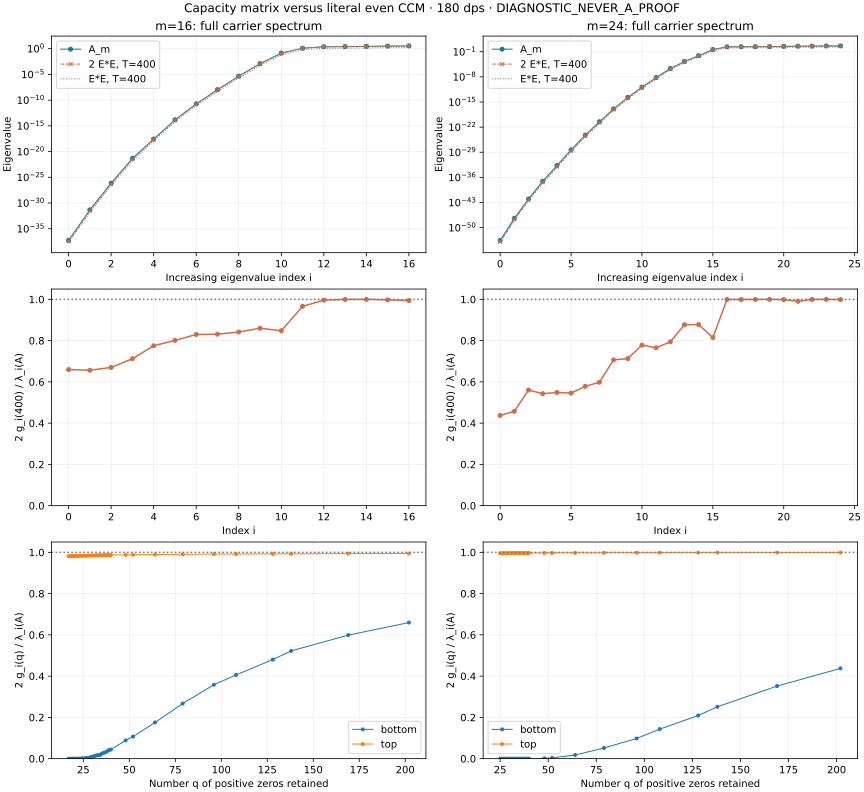
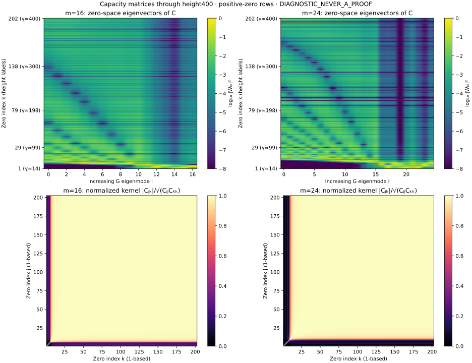

# Capacity matrix check: m=16 and24

**DIAGNOSTIC_NEVER_A_PROOF.** Literal even CCM, N=m and L=ln m. Arithmetic180dps. Source branch at start: rh_clean @9c6fa2a8032f5ab78993b8c1784ea122f22cd4a0.

## Matrices and normalization

Use the unit physical basis ψ_n(x)=d_n(−1)^n cos(2πnx/L)/sqrt(L) on |x|≤L/2 and zero outside; d_0=1,d_n=sqrt(2) for n>0. For every positive zeta ordinate γ_k≤400,

`E_kn = ψ̂_n(γ_k) = 2 d_n γ_k sin(γ_k L/2) / [sqrt(L)(γ_k²−(2πn/L)²)]`.

This is the exact analytic rational-times-sine formula evaluated at high-precision ordinates, with a direct sinc removable extension. Rows are unweighted: there is no local normalization, H division, or2π divisor. Define G=E*E and C=EE*. Both matrices were built at180dps. There are202 positive-zero rows, and carrier dimensions17 and25.

The source explicit formula counts both ±γ. Thus **2G**, not G, is the retained-critical-zero contribution to the full Weil matrix A. Raw G eigenvalues are also retained. Both pole sectors already belong to A; no extra pole term is added to2G. See [NORMALIZATION.md](NORMALIZATION.md) for source lines.

C has compulsory nullity at least185/177; all17/25 eigenvalues of G are numerically resolved positive at the final cutoff, so the computed nonzero C spectrum is exactly the G spectrum via W_i=EU_i/sqrt(g_i). These large C nullspaces live in zero-index space; they are not extra physical near-null modes. The physical cluster consists of small but resolved positive G eigenvalues.

## Spectrum and carrier eigenvectors

The capacity Gram reproduces the cluster counts and almost the same carrier eigenbasis, but not yet the small eigenvalues quantitatively. Every best-overlap pairing between G and A has the same index.

|m|2g₀(400)/λ₀(A)|2g_top(400)/λ_top(A)|Minimum same-index overlap²|‖A−2G‖op|Relative to ‖A‖op|
|---:|---:|---:|---:|---:|---:|
|16|0.65976151|0.99430357|0.99780045|0.10118445|0.02958408|
|24|0.43749768|0.99865259|0.99619376|0.12764306|0.030365017|

|m|B|Cluster count of A / raw G / 2G|Largest A-vs-2G cluster principal angle|
|---:|---:|:---|---:|
|16|2|10 / 10 / 10|0.859615°|
|16|4|9 / 9 / 9|0.56977°|
|16|8|7 / 7 / 7|0.447223°|
|24|2|14 / 14 / 14|1.24679°|
|24|4|13 / 13 / 13|1.05811°|
|24|8|10 / 11 / 10|0.6054°|

## Convergence as zeros are added

Fifty prefix sizes are retained in spectra.csv. Each Gram update is a positive rank-one addition. Prefixes with q<d have structural nullity at least d−q; their near-zero floating values are labelled accordingly. The following table uses400 only as the final finite reference, not as the infinite-zero limit. Relative errors of the deepest levels remain large even between350 and400.

|m|q|Last γ retained|2g₀(q)/λ₀(A)|2g_top(q)/λ_top(A)|Worst relative eigenvalue change from q to202|
|---:|---:|---:|---:|---:|---:|
|16|29|98.83119|0.006932009|0.9846838|0.992168|
|16|79|198.0153|0.2670872|0.9904346|0.644113|
|16|138|299.8403|0.5224624|0.9929286|0.228594|
|16|169|349.3163|0.5987595|0.9937071|0.0987667|
|16|202|399.9851|0.6597615|0.9943036|1.6065e-144|
|24|29|98.83119|2.676054e-07|0.99575|0.999999|
|24|79|198.0153|0.05183337|0.9977769|0.881523|
|24|138|299.8403|0.2514357|0.9983349|0.425287|
|24|169|349.3163|0.3518393|0.9985366|0.195792|
|24|202|399.9851|0.4374977|0.9986526|3.2545e-128|

The final residual is numerically almost rank one and almost parallel to the endpoint-evaluation direction b=(1,sqrt(2),…,sqrt(2)), since ψ_n(L/2)=d_n/sqrt(L). This is a measured finite-matrix observation, not an unconditional infinite-zero tail bound.

|m|Second/largest eigenvalue of A−2G|Top residual direction overlap² with b|
|---:|---:|---:|
|16|5.8384247e-07|0.999999416475|
|24|1.6669434e-06|0.999998328291|

All computed residual eigenvalues are positive, but their positivity is not certified by these floating computations. Off-critical zero contributions cannot be deleted: interpreting A−2G as an exclusively positive real-zero tail would require an additional premise. No extrapolated tail or completed convergence claim is made.

## Mixing between zeros

The nonzero C eigenvectors are W=EU diag(g^(−1/2)), with unit columns. Their weights |W_ki|² describe mixing in zero-index space. N_eff=1/sum_k|W_ki|⁴ measures participation. Full signed components, top-five weights and shortest contiguous index windows carrying90% mass are saved.

Large lifted modes mix several of the first zeros, rather than belonging to one zero each. Examples: at m16, mode i14 has its largest weights at zeros1 and2; at m24, mode i20 is shared mainly among zeros2,3,1. The lowest cluster modes instead use broad sets of higher zeros; their left eigenvectors remain sensitive to increasing the height cutoff even while their carrier eigenvectors are close to those of A.

For example, extending height300 to400 gives bottom carrier-vector overlap²0.999999929 (m16) /0.999999839 (m24), but only0.791896 /0.574713 for the zero-space C eigenvectors after zero-padding the shorter vector. Stable carrier geometry therefore does not mean that its zero-index mass or smallest energy has converged. The exact finite comparison used is |<W_i,Wq_i>|²=|<U_i,Uq_i>|² gq_i/g_i.

Adjacent normalized evaluation-row correlations also distinguish the low-band and exterior regions. These are |C_j,j+1|/sqrt(C_jj C_j+1,j+1), not eigenvector weights:

|m|Median adjacent correlation below2πm/L|Median above2πm/L|Median with both heights>200|
|---:|---:|---:|---:|
|16|0.092109163|0.999999994784|0.999999998864|
|24|0.11424302|0.99999998766|0.999999996721|

High-frequency evaluation rows are almost collinear. The rational formula displays the reason: its leading large-t vector is proportional to b=(d_n), with scalar2 sin(tL/2)/(sqrt(L)t). Thus many high zeros add to a nearly common boundary direction; they do not act as orthogonal independent coordinates.

## Every level at height400

C uses the raw G eigenvalues below; multiplication by2 is only for comparison with A. Indices i are zero-based; zero indices k are one-based. The last column lists the three largest zero-space weights, not a one-to-one matching.

### m=16

|i|λ_i(A)|g_i(E*E)|2g_i/λ_i|Carrier overlap²|N_eff|Top zero indices: weights|
|---:|---:|---:|---:|---:|---:|:---|
|0|5.456138e-38|1.799875e-38|0.6597615|0.9999998|8.1237|10: 0.316, 12: 0.090, 19: 0.089|
|1|4.733418e-32|1.553412e-32|0.6563593|0.99999872|21.289|13: 0.131, 12: 0.089, 16: 0.075|
|2|7.346489e-27|2.461312e-27|0.6700648|0.99999682|16.882|13: 0.174, 14: 0.090, 11: 0.083|
|3|4.629774e-22|1.64873e-22|0.7122292|0.99998375|13.487|11: 0.191, 9: 0.153, 16: 0.062|
|4|2.722708e-18|1.055175e-18|0.7750925|0.99997553|8.5357|9: 0.305, 8: 0.097, 11: 0.070|
|5|1.470397e-14|5.890018e-15|0.8011465|0.99995814|11.451|8: 0.228, 7: 0.112, 11: 0.091|
|6|1.904168e-11|7.899984e-12|0.829757|0.99990762|9.18|7: 0.255, 8: 0.168, 9: 0.075|
|7|1.086755e-08|4.51628e-09|0.8311498|0.9998638|8.0402|7: 0.275, 9: 0.159, 11: 0.133|
|8|4.608516e-06|1.939592e-06|0.8417425|0.99982606|8.2274|7: 0.236, 8: 0.229, 11: 0.062|
|9|0.001223205|0.0005260249|0.8600763|0.99967794|7.9755|8: 0.233, 9: 0.177, 11: 0.173|
|10|0.1429602|0.06060581|0.8478698|0.99890203|16.837|6: 0.217, 11: 0.056, 16: 0.037|
|11|1.236823|0.5975205|0.9662179|0.99860515|2.098|6: 0.686, 3: 0.059, 5: 0.027|
|12|2.285644|1.138438|0.9961637|0.99919483|3.4991|3: 0.386, 4: 0.316, 2: 0.177|
|13|2.527455|1.263016|0.9994371|0.99968325|1.966|5: 0.647, 4: 0.298, 6: 0.023|
|14|2.751836|1.375856|0.9999553|0.99997673|1.8822|1: 0.683, 2: 0.251, 5: 0.035|
|15|3.127193|1.559754|0.9975428|0.99794425|2.711|2: 0.523, 1: 0.274, 3: 0.135|
|16|3.420233|1.700375|0.9943036|0.99780045|3.112|3: 0.409, 4: 0.331, 5: 0.210|

### m=24

|i|λ_i(A)|g_i(E*E)|2g_i/λ_i|Carrier overlap²|N_eff|Top zero indices: weights|
|---:|---:|---:|---:|---:|---:|:---|
|0|2.690513e-54|5.885466e-55|0.4374977|0.9999996|20.419|15: 0.117, 17: 0.108, 18: 0.096|
|1|4.276202e-48|9.779067e-49|0.4573716|0.99999785|20.268|15: 0.128, 17: 0.098, 13: 0.091|
|2|9.974198e-43|2.7953e-43|0.5605063|0.9999941|8.0391|13: 0.328, 19: 0.068, 15: 0.067|
|3|8.584109e-38|2.329839e-38|0.5428261|0.99997957|7.7818|13: 0.341, 24: 0.052, 17: 0.052|
|4|1.927346e-33|5.287722e-34|0.5487049|0.99996898|14.719|13: 0.156, 15: 0.145, 19: 0.108|
|5|4.785397e-29|1.305623e-29|0.5456696|0.99996052|15.495|15: 0.201, 24: 0.074, 18: 0.073|
|6|6.281203e-25|1.816716e-25|0.5784611|0.99992013|16.76|15: 0.136, 19: 0.132, 16: 0.091|
|7|3.178759e-21|9.508944e-22|0.5982802|0.99990307|27.038|17: 0.100, 14: 0.080, 24: 0.076|
|8|1.251886e-17|4.423057e-18|0.7066229|0.99987991|7.4607|14: 0.337, 18: 0.095, 12: 0.058|
|9|1.880935e-14|6.704463e-15|0.712886|0.99981016|11.684|14: 0.238, 12: 0.135, 28: 0.046|
|10|1.377527e-11|5.360513e-12|0.7782806|0.99974576|8.8698|11: 0.212, 12: 0.201, 18: 0.139|
|11|6.591301e-09|2.521769e-09|0.7651808|0.99967231|7.5928|11: 0.320, 14: 0.146, 12: 0.038|
|12|2.192946e-06|8.706948e-07|0.7940868|0.999476|12.314|11: 0.182, 18: 0.126, 12: 0.106|
|13|0.0001949807|8.550357e-05|0.8770465|0.9992024|4.3597|10: 0.426, 12: 0.187, 14: 0.088|
|14|0.007780922|0.003414299|0.8776077|0.99899627|5.1308|10: 0.380, 11: 0.170, 12: 0.143|
|15|0.4173852|0.1700171|0.8146772|0.99900405|32.232|12: 0.108, 9: 0.073, 18: 0.055|
|16|2.272764|1.13563|0.999338|0.99982877|3.5995|9: 0.332, 7: 0.321, 6: 0.247|
|17|2.488453|1.243258|0.9992217|0.9991207|4.3765|4: 0.384, 5: 0.166, 3: 0.160|
|18|2.552654|1.275589|0.9994213|0.99917518|4.9911|8: 0.329, 7: 0.172, 5: 0.171|
|19|2.652698|1.326349|1|0.99999999|5.407|5: 0.272, 8: 0.258, 1: 0.130|
|20|3.11939|1.557712|0.9987287|0.99873789|2.553|2: 0.453, 3: 0.428, 1: 0.048|
|21|3.474292|1.720675|0.9905185|0.99619376|4.8982|1: 0.378, 6: 0.156, 9: 0.134|
|22|3.632908|1.815585|0.9995217|0.99802282|4.3578|1: 0.273, 2: 0.270, 3: 0.261|
|23|4.035942|2.017927|0.9999781|0.99997079|4.3049|6: 0.337, 5: 0.222, 7: 0.195|
|24|4.203622|2.098979|0.9986526|0.99955452|5.0838|8: 0.286, 7: 0.196, 9: 0.192|

## Checks, files and reproduction

The202 ordinates through400 were obtained with mpmath.zetazero at180dps; the first zero above400 is also saved. The inherited table through300 is hash-pinned. Rational Fourier evaluations were independently checked against sinc at every row and mode (maximum difference1.11e−178), and against physical eight-panel GL128 integration at first/last/nearest-modal cases (maximum difference2.30e−164). See RESULT_validation.md.

The direct C eigensystem checks use CW−W diag(g), W*W−I, and trace(C)−trace(G). Maximum absolute residuals are1.13e−154,1.53e−128 and7.72e−180 respectively. No float64 eigensolver is used. Float conversion is confined to plotting and descriptive participation/weight-window statistics. Full C is constructed in mixing.py and stored implicitly without loss through its180-digit E factor; nearby entries are exported in nearby_kernel.csv.

cell_m16.json/cell_m24.json store E,G,A and both carrier eigenbases, the zero-space W, residual spectra,50 prefix spectra and selected prefix eigenvectors. spectra.csv and convergence.csv preserve prefix data. levels.csv, zero_components.csv, nearby_kernel.csv, subspaces.csv and prefix_mixing.csv preserve all comparisons. NORMALIZATION.md identifies the exact source conventions.

Replay: `zeros.py`; `validation.py`; `capacity.py 16`; `capacity.py 24`; `capacity.py aggregate`; `mixing.py`; `plot.py`; `report.py`. Dependencies: mpmath,numpy,matplotlib (validation uses its documented mpmath quadrature). Source A files are the existing pinned180dps/GL160 eigensystems. The zero-table and source-byte hashes are recorded.

**Outcome:** capacity eigenmodes closely reproduce the carrier modes and cluster counts, while the finite height400 truncation still misses a substantial relative part of the smallest energies. The zero-space modes exhibit mixing, not a single-zero energy ladder. This is a finite diagnostic, not a source upper bound, RH result, or cofinal counting theorem.
