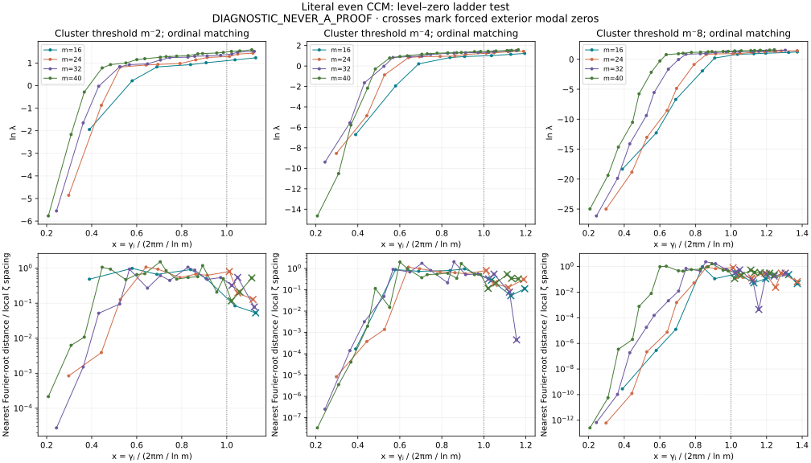
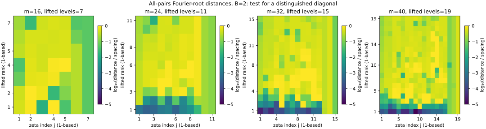
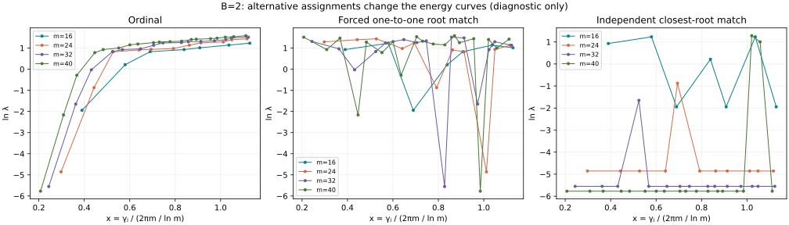

# Level–zero ladder: repository reuse and missing higher-level test

**DIAGNOSTIC_NEVER_A_PROOF.** Source rh_clean @ a412a678a4ae1df4f03106d1a46cf5453451c65a. Literal even CCM, N=m, L=ln m, unit physical eigenvectors.

## Repository search came first

The repository already contains ground-transform root searches at m=13,23,43 (`phase5_codex/xi_row_zeros.py`). Their archived polynomial-root displacement table has a documented ERRATUM; it is not reused as numerical evidence. Recent `ladder_limit/identify` and `zero_height_local` supply physical Fourier formulas, accurate zeta ordinates and full m16/m24 eigenpairs. The missing experiment is the lifted-level association, not the invention of ground-root tracking. See [PREVIOUS_WORK.md](PREVIOUS_WORK.md) for pinned blobs and corrections.

The CCM source-paper theorem concerns zeros of a ground-vector transform as eigenvalues of a perturbed scaling operator. Those are not the energy eigenvalues of the Weil matrix K plotted here.

## Definitions and reproducibility

Main cluster convention: |lambda_i|<m^(-2). Sensitivity runs use B=4 and8. Remaining positive eigenvalues are sorted increasingly; j=1 is the first level above the threshold and is assigned gamma_1. Indices i are zero-based. No zeros are skipped in this ordinal convention. Every level above m^(-8) is included in the root scan, so both alternative thresholds are covered.

The physical basis is d_n(-1)^n cos(2πnx/L)/sqrt(L), d_0=1, d_n=sqrt(2) for n>0, zero outside the window. Its direct sinc Fourier transform is evaluated with removable modal values. Away from those points:

`Phi_i(t) = 2 t sin(tL/2)/sqrt(L) * sum_n d_n v_ni / (t²-(2πn/L)²)`.

Roots of a rational numerator with 100-digit rounded coefficients seed exact rational real-root isolation; each positive candidate is then refined and evaluated with the direct sinc transform. At modes n≤N the expression is removable, not automatically zero. At n>N, t=2πn/L is an exact structural zero for every carrier vector. Those common roots are retained and flagged; they are not evidence of zeta identification.

m16/m24 reuse 180 dps/GL160 eigensystems; m32 uses160dps/GL128; m40 roots use180dps/GL160, compared with160dps/GL128. All original matrix terms and prime powers remain. There are67 profiles and4,018 retained positive roots, including the exterior lattice through120 and the next two lattice points. All positive off-lattice roots of the rounded numerator were considered, including those beyond120; this range covers the first23 matched zeta ordinates. Searches are finite numerical diagnostics, not root enclosures for exact CCM eigenvectors.

## Does the scaled energy curve collapse?

Define Ω_m=2πm/ln m and x=gamma_j/Ω_m; all logarithms in the energy plots are natural. There is a qualitatively similar upper branch for B=2, but no tight threshold-independent collapse. The shoulder moves with m and with the cluster threshold. The table quantifies linearly interpolated **ln lambda** curves on their common x interval; factors are exp(max ln lambda − min ln lambda) across the four carriers. No extrapolation is used.

|B|Common x range|Median lambda factor|Maximum lambda factor|Median / max factor on 0.6≤x≤1|
|---:|:---|---:|---:|:---|
|2|0.38983–1.1112|1.5299|10.5189|1.5221 / 2.272|
|4|0.38983–1.1563|2.0004|58.6124|1.8245 / 11.756|
|8|0.38983–1.2437|46.428|73198.4|78.988 / 55999|

As a modest check of m-dependence, `simple_models.json` fits ln lambda=a+b x+c x², and then adds d ln m. For B=2 the mean leave-one-carrier-out log RMSE improves only from0.713 to0.668. These are descriptive fits, not an inferred F or an asymptotic law. An unrestricted F(x,m) could interpolate any finite table; this experiment does not identify one.

## Does Fourier-root matching select the ordinal ladder?

For each gamma_j and each lifted vector, the cost is distance to its nearest positive real Fourier root divided by the smaller adjacent zeta spacing (first zero uses its next gap). Three conventions are saved:

- **ordinal:** j-th increasing energy gets gamma_j, without optimization.
- **root_independent:** each gamma independently picks the lowest-cost vector; repetition is allowed.
- **root_bijective:** Hungarian minimum-total-cost assignment forces distinct vectors. This is a fitted matching, not independent evidence for the ordinal hypothesis. Exterior-lattice ties have no intrinsic vector identification; tie-breaking is incidental.

|m|Lifted levels (B=2)|Ordinal median root distance / spacing|Bijective median distance / spacing|Bijective pairs retaining ordinal index|Distinct levels used by independent match|
|---:|---:|---:|---:|:---|---:|
|16|7|0.50945|0.039134|1/7|4|
|24|11|0.54098|0.12831|0/11|2|
|32|15|0.44754|0.095161|2/15|2|
|40|19|0.52806|0.11675|1/19|3|

The ordinal errors are typically about half a local zeta spacing. The optimized bijection substantially reorders the levels. The independent choice is many-to-one: at m24,10/11 zeros select i14; at m32,14/15 select i18; at m40,17/19 select i22. A single low lifted vector retains many nearby zeta zeros. This does not support one distinct lifted energy level per zeta ordinate.

## Every lifted level: main B=2 ordinal assignment

Nearest-root positions and signed offsets are computed before conversion to display precision. Full100-digit values, x and ln lambda are in matches.csv; all B=4/8 rows and both alternative assignments are there too. An asterisk marks a common exterior-modal root.

### m=16

|i|j|lambda_i|gamma_j|Nearest real Fourier zero|root−gamma_j|
|---:|---:|---:|---:|---:|---:|
|10|1|0.1429601817|14.134725142|17.481932346|3.3472072|
|11|2|1.236823457|21.022039639|17.062953311|-3.95908633|
|12|3|2.285643561|25.01085758|27.670529652|2.65967207|
|13|4|2.527454598|30.424876126|28.132110187|-2.29276594|
|14|5|2.751835889|32.935061588|31.656257265|-1.27880432|
|15|6|3.127192974|37.586178159|37.866775266|0.280597108|
|16|7|3.420233008|40.918719012|40.791241276 *|-0.127477736|

### m=24

|i|j|lambda_i|gamma_j|Nearest real Fourier zero|root−gamma_j|
|---:|---:|---:|---:|---:|---:|
|14|1|0.007780922497|14.134725142|14.140516007|0.00579086479|
|15|2|0.41738518|21.022039639|21.03758187|0.0155422315|
|16|3|2.272764288|25.01085758|24.503976881|-0.506880699|
|17|4|2.488453192|30.424876126|27.722201077|-2.70267505|
|18|5|2.55265436|32.935061588|35.293588289|2.3585267|
|19|6|2.652697591|37.586178159|39.389006984|1.80282883|
|20|7|3.119390186|40.918719012|39.289339427|-1.62937959|
|21|8|3.474292241|43.327073281|44.8391709|1.51209762|
|22|9|3.632907877|48.005150881|49.426359988 *|1.42120911|
|23|10|4.035941797|49.773832478|49.426359988 *|-0.34747249|
|24|11|4.203622292|52.970321478|53.380468787 *|0.410147309|

### m=32

|i|j|lambda_i|gamma_j|Nearest real Fourier zero|root−gamma_j|
|---:|---:|---:|---:|---:|---:|
|18|1|0.003878918993|14.134725142|14.134914113|0.000188971439|
|19|2|0.1919076285|21.022039639|21.016032789|-0.00600684983|
|20|3|0.9703550813|25.01085758|25.216973038|0.206115458|
|21|4|2.306650055|30.424876126|30.663747244|0.238871118|
|22|5|2.524056312|32.935061588|35.298203376|2.36314179|
|23|6|2.617091259|37.586178159|36.687626651|-0.898551508|
|24|7|3.102082324|40.918719012|39.434068521|-1.48465049|
|25|8|3.463826844|43.327073281|42.24923571|-1.07783757|
|26|9|3.521066192|48.005150881|46.11213527|-1.89301561|
|27|10|3.660670283|49.773832478|51.326329924|1.55249745|
|28|11|3.717059064|52.970321478|51.441108666|-1.52921281|
|29|12|3.821470437|56.446247697|58.009833875|1.56358618|
|30|13|4.054715104|59.347044003|59.827153872 *|0.48010987|
|31|14|4.392135898|60.831778525|61.640097929 *|0.808319404|
|32|15|4.550850287|65.112544048|65.265986042 *|0.153441994|

### m=40

|i|j|lambda_i|gamma_j|Nearest real Fourier zero|root−gamma_j|
|---:|---:|---:|---:|---:|---:|
|22|1|0.003115140338|14.134725142|14.133244849|-0.00148029323|
|23|2|0.114693642|21.022039639|20.997028623|-0.0250110162|
|24|3|0.7506231353|25.01085758|25.053718383|0.0428608028|
|25|4|2.190356388|30.424876126|27.74857781|-2.67629832|
|26|5|2.528301519|32.935061588|35.299356082|2.36429449|
|27|6|2.722986139|37.586178159|39.160182532|1.57400437|
|28|7|3.159550561|40.918719012|42.503665582|1.58494657|
|29|8|3.285983804|43.327073281|45.008674891|1.68160161|
|30|9|3.505945067|48.005150881|45.301000182|-2.7041507|
|31|10|3.604532336|49.773832478|51.28209221|1.50825973|
|32|11|3.681135734|52.970321478|51.413428269|-1.55689321|
|33|12|3.761977525|56.446247697|54.870117008|-1.57613069|
|34|13|4.073919198|59.347044003|58.496438757|-0.850605246|
|35|14|4.133845827|60.831778525|62.595153129|1.7633746|
|36|15|4.229383756|65.112544048|64.703336255|-0.409207794|
|37|16|4.338635283|67.079810529|66.092240931|-0.987569598|
|38|17|4.545550685|69.546401711|69.834376753 *|0.287975042|
|39|18|4.642363527|72.067157674|71.537654235 *|-0.52950344|
|40|19|4.877202148|75.704690699|74.944209198 *|-0.760481501|

## Validation and limits

No sign-change bracket on the independent step0.05 physical-frequency scan was unmatched. The maximum internal direct-sinc root residual is1.98e−160. Roots are serialized to125 significant digits; the largest serialized position residual |Phi/Phi′| is4.98e−123. All737 m40 off-lattice roots were refined again with independent160-digit eigenvectors; maximum location difference is4.97e−123, at serialization scale. These figures validate computed finite roots, not exact source intervals or a cofinal correspondence. Root counts for the rounded polynomial include negative and nonreal squared-frequency roots; excited vectors are not assumed real-rooted.

`root_method.md`, `root_summary.json`, per-carrier root checks and `root_validation_m40.json` retain the details. The first-order |Phi/Phi′| quantity is a numerical position residual, not a rigorous enclosure radius.

Files: matches.csv (all per-level assignments), matching_costs.csv (full pairwise costs), matching_summary.csv, collapse.csv, simple_models.json, roots.csv, full eigensystems, code, source hashes and plots. Reproduce with eigenpairs.py; roots.py per source cell; root_counts.py; root_finalize.py; root_serialized.py; matching.py; plot.py; report.py. Dependencies: mpmath, sympy, numpy, scipy, matplotlib. See the script entry points for exact per-cell arguments.

**Conclusion:** the requested ordinal ladder is not supported by the Fourier-root matches. A rough B=2 upper-branch energy similarity survives, while the threshold shoulder and higher-threshold comparisons vary substantially. This leaves no identified universal F(x,m), and supplies no RH or NOESCAPE theorem input.
