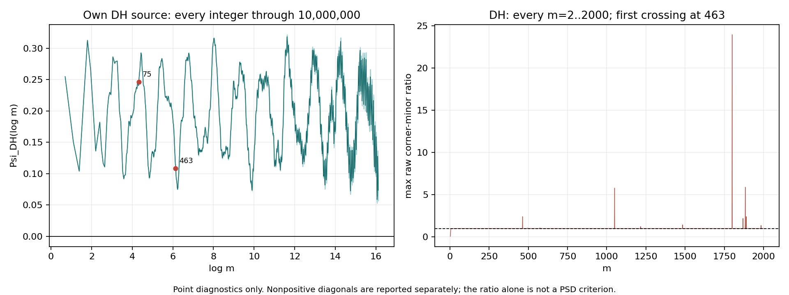

# Addendum: corner-sharing 2×2 minors and the own-source DH thermometer

Route B = CHALLENGER / NOT_RH. Diagnostic, never a proof.

**The DH corner remains positive at every sampled integer through10⁷, while corner-sharing2×2 minors already fail.** Its first raw ratio s>1 occurs at **m463,j234**, with both diagonals positive. An earlier PSD failure at m75 is caused by a negative diagonal and has a negative raw ratio; these two events are reported separately. For ζ all requested grid minors pass; the maximizing index is alwaysj1, rather than near frequency14.13.

## A+1: ζ second rung

All j=1,…,m were evaluated at256bits on the seven requested m. The maximum at m2000 exceeds the registered near-one threshold and was independently recomputed at320bits. Both precisions exceed50decimal digits. All displayed results are points, not interval certificates.

| m | max_j s | argmax j | ω_j | all corner-sharing minors pass |
|---:|---:|---:|---:|---|
|16|0.99990433697071006085|1|2.26618007091|yes|
|40|0.99996602965034395481|1|1.70327748178|yes|
|80|0.99999148907249848862|1|1.43385374645|yes|
|160|0.99998825617075937161|1|1.23802366893|yes|
|300|0.99999577134028712054|1|1.10158221059|yes|
|1000|0.99999681932304063072|1|0.909584235895|yes|
|2000|0.99999932954867157289|1|0.826636750126|yes|

The tightest cell is m2000,j1: s=0.999999329548671572890… and determinant≈1.8352745e−10>0. Every ζ diagonal used here is positive. The nearest-first-zero condition fails in all7cells: |ω_j−14.13| is larger than2π/L. This scores S1 PASS_DIAGNOSTIC and S2 FAIL_DIAGNOSTIC. It does not establish positivity of the full matrices or any cofinal property.

ADD_SECOND_RUNG.csv contains every j on both grids, with A00,A0j,Ajj, determinant, raw ratio and sign flags. ADD_SUMMARY.csv uses positive **individual** diagonals for the meaningful Schur-ratio headline; no negative-diagonal failure is discarded. On the tabulated cells A00>0, so the raw maximum is also attained in that set.

## A+2: own DH corner through10⁷

Every integer2≤m≤10,000,000 was evaluated:9,999,999 samples. **No Ψ_DH<0 was observed; H1 FAIL_DIAGNOSTIC.** The minimum is

Ψ_DH(log9,356,256)=**0.05291509594595864822824…**.

The native value is0.052915095945958620996…; the own-source60dps formula, evaluated with192bit prefix sums, agrees within2.73e−17. The neighboring integers give0.0529152002843850… and0.0529154802361599…, confirming the local minimum. The largest discrepancy among the saved DH corner checkpoints is3.15e−17. The maximum native value is≈0.32197353670323 at m111,384. All55,052 strict native record minima are retained in ADD_DH_RECORD_MINIMA.csv.gz; ADD_DH_SUMMARY.json records counts and extrema.

The corner is defined by Ψ_DH(L)=(L/2)(A_D)00 and constructed from the pinned DH completion, **without a ζ pole**:

Ψ_DH(L)=−c_D L/2+[ζ(2,3/4)−e^(−3L/2)Φ(e^(−2L),2,3/4)]/4−L S1_D+S2_D,

c_D=γ_E+log(8π/5)−π/2,

S1_D=Σ_{2≤n<m}b_D(n)/√n,  S2_D=Σ_{2≤n<m}b_D(n)log n/√n.

Here the Γ multiplier is log(5/π)+Reψ(3/4+it/2), with kernel e^(−3u/2)/(1−e^(−2u)); it is not the ζ Gamma term. Let τ=(sqrt(10−2sqrt5)−2)/(sqrt5−1), and a(n) periodic modulo5 with residues a(1),…,a(5)=(1,τ,−τ,−1,0). All signed integers are retained using

b_D(n)=a(n)log n−Σ_{1<d<n,d|n}b_D(d)a(n/d).

For the full range, an ascending Dirichlet-convolution sieve initializes b(n)=a(n)log n, then subtracts b(d)a(k) from b(dk) for each d,k≥2. At the time b(d) is used, every proper-divisor contribution has already arrived. The coefficient construction, logs and independent prefix sums use MPFR192bits; native every-integer corner values use compensated64-mantissa-bit long double. No coefficient clipping or prime-power restriction is applied. In particular b2=τlog2, b3=−τlog3, b4=−(2+τ²)log2 and b6=(1+τ²)log6. The independent recursive60dps spot checks retain that non-prime-power atom.

ADD_DH_CHECKS.json verifies own Gamma/Lerch formula checkpoints, independent recursive coefficient spots and all7common A00 values against the separate row/diagonal engine to better than1e−45. Direct60dps constructions at m75 and463 give Ψ_DH≈0.24615755537603 and0.10819296719695, respectively: the corner is positive at both matrix-failure events.

## A+3: DH second rung and firstness

Every integer m=2,…,2000 and every j=1,…,m was screened:2,000,999 corner-sharing pairs. Every raw ratio above1−1e−6 was recomputed at≥256bits; the first raw crossing was independently recomputed at320bits. The full grid in A+1 was also evaluated directly at256bits for DH. All34 failed DH grid minors were independently recomputed at320bits.

| Event | m,j | A00 | Ajj | raw s | determinant |
|---|---|---:|---:|---:|---:|
| first failed corner-sharing PSD minor |75,58|0.114028133443737|−0.167462329592483|−0.000312084137059|−0.019101376242265|
| **first raw s>1**, both diagonals positive |**463,234**|0.035255059810755|0.004425753366331|**2.399479153445726**|−0.000218361011701|
| largest raw ratio in dense range, confirmed |1800,137|see dense receipt|positive|23.955280121212188|negative|

The first raw crossing has ω234=239.5455758986845…. Every earlier integer/all j was screened; the closest earlier maximum is0.9999822531040007 at m139,j1, leaving1.77e−5 below1. For the earlier PSD event, all corner-sharing minors at integers2…74 were computed at256bits and passed. These are numerical firstness results, not interval-certified firstness or the first failure of an unrestricted full-matrix spectral test.

At m75, s<1 does not mean the minor is PSD: Ajj<0, so its denominator is negative. For a real Hermitian2×2 block, positivity requires A00≥0,Ajj≥0 and det≥0; the ratio test s≤1 is equivalent only when both diagonals are strictly positive. A zero diagonal requires the off-diagonal to vanish. The receipts retain these cases explicitly.

The seven DH comparison cells alone would miss the positive-diagonal ratio spike: their raw maxima are all below1, although some have negative diagonals. The dense integer screen is therefore retained independently:

| m | max raw ratio | argmax j | failed corner-sharing minors | nonpositive Ajj |
|---:|---:|---:|---:|---:|
|16|0.98963231546210251|1|0|0|
|40|0.99978983223532749|1|0|0|
|80|0.99865222053684971|1|1|1|
|160|0.99957430500710731|1|1|1|
|300|0.99950779841712712|1|2|2|
|1000|0.99978359295127265|1|7|7|
|2000|0.99989518969680847|1|23|23|

ADD_DH_DENSE.csv records every m through2000. ADD_DH_DENSE.json contains all11 additional near-one/exceeding rows after463, their≥256bit confirmations and selected-engine cross-checks. ADD_SECOND_RUNG_RAW.json preserves the independent320bit first-crossing receipt and float/high-precision calibration. Large raw ratios can be sensitive to a tiny positive Ajj: at m1800 the float screen differs from the confirmed ratio by about1.21e−7. The report uses the confirmed value.

## Scores, provenance and scope

S1 (0.97): PASS_DIAGNOSTIC on the requested ζ grid/all j. S2 (0.45): FAIL_DIAGNOSTIC,0/7 near14.13. H1 (0.40): FAIL_DIAGNOSTIC, no negative DH corner through10⁷. These finite findings show the particular corner and corner-sharing-minor tests distinguish this DH sample differently; they do not prove an implication for another source or a cofinal family.

The pinned TWO_CORES §6 Schur correction is used with the unshifted matrix (κ=0), retaining the source terms. These tests do not establish the separate pole-null Sobolev core or negate the bounded-atom stability statement in its §§2,5. All source/operator definitions remain unchanged. A smallm16 normalization check against the unchanged pinned full analytic builder passes in both worlds; every production grid cell uses only the corner row and diagonal, not a full matrix or eigensystem.

The append-only addendum predictions were committed in immutable object bb91ed2018ff4b92f7cfc4fe60b6b0bf2ff76a73 before any addendum run. ADD_PREREGISTRATION.json pins both new verdicts and the updated full prediction blob; the original Task A prediction prefix is preserved exactly. Task A had already been published when this addendum arrived. Consequently this is a scoped follow-up commit in the same directory, retaining the published history rather than rewriting its SHA.

ADD_SOURCE_REVIEW.md records the bounded independent source/implementation review. ADD_GATES.json records scores and sign-aware findings. All arithmetic remains point diagnostics with explicit precision; no uniform rounding certificate, RH claim, route-state change or RH export is made.
