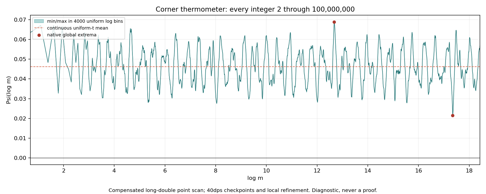

# Corner thermometer through 100,000,000

Route B = CHALLENGER / NOT_RH. Diagnostic, never a proof.

**Every integer2≤m≤100,000,000 was evaluated:99,999,999 samples, with no nonpositive value observed. G1 and G2 pass. T1–T4 all pass as numerical diagnostics.** These are point-arithmetic observations, not a certified positivity theorem or a cofinal/RH claim.

## Extrema and means

| Quantity | Result | m or convention |
|---|---:|---|
| global minimum, locally refined40dps | **0.0214985808238387377857** | **34,186,454** |
| minimum for m≥1000 | same minimum |34,186,454|
| global maximum, locally refined40dps | **0.0689080386747095466213** | **319,439** |
| primary mean, continuous uniform t | **0.0461840547753115281097** | t∈[log2,log10⁸] |
| continuous uniform t, lower endpoint0 |0.0461937563737181436678| t∈[0,log10⁸] |
| trapezoid on the log-integer samples |0.0472241321745987743972| interpolation control |
| ordinary uniform-m mean |0.0459667719096427526583| different sampling measure |
| strict native record minima |**605,239**| initial m2 included;10 consecutive runs |

The primary mean and its interval were fixed in PREDICTIONS.md before numerical work. It is evaluated from the analytic antiderivative, then independently checked using40dps sums. The log-grid trapezoid differs because the early integer samples are sparse in t; it is not silently substituted for the continuous mean. The ordinary integer mean is another labelled control.

The exhaustive native minimum and maximum occur at the same integers as the local40dps refinements. For minimum ranking, every stored sample within1e−9 of the native minimum was retained:40 integers,34,186,435…34,186,474. All40 were independently reevaluated from the original Suzuki formula; the maximum and its two neighbors on each side were likewise checked. The closest two refined minima differ by about1.2454e−12. This establishes a stable numerical ranking within the broad native guard band, not a global interval error certificate.

The plotted envelope retains minimum and maximum over4000 uniform-log bins covering all samples; it is not a claim that every one of the100million values is individually visible. LOG_ENVELOPE.csv preserves the plotted data.

## Gates

**G1 PASS.** The compensated native values at16,80,300 are respectively0.04594245063082056881,0.04499011999389815123,0.03453065923301446554. The largest difference from the supplied decimal targets is1.015e−12, below1e−10. G1_NATIVE.csv records all three. The value at300 therefore need not agree with every last digit of the supplied12-decimal reference to pass the stated tolerance.

**G2 PASS.** Independent mpmath40dps arithmetic, using the original pole/Catalan/Lerch formula, was evaluated at every10^k, k=1,…,8. The largest native/reference difference is **1.88944e−14**, well below1e−9. CHECKPOINTS_MP.json additionally includes16,80,300 and independently accumulated S1,S2,S3. The high-precision producer reads the shared prime integer file but none of the native running sums; this independently checks formula evaluation and summation, not a second prime sieve. CHECKPOINT_COMPARISON.csv contains all required G2 comparisons.

**G3 NOT RUN, optional.** The suggested denominator γ²+1/4 is not Suzuki's exact zero-side kernel: under a complete critical-line divisor, the paired expression for Ψ uses γ². A critical-line-only table would additionally need explicit completion/location and omitted-tail premises; none is silently assumed. The reference2+γ_E−log4π belongs to the reciprocalρ(1−ρ) sum and is retained as the registered approximate comparison target, not asserted to equal the exact mean of the γ² kernel or a finite-interval mean. No zero list is used by this computation.

## Twenty smallest observed values, refined40dps

The exhaustive heap and the independent guard-band refinement give the same ordering. TWENTY_SMALLEST.csv retains full point values; the table below is rounded for display.

| Rank | m | Ψ(log m) |
|---:|---:|---:|
|1|34,186,454|0.02149858082383873778571|
|2|34,186,455|0.02149858082508414713626|
|3|34,186,453|0.02149858082759619499801|
|4|34,186,456|0.0214985808313324226838|
|5|34,186,452|0.021498580836356519139|
|6|34,186,457|0.02149858084258356406248|
|7|34,186,451|0.02149858085011971057453|
|8|34,186,458|0.02149858085883757090645|
|9|34,186,450|0.02149858086888576967046|
|10|34,186,459|0.02149858088009444284986|
|11|34,186,449|0.02149858089265469679265|
|12|34,186,460|0.02149858090635417952685|
|13|34,186,448|0.02149858092142649230693|
|14|34,186,461|0.02149858093761678057158|
|15|34,186,447|0.02149858095520115657917|
|16|34,186,462|0.0214985809738822456182|
|17|34,186,446|0.02149858099397868997521|
|18|34,186,463|0.02149858101515057430084|
|19|34,186,445|0.02149858103775909286091|
|20|34,186,464|0.02149858106142176625367|

## Strict record minima

The native record list records every strict decrease of the running minimum, not just local extrema. It contains605,239 rows. The following10 consecutive runs compactly describe where records occurred; every individual record value remains in the lossless CSV shards under records/.

| First m | Last m | Records | Last native Ψ |
|---:|---:|---:|---:|
|2|2|1|0.0635555860375704|
|4|4|1|0.0483152993957214|
|6|6|1|0.0327650227444012|
|15|15|1|0.0320828665905648|
|34|34|1|0.0303855379095401|
|205|208|4|0.0280248346687499|
|3,084|3,100|17|0.0275208174022691|
|33,578,475|34,181,823|603,349|0.0214997430788315|
|34,181,870|34,181,944|75|0.0214997368552661|
|34,184,666|34,186,454|1,789|0.0214985808238358|

RECORDS_INDEX.json lists the seven gzip shards and their row ranges/hashes. `python scripts/records.py > RECORD_MINIMA.csv` reconstructs the original full CSV byte for byte, including its header. The record list is the strict ordering observed in compensated native point arithmetic; the entire list is not independently reevaluated at40dps. The final extreme and top20 have the additional local check described above.

## Registered scores

| Prediction | Outcome |
|---|---|
| T1 (0.97): every sampled integer positive | **PASS_DIAGNOSTIC**:0 nonpositive samples; minimum≈0.02150 |
| T2 (0.85): uniform-t mean0.0462±0.003 | **PASS_DIAGNOSTIC**:0.04618405477531… |
| T3 (0.60): minimum on10³…10⁸≥0.002 | **PASS_DIAGNOSTIC**:0.02149858082384… |
| T4 (0.95): maximum≤0.0924 | **PASS_DIAGNOSTIC**:0.06890803867471… |

## Arithmetic, provenance and limits

PREDICTIONS.md was committed in immutable registration object bd8ebad42d718a9fd2c5149470a646377f8e638f at2026-11-04T14:37:23Z, before any numerical run. The registration object did not move rh_clean; one final scoped branch commit carries its identical prediction blob. INPUTS.json pins the prior Gate0 and the44aaf90d plan, blobca1fc4d, including S1–S2.

The native run used long double with64 mantissa bits, Kahan compensation for S1,S2,S3 and the means, and compilation without fast-math. All5,761,455 primes and1,404 higher prime powers through10⁸ were retained. Source sums have strict n<m support; the n=m weight is exactly zero. The exact cancellation of the4/√m pole and Lerch terms was performed algebraically before floating evaluation. Retained scalar-tail errors are bounded analytically by3e−24 for m<64 and6.2e−18 for m≥64; these are series-truncation bounds, not bounds for all floating-point operations.

The full scan completed in about17.8seconds. Independent40dps checkpoints took157seconds, and bounded local refinement took42seconds. Dense raw values and prime integers remain local with hashes in LOCAL_DATA.json. No large source matrices, eigensystems, changed source, or zero-side positivity assumption are involved. INDEPENDENT_REVIEW.md records a bounded read-only derivation/implementation review; it is not a second exhaustive run.

Checkpoint agreement and the margins in this finite sample do not supply a rigorous uniform roundoff bound, prove positivity on a real interval, or extend beyond10⁸. No cofinal claim, route-state change or RH export is made.

## Addendum: second rung and own-source DH

The addendum is complete in [ADDENDUM_RESULT.md](ADDENDUM_RESULT.md). ζ passes all requested corner-sharing minors; the maximum at m2000,j1 is0.99999932954867157…, confirmed at320bits. The maximizing index isj1 in all7cells, so S2 fails.

DH's own-conductor5, odd-Gamma, no-pole corner is positive at every sampled integer through10⁷: H1 fails, minimum≈0.05291509594595865 at m9,356,256. Nevertheless its first raw corner-minor ratio above1 is at m463,j234, s≈2.399479153445726 with both diagonals positive. An earlier PSD-minor failure at m75,j58 has a negative diagonal and negative raw ratio; it is not the same event. Every m2…2000/all j was screened, with every near-one/exceeding candidate independently confirmed at≥256bits.

The original Task A results/data remain retained. The appended prediction registration preceded all addendum runs; delivery is a follow-up commit because the original Task A SHA had already been published. No RH or route-state export is made.
