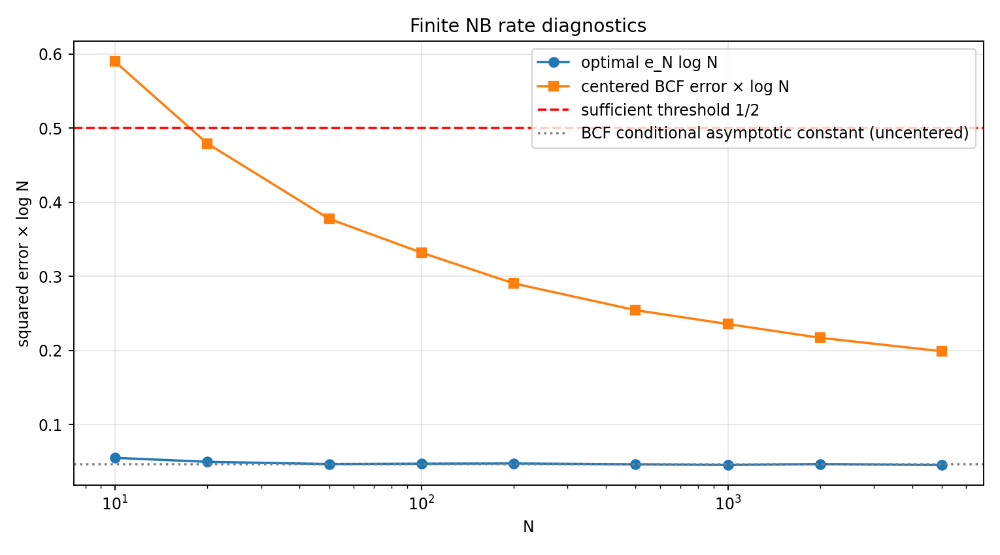
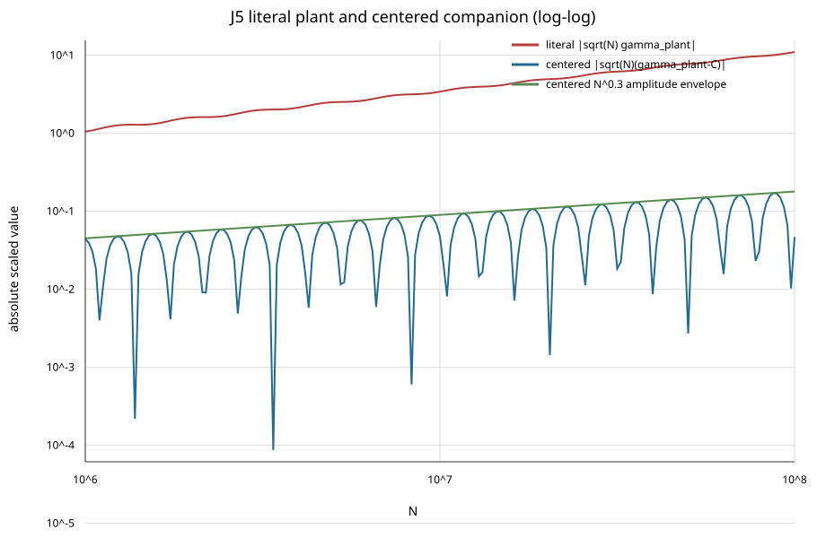

# NB rate thermometer — результат по брифу 2026-11-06

**Часть A посчитана до N=5000. Часть B — INCONCLUSIVE, большой научный запуск остановлен на J5.** Общего валидированного прохода J1–J5 нет. Причина — несогласованность буквальной формулы подложенного контроля с требуемым показателем, а не отсутствие видимого сигнала. Центрированный контроль показан отдельно и не подменяет исходный.

Это DIAG в точечной арифметике, не доказательство RH или cofinal rate. `RH_PROVED: false`; `CHALLENGER_NOT_RH`. Proshka verdicts, Lean и route-state не изменены. Дата в пути — дата брифа; фактический запуск — 2026-11-05 UTC.

## Источники и воспроизводимость

Бриф: `rh_clean @ 572d6f727f287fdfd5ba284fd7f70b2a673dd223`, `docs/routeB_bus/mythos/CODEX_TASK_NB_RATE_THERMOMETER_2026-11-06.md`, blob `1a4f4638f1e757b4f2d26b5ee8cac71935e4c8a5`. Все полные source commit/blob, включая старые sieve/Kahan, в [SOURCE_PINS.json](SOURCE_PINS.json). Пути и Git blobs всех остальных артефактов — [BLOBS.tsv](BLOBS.tsv); контрольные SHA-256 — [SHA256SUMS](SHA256SUMS).

- R6 C: `0005623ec3a2b476019899562b50c0854a602dfb`, blob `83004738a32926d80030b52bbae4655ee221dba0`; (C1)–(C7), (C24)–(C27).
- R7 B: `8a994500ffc9648f2f3e22561ee74a9d0c2e9eca`, blob `91cf942a527100c8a0b006377ff963adb23e7b6f`; (2.1)–(2.4), (7.1), (7.9)–(7.12).
- Limit 9 C: `c09713ede9913599b75e18d94ba36d41f10d5d24`, blob `5ccfaab6030cd9652aa5f061a2c33654afec4994`; (L6)–(L10), (B), (L14).

[PREREGISTRATION.json](PREREGISTRATION.json) сохраняет прогнозы и до расчёта таблицы фиксирует операционную интерпретацию A3. Текст брифа с прогнозами не редактировался.

Воспроизведение из каталога результата:

```bash
OPENBLAS_NUM_THREADS=4 OMP_NUM_THREADS=4 uv run --no-project part_a.py --preflight-only
OPENBLAS_NUM_THREADS=4 OMP_NUM_THREADS=4 uv run --no-project part_a.py --max-n 5000
uv run --with mpmath python part_b_judge_preflight.py
```

Part A содержит PEP 723 зависимости с версиями, компилирует небольшой C++/OpenMP kernel и удаляет временную плотную Gram после сохранения результатов. Скрипты имеют ASCII progress/ETA для длинных циклов; команды и фактические логи сохранены. Сама 10^8 prime-sieve/Kahan инфраструктура прочитана и закреплена для переиспользования, но большой sieve run **не запускался** после отказа J5; утверждать её использование в несуществующем научном B-run было бы неверно. Малый preflight использует Euler sieve и Kahan.

## A. Оптимальная ошибка и явный BCF

Сохранён исходный объект `H=ℓ²(ℕ,1/[k(k+1)])`, `v=1`, `r_n(k)=(k mod n)/n`. Требуемая `e_N` — **квадрат** расстояния, не его корень. В таблице `E(V_N)` означает центрированную ошибку в той же H-норме:

```
a_n=μ(n)(1−log n/log N),
R_N^V(k)=1+Σ_{n=2}^N a_n r_n(k),
E(V_N)=||R_N^V||_H² = E_global(V_N−V_N(1)).
```

Нецентрированная глобальная BCF-ошибка — другой объект; она дана отдельной дополнительной колонкой CSV, не участвует в подмене требуемой таблицы.

| N | e_N | e_N·log N | E(V_N) | E(V_N)·log N | e_N / [1/(2log N)] | E_N^h для J2 |
|---:|---:|---:|---:|---:|---:|---:|
| 10 | 0.02385255332 | 0.0549225337 | 0.2560562793 | 0.5895913716 | 0.1098450674 | 0.03603540406 |
| 20 | 0.01653825211 | 0.04954417559 | 0.1599573756 | 0.4791894724 | 0.09908835118 | 0.04288032809 |
| 50 | 0.01188697042 | 0.04650210174 | 0.09647854988 | 0.3774263067 | 0.09300420348 | 0.03645439243 |
| 100 | 0.01020191928 | 0.04698157453 | 0.0720613812 | 0.3318549243 | 0.09396314906 | 0.03814704871 |
| 200 | 0.008930777788 | 0.04731809505 | 0.0548040165 | 0.2903690724 | 0.0946361901 | 0.0382059429 |
| 500 | 0.007426788072 | 0.0461545773 | 0.04090652138 | 0.254217999 | 0.09230915459 | 0.03602813758 |
| 1000 | 0.006561374298 | 0.04532436795 | 0.03408267539 | 0.2354347808 | 0.09064873589 | 0.03258986501 |
| 2000 | 0.00611880278 | 0.0465084231 | 0.02853848542 | 0.216918244 | 0.0930168462 | 0.03986302842 |
| 5000 | 0.005307020683 | 0.04520092043 | 0.02333637999 | 0.1987604568 | 0.09040184085 | 0.03844984854 |

На всех зарегистрированных N≥50 отношение к порогу меньше 0.095. При N=5000 оно примерно 0.0904: finite запас около 11 раз. Это подтверждение **конечной сетки**, не утверждение `∀m≥M` из R7 B (7.1).



### K, LS и оплаченный хвост

Прямая K×N матрица не строилась. Использована аналитическая агрегация нормальных уравнений конечного weighted LS: полный Gram через формулу Васюнина минус явно оценённый периодический хвост. Детали, доказательство оценки остатка, `λ0` и отличие численной ошибки от truncation budget — в [part_a_method.md](part_a_method.md).

Для всех строк выбран **K=100000000000000000000 = 10^20**. Это математический cutoff агрегированного LS, а не заявление, что выполнены 10^20 итераций. В CSV сохранены также решение агрегированного finite-K LS, оценка отличия его минимума от полного минимума, стационарность и condition estimate.

| N | (1+Σ|c_n|)²/(K+1) | bound / e_N |
|---:|---:|---:|
| 10 | 2.4740e-19 | 1.0372e-17 |
| 20 | 6.1120e-19 | 3.6957e-17 |
| 50 | 2.5906e-18 | 2.1794e-16 |
| 100 | 7.7267e-18 | 7.5737e-16 |
| 200 | 2.5572e-17 | 2.8633e-15 |
| 500 | 1.2855e-16 | 1.7309e-14 |
| 1000 | 4.5513e-16 | 6.9364e-14 |
| 2000 | 1.5954e-15 | 2.6074e-13 |
| 5000 | 8.9839e-15 | 1.6928e-12 |

Во всех строках выполнено требование `<10^−3 e_N`. Наибольший относительный crude tail budget — 1.6928e-12. Аналитический remainder периодического агрегирования ещё меньше и указан отдельно. Эти truncation budgets не выдаются за интервал, включающий весь floating-point roundoff.

Матрица собрана в long double, normal solve — float64. Mpmath 30 dps для N=10,20,50,100,200 согласуется с e_N с максимальным расхождением 1.6653e-16; Gram entry discrepancy не больше 1.2380e-17. При N=5000 оценка cond₁ около 9.843e+08; последние распечатанные цифры не сертифицированы interval arithmetic. Пороговый запас существенно больше проверенных численных расхождений.

Все оптимальные коэффициенты сохранены в [part_a_coefficients.csv](part_a_coefficients.csv); числа и budgets — [part_a_results.csv](part_a_results.csv), mp-сверка — [part_a_mp30.csv](part_a_mp30.csv).

## B. Судья сначала: буквальный J5 не проходит

Бриф требует перед большим запуском построить судей и говорит: **«any failure voids the run»**; отдельно для J5 предусмотрен вывод INCONCLUSIVE для B. При предварительной проверке буквального контроля обнаружено:

```
δγ(N)=0.01 Σ_{k<N} k^0.8 cos(14 log k)/[k(k+1)] → C ≠ 0,
C=0.01 Re[1/2+Σ_{j≥0} (−1)^j(ζ(1.2+j−14i)−1)]
 ≈0.0010960362730492558211692100925.
```

Член k=1 отделён; остаточный ζ-ряд действительно сходится. После 64 членов его неумноженный geometric remainder не больше `ζ(65.2)−1≈2.36·10^−20`. Поэтому буквальный `√N δγ(N)` имеет ведущий рост **N^1/2**, а не N^0.3. Это не эффект слепого детектора. Проверенный fit на [10^6,10^8] по 201 log-spaced точке даёт slope **0.4997859247**.

| N | δγ(N), plant only | √N δγ(N), plant only |
|---:|---:|---:|
| 10^6 | 0.00105182578901814 | 1.05182578902 |
| 10^7 | 0.00108103860769303 | 3.41854423885 |
| 10^8 | 0.00110072888704273 | 11.0072888704 |

Слово `plant only` существенно: это вклад добавки, **не результаты Mertens sweep** по настоящим μ до 10^8. Prefix для контроля вычислен как C минус аналитически оценённый хвост; error bound каждой точки сохранён в CSV.

Отдельный центрированный companion `√N(δγ(N)−C)` имеет амплитудную огибающую `0.01 N^0.3/√(0.2²+14²)`. Fit по абсолютным осциллирующим отсчётам даёт 0.30934, а наклон огибающей ровно 0.3. Этот companion помогает локализовать ошибку спецификации; он **не заменяет J5 и не даёт ему PASS**.



Уточнение о трактовке J5 было запрошено во время работы; исправление условия не получено. Поэтому исходный судья сохранён, а большой B-run не выполнялся. Конкретный возможный будущий ремонт — явно заменить plant на

```
δM_centered(k)=0.01 k^0.8 cos(14 log k)−2C·1_{k=1}.
```

Тогда для N≥2 его prefix γ равен δγ(N)−C. Это **новая спецификация контроля**, требующая отдельного согласования; текущий прогноз задним числом не переписан.

### Что рассчитано и что не рассчитано в B

| Требование B | Результат текущего задания |
|---|---|
| γ(N), √Nγ(N) для всех N≤10^8 | NOT_RUN после отказа J5 |
| Настоящие global min/max, uniform-log mean, dyadic envelopes | NOT_RUN; числа не выдуманы |
| Полная E_N^h до 10^5, около 200 точек | NOT_RUN после отказа J5 |
| Decade minima / liminf-type statistics до 10^5 | NOT_RUN; конечная сетка всё равно не доказала бы условие (B) |
| Полная E_N^h на пересечении с сеткой A, N≤5000 | Посчитана по полному Gram для J2, значения в таблице A |
| J5 literal и центрированный diagnostic companion | Посчитаны; CSV, SVG, tail bounds и metadata сохранены |

Для полного head error нельзя принять нулевую ошибку на k<N за полную норму. (L6)–(L10) сохраняют весь k≥N хвост; source (L14) даёт лишь `9N²/(K+1)` для грубого остатка после K. [part_b_judge_preflight.py](part_b_judge_preflight.py) имеет явный interval-of-truncation helper, не выдающий partial sum за E_N^h. Условие `liminf E_N^h<∞` не доказано и не опровергнуто этим запуском.

## Пять судей

| Судья | Статус / точный охват |
|---|---|
| J1 | PASS: e_N не возрастает на всей сетке A. Не путать с e_N log N, у которого есть finite колебания. |
| J2 | PASS на всей сетке A: e_N≤E(V_N) и e_N≤E_N^h; обе энергии с полным хвостом. Дополнительно проверено PSD gap `(c_comp−c_opt)^T Γ(c_comp−c_opt)`. |
| J3 | PASS на всей сетке A: все k<N для H_N, все k≤N для BCF identity; ψ включает все prime powers. Max head discrepancy 4.3065e-16; max BCF discrepancy 3.9366e-13. Для B до 10^5 отдельного полного запуска нет. |
| J4 | Малый preflight PASS: M(10)=−1, M(100)=1, M(1000)=2 против OEIS A084237. Полный 10^8 sanity/trend judge — NOT_RUN. |
| J5 | FAIL буквального показателя ≈0.3: видимый рост имеет slope ≈0.5 из-за ненулевого offset. Общий научный B-run INCONCLUSIVE. |

Судьи и дешёвые preflight-контроли были реализованы до научной таблицы A. Факт, что B не прошёл входной gate, не скрыт за хорошими результатами A. Независимый read-only reviewer проверил формулы, пять direct-sum periodic-tail checks, B1 witness и literal J5 prefix; существенных ошибок не найдено. Это bounded numerical/PAPER review, не Lean/Arb-сертификат.

## Оценка прогнозов без переписывания исходного брифа

| Прогноз | Score | Основание |
|---|---|---|
| A1, p≈0.85 | HIT на зарегистрированной сетке | e_N log N≤0.5 для всех N≥50 из сетки. |
| A2, p≈0.6 | HIT | N=1000: e_N log N=0.04532436795 ∈[0.03,0.15]. |
| A3, p≈0.55 | MISS **по предзарегистрированной endpoint-интерпретации** | E(V_N) log N монотонно уменьшается 0.58959→0.19876, но при N=5000 ещё вне [0.04,0.10]. Само уменьшение — HIT; eventual «toward the band» этой конечной сеткой не опровергнуто. |
| B1, p≈0.75 | MISS, точный witness | γ(3)=1/2, √3·|γ(3)|=√3/2≈0.8660254>0.6. Это уже опровергает all-N bound без знания полного максимума. |
| B2, p≈0.6 | NOT_RUN | Судья J5 остановил требуемую 10^5 сетку. HIT/MISS без этих данных не присваивается. |
| B3, p≈0.9 | SPLIT | Видимость подложенного роста — HIT; требуемый ≈0.3 показатель исходного J5 — MISS. Центрированный companion не меняет исходный score. |

Даже два точных малых witness N=2,3 уже нарушают B1; они ничего не говорят против достаточного cofinal условия (B). Аналогично FAIL J5 — дефект подложенного контроля, а не математический запрет на Mertens thermometer.

## Литература и границы вывода

- [Bettin–Conrey–Farmer, arXiv:1211.5191](https://arxiv.org/abs/1211.5191), Theorem 1, p.2: asymptotic constant `2+γ_E−log(4π)≈0.0461914` для ошибки конкретного нецентрированного V_N при **RH и H₋₁**, отрицательном моменте ζ′; дополнительная гипотеза включает простоту нулей. Скорость не импортирована как RH-alone theorem.
- [Burnol, arXiv:math/0103058](https://arxiv.org/abs/math/0103058), Theorem 1.3: нижняя оценка с multiplicities squared. Это не upper bound и не поставщик rate для (7.1).
- [Báez-Duarte–Balazard–Landreau–Saias, arXiv:math/0306251](https://arxiv.org/abs/math/0306251), Proposition 89, и [Bettin–Conrey, arXiv:1111.0931](https://arxiv.org/abs/1111.0931), (13): computable rational autocorrelation/Gram.
- [OEIS A084237](https://oeis.org/A084237): reference values M(10^j) для малой sanity-сверки.

Для части A проверены finite значения до 5000 и truncation budgets; бесконечная скорость не установлена. Для B оставлен явный INCONCLUSIVE по исходному судье. Ни bounded subsequence E_N^h, ни RH не заявлены.
