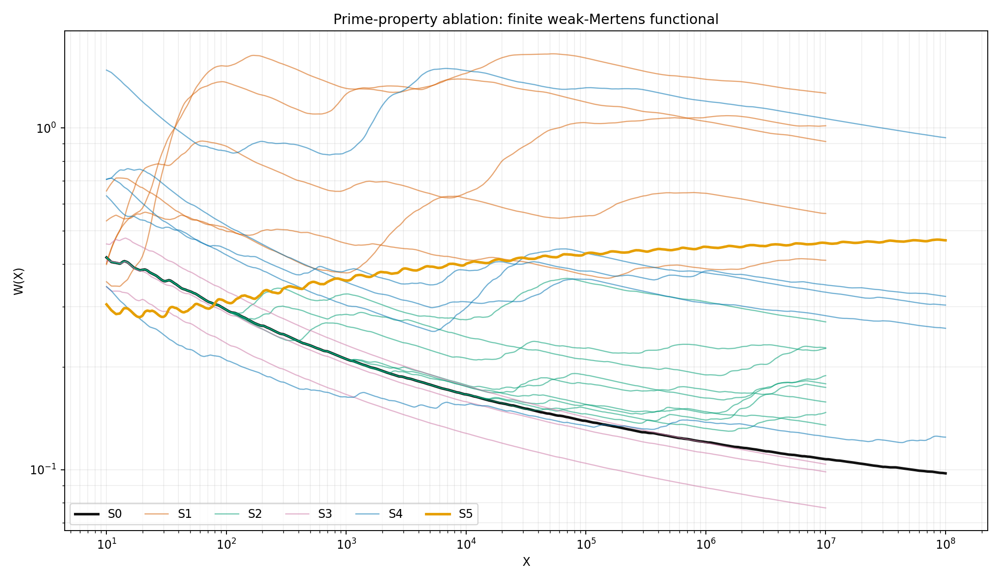
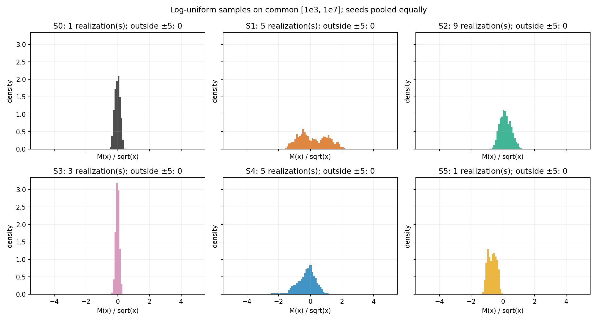
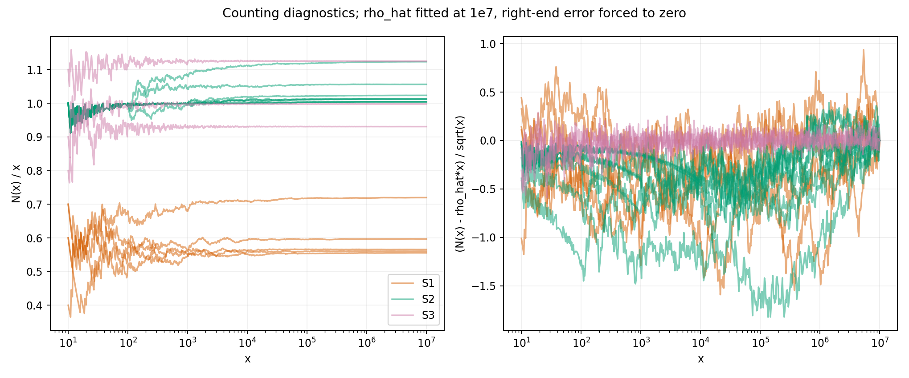

# Prime-property ablation — 2026-11-06

**FINITE_DIAGNOSTIC_NOT_RH.** Все 24 зарегистрированные реализации досчитаны: S0, S4×5 и S5 до 10⁸; S1×5, S2×9 и S3×3 до 10⁷. Объём основных прогонов не сокращён. **A1/A4/A5 HIT; A2/A3 MISS** по критериям, зафиксированным до вычислений. J1, J2, J4 PASS; J3 PASS для конечной проверки перечисления, асимптотическая сходимость не установлена.

Главный конечный результат: различия видны, но единственное свойство, «несущее RH», не выделено. Максимальное отличие наклонов от S0 — 0.137820 (S1 seed 1105). Возмущённые простые S3, лишённые точной целочисленной решётки, сохраняют малый W: W(10⁷)=0.07726–0.10372. Это не позволяет объявить целочисленность необходимым условием наблюдаемого конечного эффекта.

## Источники и фиксация до запуска

- Задание: commit `089f59e5498eecb6c2b122f411c6c78e75110da8`, blob `fab2698cc9cf804986dc7ec9747c89fe8b9740f1`.
- Словарь: blob `8462d827e01dd83fef22f750936f3d84ad238e1d`. Оба blob сверены с физическими файлами.
- Инфраструктура решета/Kahan: `a33870cb`, использованы алгоритмические образцы `corner_thermometer_2026-11-04/scripts/{sieve,thermometer}.cpp`.
- [PREREGISTRATION.json](PREREGISTRATION.json) закоммичен и запушен **до любых малых или производственных численных прогонов**: `8e2e29a866600c16cf38127ff5325ac97dc2880e`. Пороговые правила после результатов не менялись.
- Контрольные значения прочитаны из [OEIS A084237](https://oeis.org/A084237/b084237.txt) и [OEIS A090410](https://oeis.org/A090410/b090410.txt); точная выписка и способ получения — [SOURCES.json](SOURCES.json).

## Судьи

| Judge | Результат | Проверенное свидетельство |
|---|---|---|
| J1 | PASS | Все M(10ᵏ), k=0…8, совпали: 1, −1, 1, 2, −23, −48, 212, 1037, 1928. |
| J2 | PASS | Все L(10ᵏ), k=0…8, совпали: 1, 0, −2, −14, −94, −288, −530, −842, −3884. |
| J3 | PASS (finite enumeration); asymptotic UNKNOWN | Независимый перебор показателей против C++ DFS: настоящий S1 seed 1101 до 500 — 91 генератор, 283 объекта с кратностями, 188 разных чисел; дополнительно коллизии [2,4] и [2,3,6]. |
| J4 | PASS | OLS log W по log X на [10⁵,10⁷], 201 точка: **0.420080336635 ≥ 0.4**. Аналитические первообразные отдельно сверены с Simpson. |

В тесте [2,4] при произведении 4 проверены **приращения** ΔN=2, ΔM=−1 (это не N(4)); для [2,3,6] при 6: ΔN=2, ΔM=0. Сходимость N(x)/x не эквивалентна корректности кода и не доказана конечным тестом. Стабилизация по декадам показана ниже.

Сначала выполнены малые судьи, затем полные прогоны. Для истинных систем trial-factor перебор до 50 000 независимо сверяет μ, λ и все пять S4; проверены W, сетка и квадратура planted-членов. Ошибки аналитика/Simpson на тестовом интервале: 3.11e−15 (cross) и 7.81e−18 (square). [true_systems_checks.json](true_systems_checks.json), [true_systems_run.json](true_systems_run.json), [FAKE_CHECKS.json](FAKE_CHECKS.json).

### Аналитика planted-контроля, записанная до запуска

Использован P(x)=0.05·(x^0.8 cos(7 log x)−1), P(1)=0. Это интеграл от 1 производной 0.05·x^0.8 cos(7 log x). Для ведущего квадратичного члена:
```text
∫ P(x)²/x² dx = 0.00125 x^0.6 [1/0.6 +
  (0.6 cos(14 log x)+14 sin(14 log x))/(0.6²+14²)]
  + lower-order terms + integration constant.
```
Поэтому ведущая огибающая W имеет показатель 0.6−1/log X ≈ 0.513…0.538 на тестовом окне. Полный конечный наклон включает исходный M, перекрёстный член, нижние пределы и осцилляции; он не обязан совпадать с огибающей. В программе cross и P² интегрируются аналитически, M постоянен на каждом [n,n+1).

## Прогнозы

Слово «bounded» операционализировано заранее как **max W≤1** на указанной конечной сетке. Это произвольный диагностический порог, а не проверка асимптотической ограниченности. Наклон — OLS(log W, log X); общий диапазон сравнения [10³,10⁷]. Для A1/A2 используется полный диапазон [10³,10⁸], для A4 — лог-выборки [10³,10⁸].

| ID | Prior | HIT/MISS | Число |
|---|---:|---|---|
| A1 | 0.80 | HIT | S0 W∈[0.097534,0.210692], полный наклон −0.064585. |
| A2 | 0.55 | MISS | Среднее по seed и сетке S4: 0.473398 против S0: 0.136494; max S4=1.492958. |
| A3 | 0.60 | MISS | max S1=1.647934; порог 1 превышают seeds 1102, 1104, 1105. Это не доказательство неограниченности W. |
| A4 | 0.70 | HIT | Среднее L/√x=−0.679827, цель −0.684765; ошибка 0.004938<0.15. |
| A5 | 0.35 | HIT | S1 seed1105 slope +0.066390 против S0 −0.071431 на общем диапазоне; разность 0.137820>0.1. |

Числа и решения воспроизводятся `scripts/analyze.py` в [ANALYSIS.json](ANALYSIS.json). HIT/MISS относятся ровно к этим конечным условиям, а не к вероятностям RH. A5 выбирает максимум среди зарегистрированных реализаций; отдельный статистический significance-тест не заявлен.

Для S4 независимость знаков даёт точное тождество E[M(x)²]=Σ_{n≤x}μ(n)²: смешанные произведения разных squarefree n имеют нулевое ожидание. Следовательно, оценки первого абсолютного момента |M| не предсказывают автоматически малый квадратичный функционал W или W меньше, чем у S0. A2 MISS не является опровержением результата Harper.

## Все реализации

`W end` указан при индивидуальном Xmax; наклоны в последнем столбце используют один диапазон [10³,10⁷].

| Система / seed | Xmax | M end | W end | common slope |
|---|---:|---:|---:|---:|
| S0 | 1e+08 | 1928 | 0.097533657 | -0.071431 |
| S1_seed1101 | 1e+07 | 1777 | 0.410008278 | -0.013493 |
| S1_seed1102 | 1e+07 | 907 | 0.912489048 | -0.046105 |
| S1_seed1103 | 1e+07 | -2072 | 0.562006734 | +0.025207 |
| S1_seed1104 | 1e+07 | -1668 | 1.263760991 | -0.002757 |
| S1_seed1105 | 1e+07 | -3858 | 1.014586280 | +0.066390 |
| S2_y10000_seed2201 | 1e+07 | 147 | 0.134964713 | -0.038142 |
| S2_y10000_seed2202 | 1e+07 | 2387 | 0.147020737 | -0.043425 |
| S2_y10000_seed2203 | 1e+07 | 993 | 0.174060446 | -0.021647 |
| S2_y1000_seed2201 | 1e+07 | -154 | 0.157763911 | -0.019562 |
| S2_y1000_seed2202 | 1e+07 | 2064 | 0.188394923 | -0.016501 |
| S2_y1000_seed2203 | 1e+07 | 393 | 0.178352422 | -0.022894 |
| S2_y100_seed2201 | 1e+07 | -2328 | 0.226439607 | -0.004160 |
| S2_y100_seed2202 | 1e+07 | 90 | 0.270638303 | -0.002081 |
| S2_y100_seed2203 | 1e+07 | 306 | 0.227150538 | -0.038184 |
| S3_seed3301 | 1e+07 | 7 | 0.103717798 | -0.085201 |
| S3_seed3302 | 1e+07 | 50 | 0.098518006 | -0.076897 |
| S3_seed3303 | 1e+07 | 397 | 0.077262493 | -0.081116 |
| S4_seed4401 | 1e+08 | -3340 | 0.321344747 | -0.003867 |
| S4_seed4402 | 1e+08 | 1706 | 0.259237155 | -0.009776 |
| S4_seed4403 | 1e+08 | 5222 | 0.303153723 | +0.029732 |
| S4_seed4404 | 1e+08 | 3424 | 0.936203342 | -0.012060 |
| S4_seed4405 | 1e+08 | 3290 | 0.124500999 | -0.027183 |
| S5 | 1e+08 | -3884 | 0.468969836 | +0.024597 |

S2: при сохранении большего начального участка истинных простых конечный W приближается к S0, но это не изолирует причину: меняются генераторы, их малые множители, плотность и вся структура произведений. S3 показывает, что разрушение точной решётки само по себе здесь не уничтожило малый W. S4 показывает сильную зависимость от реализации малых знаков. Никакое из этих наблюдений не является необходимым/достаточным условием RH.





Гистограммы и [QUANTILES_COMMON.json](QUANTILES_COMMON.json) используют одинаковое окно [10³,10⁷]. Квантили 1%,5%,25%,50%,75%,95%,99% сохранены **для каждой из 24 реализаций**. Полные samples идут от 1 до соответствующего Xmax. На графиках seed смешаны с одинаковым весом; у S2 одинаковый вес имеют все девять пар (y,seed). Все выбранные histogram samples лежат в [−5,5], обрезанных наблюдений нет.

## Счёт искусственных целых

Объекты — свободный коммутативный моноид индексов генераторов. Каждому вектору показателей соответствует один объект N; μ=0, если есть повторный генератор, иначе (−1)^(число факторов). Численно равные произведения объединяются **со сложением кратностей и μ**, без удаления объектов. S1/S2 используют точные целые произведения ≤10⁷, представимые binary64; S3 — вещественные binary64 произведения.

В CSV сохранены N, N/x и N−ρ̂x, где **ρ̂=N(10⁷)/10⁷**. Это endpoint-fit, а не установленная асимптотическая ρ. Ошибка на 10⁷ принудительно равна нулю. Поэтому вопрос «RH-quality ли целые фейка?» по этой подогнанной кривой **не решён**. Для независимой оценки ρ понадобился бы отдельный аналитический/хвостовой контроль, не подменённый этими числами.

| Система / seed | N(10⁷) | ρ̂ | N(10⁷)/10⁷ − N(10⁶)/10⁶ |
|---|---:|---:|---:|
| S1_seed1101 | 5655718 | 0.5655718 | -0.0000312 |
| S1_seed1102 | 7197837 | 0.7197837 | +0.0013227 |
| S1_seed1103 | 5604471 | 0.5604471 | -0.0003969 |
| S1_seed1104 | 5555469 | 0.5555469 | +0.0000529 |
| S1_seed1105 | 5969380 | 0.5969380 | +0.0003340 |
| S2_y100_seed2201 | 10134560 | 1.0134560 | +0.0002360 |
| S2_y100_seed2202 | 11234311 | 1.1234311 | +0.0010321 |
| S2_y100_seed2203 | 10561958 | 1.0561958 | -0.0001602 |
| S2_y1000_seed2201 | 10123189 | 1.0123189 | +0.0000539 |
| S2_y1000_seed2202 | 10234886 | 1.0234886 | +0.0004846 |
| S2_y1000_seed2203 | 10117766 | 1.0117766 | -0.0001094 |
| S2_y10000_seed2201 | 10042744 | 1.0042744 | +0.0000214 |
| S2_y10000_seed2202 | 10046021 | 1.0046021 | +0.0003531 |
| S2_y10000_seed2203 | 10040824 | 1.0040824 | -0.0001286 |
| S3_seed3301 | 9307533 | 0.9307533 | +0.0000123 |
| S3_seed3302 | 9976599 | 0.9976599 | +0.0000179 |
| S3_seed3303 | 11252548 | 1.1252548 | -0.0001002 |

Для пяти S1 абсолютный дрейф последней декады — от 0.0000312 до 0.0013227. Это наблюдаемая конечная стабилизация, не доказательство существования предела.



## Метод, воспроизведение и ограничения

- S0/S4/S5: odd sieve + сегментированная факторизация; C++ SplitMix64, seeds 4401…4405, отдельный поток на seed; один знак на каждый простой, вне squarefree значений f=0.
- S1/S2/S3: C++ `mt19937_64`, uniform53=(rng>>11)·2^−53; seeds перечислены в prereg. S2 запускает заново поток каждого seed для каждого y; одинаковый номер seed не означает одинаковые случайные назначения m между разными y.
- S3: сито истинных p до 10 062 432. Для p>X имеем q_p>p·(1−0.1/log X), поэтому такой запас включает все возможные q_p≤X. После возмущений генераторы сортируются. Отсутствие продуктов в пределах 32 ulp **снизу** от конечной границы отмечено в FAKE_CHECKS; минимальные наблюдаемые зазоры 0.898616, 0.238189, 1.539034. Это не сертификат всех floating-point границ/отброшенных продуктов.
- W — точная формула интеграла ступенчатой M между событиями, вычисленная с Kahan: Σ M(t)²·(1/t−1/t_next), с разбиением в точках сетки. Это не трапециевидная квадратура по редкой лог-сетке.
- 100 лог-шагов на декаду, X начинается с 10: 601 строка до 10⁷, 701 до 10⁸. Samples — 1000 лог-равномерных midpoint на декаду [1,10), …; 7000/8000 строк. В каждом десятилетии сохранены mean и population variance M/√x.
- Изменения знака считаются по **всем** событиям M, нулевые плато пропускаются. Перемена при точной правой границе принадлежит следующей декаде: истинные CSV имеют отдельную строку endpoint с 0 samples; fake CSV — `sign_changes_at_limit` отдельно от семи обычных декад.
- На данной Apple arm64 машине `double` и `long double` имеют 53-битную мантиссу. No fast-math. Длинная десятичная запись CSV не означает 21 значащую надёжную цифру. Нет interval certificate и доказательства устойчивости к каждому округлению S3.
- **Truncations:** основные пределы и количество seed выполнены полностью. Planted-контроль рассчитан до 10⁷ (полное требуемое окно J4); S0 продолжается до 10⁸. Первый положительный L при 906150258 не вычислялся, поскольку вне задания 10⁸. Фиксированные конечные диапазоны не продолжаются в бесконечность; очень редкие seed и хвостовые режимы не исследованы.
- W интегрирует от 1: вклад малых x сохраняется как constant/log X. Разность конечных наклонов может отражать этот вклад и плотности, а не единственное «сломанное свойство». Интегральный W и конечные M/√x не доказывают √-оценку для всех x.
- Никаких Lean-доказательств, смены статуса Route B или PX_RH_CLAIM. Статус: CHALLENGER_NOT_RH; PX_RH_CLAIM: NOT_MADE.

Команды из корня репозитория (производственные скрипты сначала запускают малые судьи):

```bash
uv run --script docs/routeB_bus/diag/PRIME_PROPERTY_ABLATION_2026-11-06/scripts/run_true.py --full
uv run --script docs/routeB_bus/diag/PRIME_PROPERTY_ABLATION_2026-11-06/scripts/run_fake.py run
uv run --script docs/routeB_bus/diag/PRIME_PROPERTY_ABLATION_2026-11-06/scripts/analyze.py
uv run --script docs/routeB_bus/diag/PRIME_PROPERTY_ABLATION_2026-11-06/scripts/verify_outputs.py
```

В этом прогоне графики/анализ выполнены существующим `.venv/bin/python` (numpy 2.3.5, matplotlib 3.10.7), без изменения зависимостей проекта; численные runners выполнены через uv. [ENVIRONMENT.json](ENVIRONMENT.json). `verify_outputs.py` PASS: все 24 набора, пределы, монотонность интеграла, сетки/выборки, OEIS, формулы count_error и независимый пересчёт decade mean/variance. Этот PASS сам по себе не заменяет отдельные J3/J4.

Окончательные файлы, Git blobs и SHA-256 перечислены в [ARTIFACT_BLOBS.json](ARTIFACT_BLOBS.json). Таблицы [SYSTEM_SUMMARY.csv](SYSTEM_SUMMARY.csv), графики PNG/SVG и CSV всех seed сохранены рядом. Независимое рассмотрение итогового кода/данных/выводов — [REVIEW.md](REVIEW.md).
