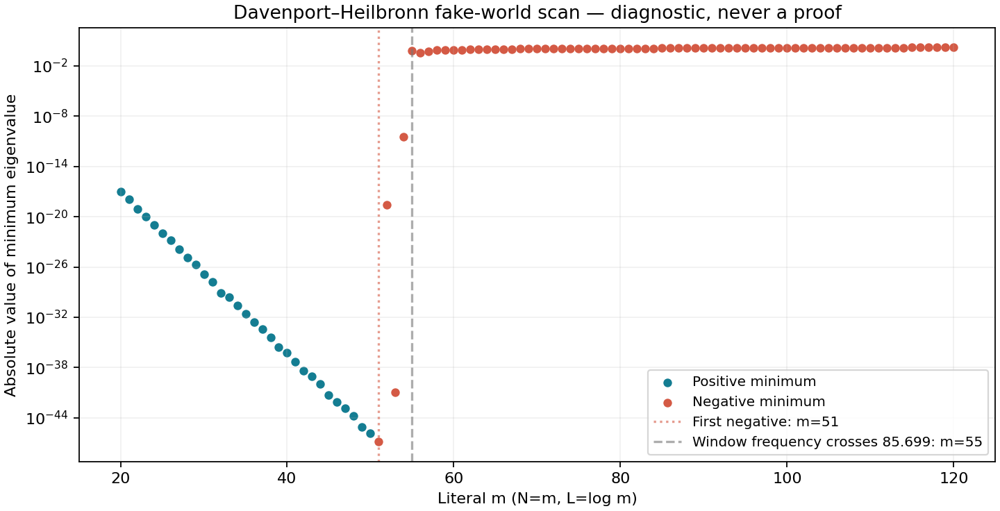

# Davenport–Heilbronn fake-world discriminator

DIAGNOSTIC_NEVER_A_PROOF

Source base: rh_clean @ 83067b249d78ef95830414b112ab42bfdbf5ad81. Literal even carriers N=m, L=log m. The matrix scan includes every integer20..120;2..19 are supplementary float observations only.

## Result

The first negative minimum in the requested integer range is **m=51**, lambda_min=-1.326857726389061e-47. All20..50 are positive in the high-precision calculations. The onset is confirmed with80/120dps eigenvalues and160dps LDL inertia; it is not an interval certificate. The very small signs would be lost in float64.

The first known off-line height is85.6993484853776. The window frequency Omega=2pi m/log m crosses it at m55, after the first negative level at51. A Fourier window frequency is not a hard detection threshold: zero-extended carrier transforms have tails. Literal finite carriers at successive m are not nested, so their minima need not be monotone.

|m|Omega|lambda_min|precision (dps)|
|---:|---:|---:|---|
|20|41.94757564|1.06010509775e-17|120|
|40|68.13109927|5.53665648298e-37|120|
|50|80.30608842|1.48626585616e-46|120|
|51|81.49965960|-1.32685772639e-47|120|
|52|82.68931487|-2.81928866755e-19|120|
|53|83.87514786|-1.18369280749e-41|120|
|54|85.05724832|-3.5529393754e-11|120|
|55|86.23570238|-0.663920646081|120|
|60|92.07606070|-0.834261455029|120|
|80|114.70829972|-1.24068701235|120|
|100|136.43763538|-1.42525737668|120|
|120|157.49003390|-1.58825368804|120|

All101 requested minima are in spectrum.csv. For20..54 use multiprecision values; for later cells the negative minima are large and resolved in the float scan, with multiprecision representative cross-checks. Raw counts of extremely small negative levels at m100/120 vary with precision; no claim is made about those individual signs. The minimum itself is stable.

## The correct fake-world form

The standard periodic coefficients are a(n)=(1,tau,-tau,-1,0) mod5, tau=(sqrt(10-2sqrt5)-2)/(sqrt5-1). The completed entire function is (5/pi)^((s+1)/2) Gamma((s+1)/2) D(s), with root number+1. The constant overall completion factor is immaterial.

Log-derivative coefficients satisfy b_n=a_n log n-sum_{d|n,1<d<n} b_d a_(n/d). Every n is retained, not just prime powers; for example b_6=(1+tau²)log6. The physical matrix is

K_ij=c_D delta_ij + integral_0^L j_D(s)(2delta_ij-Q_ij(s))ds +2delta_ij integral_L^infinity j_D(s)ds -sum_{2<=n<m} b_n/sqrt(n) Q_ij(log n),

where j_D(s)=exp(-3s/2)/(1-exp(-2s)), c_D=log(5/pi)+psi(3/4). The archimedean tail is atanh(exp(-L/2))-atan(exp(-L/2)); the birth atom n=m has exactly zero weight. There is no pole rank-one matrix. NORMALIZATION_DH.md gives the independent derivation and primary reference, [Bombieri–Ghosh2011, §5.1](https://www.mathnet.ru/php/getFT.phtml?jrnid=rm&option_lang=eng&paperid=9410&what=fullteng). The classical low off-line zeros are documented in [Balanzario–Sánchez-Ortiz2007](https://doi.org/10.1090/S0025-5718-07-01999-0).

## Quiet spaces and capacity

The full survey uses kappa=1,1.02,...,1.40 for every m20..120:2121 cells. quiet_float.csv explicitly flags unresolved singular values and kernels; these are not treated as measurements. Representative m20,40,60,80,100,120 are recomputed at100dps for kappa1,1.1,1.2,1.4 using saved multiprecision matrices. quiet_high_precision.csv retains the source-coordinate precision warning for exceptionally tiny singular values. Specifically, m120 at kappa1.2 and1.4 is flagged: do not interpret those raw capacity numbers as resolved. Both spaces have dimension zero; all six nontrivial kappa1.1 samples are resolved at the stated diagnostic precision.

The matrix E evaluates at all DH zeros below T, including both members of each positive-height reflected off-line pair. For v=a+ib and conjugate(v), rows sqrt2 a,sqrt2 b are an isometric realification: they preserve E*E and its singular values. The real quiet space imposes both constraints, not merely evaluation at the real ordinate. Rank is min(q,m+1), with distinct rational interpolation nodes and no automatic sinc zero in these cells; no numerical rank cutoff is substituted. U is the orthonormal complement of ker(E), so nonzero singular values of E equal those of F=EU.

At kappa1.1 the rank/residual/capacity tradeoff is:

|m|rank|dim J|full residual δ|sigma_min(F)|sigma_min(F)^2|N_A(1.000001 delta)-dim J|
|---:|---:|---:|---:|---:|---:|---:|
|20|19|2|4.31824292e-05|8.29646073e-05|6.88312607e-09|1|
|40|37|4|1.82437806e-07|9.89367011e-11|9.78847083e-21|2|
|60|55|6|1.16262153e-09|9.10187786e-16|8.28441806e-31|4|
|80|73|8|1.07855923e-11|1.00109976e-20|1.00220073e-40|6|
|100|91|10|1.1168886e-13|4.76948054e-25|2.27479446e-49|7|
|120|108|13|6.85316657e-14|1.48455523e-27|2.20390422e-54|8|

Thus quiet residuals can be small in this false world, while capacity becomes extremely small and the signed count at the residual threshold does not saturate in these representative sectors. Even the pre-onset sectors m20/40 have excess counts here; the excess cannot be read as exactly one per off-line pair from this table.

At kappa1 the representative capacities are of order0.1, but the full residuals are of order1. Increasing kappa to1.2 or1.4 fills the entire carrier in these six examples: J={0}. Its zero residual is vacuous, not a successful quiet-space supplier. The higher DH zero density also reflects conductor5; that rank difference alone is not an Euler-product discriminator.

## Which implication changes

For an off-line quartet with evaluation row v=a+ib, its full Weil contribution is4(a^T a-b^T b), whereas twice the positive-height capacity Gram contributes4(a^T a+b^T b). Their difference is exactly **-8 b^T b**. Consequently a positive lower singular value of F does not provide the old positive zero-side coercivity bound for A_DH. The capacity remains a positive interpolation quantity, while the zero-side metric becomes indefinite. Quiet interpolation itself survives; count saturation and positive complement coercivity do not follow from it.

The saved signed-zero comparisons use only zeros below T. A-minus-truncated-zero-form norms are diagnostic truncation errors, not bounds on the omitted zero tail. No RH or NOESCAPE theorem follows from these finite scans.

## Numerical validation and reproduction

The zero list contains146 critical-line zeros and four off-line reflected pairs below230,154 upper-half-plane zeros total. Two narrow-rectangle winding meshes and a wider[-1,2] count agree with154; the low-height strip count is0. The exterior zero-free comparison uses |D(s)-1|<=zeta(2)-1<1 at Re(s)>=2 and functional reflection. Counts and roots are numerical, not interval-certified; see dh_zeros.json. Maximum direct root residual is about8.1e-79.

12 matrix precision comparisons (80/96 versus120/128) agree in their minimum eigenvalues, maximum relative change2.78e-34. All onset-range inertia checks use160dps/GL128. quiet_source_validation.json compares fixed-Q residuals and positive-threshold count margins between the80 and120dps source matrices; it does not certify zero locations.

Extract float_matrices.zip, onset_matrices.zip and large_matrices.zip into this directory to restore matrix_cells/. MATRIX_SHA256SUMS covers all208 archived files. dh_matrix.py reproduces source matrices and spectra; dh_zeros.py the zero census; dh_quiet_float.py the all-m survey; dh_quiet.py the multiprecision samples; summarize.py the joined report tables. Raw quiet JSONs retain Q and singular data. SHA256SUMS covers published artifacts.
