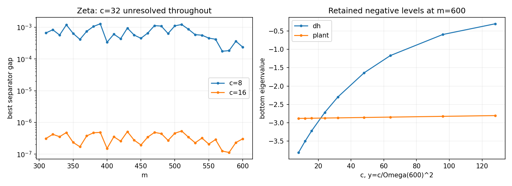

# Soft Gaussian height in literal even CCM windows

**DIAGNOSTIC_NEVER_A_PROOF. Route B CHALLENGER / NOT_RH.**
Base `rh_clean @ 50777d478c72298ff65c7ffaa2b3783aec183dd6`.

The Gaussian removes the resolved intermittency on this finite ζ grid at
c8 and c16, but compresses the absolute gap. Stronger smoothing c32 leaves
all gaps unresolved at the chosen numerical floor. DH and the plant retain
resolved negative levels. This is a finite-census diagnostic, not a positivity
certificate for the full Weil source or a claim about unlisted zeros.

## Definition and important distinction

We use multiplier exp(−yz²), y=c/Omega(m)², Omega=2pi m/logm, c8,16,32.
Its physical heat kernel has variance2y. All supplied zeros enter the matrix;
none is removed at T. The original source matrix itself had no sharp T cutoff:
T selected the quiet subspace. A nonzero Gaussian has no exact finite quiet
nullspace, so we retain those T-indexed spaces as **auxiliary test spaces**.
For each smoothed matrix we scan every nontrivial kappa>=1 sector using the
original zero-based separator lambda_r−||A_y Q||, r=dimJ. Thus this answers
the soft-source separator comparison without inventing a Gaussian nullspace.

|Gaussian c|resolved positive gaps|unresolved|best-gap range|
|---:|---:|---:|---:|
|8|30/30|0|1.757e−4 to1.289e−3|
|16|30/30|0|1.127e−7 to5.367e−7|
|32|0|30/30|within the numerical floor|

The pinned sharp calculation had14 resolved separators and16 unresolved
cells. These are absolute gaps for different operators; smoothing improves
finite-grid coverage while reducing their numerical scale.

SUMMARY.csv contains every requested m310,320,…,600 and all three c, together
with the unsmoothed separator readback. Complete evaluated/pruned sectors,
all point inputs and precision repeats are restored from the lossless archive.
No unresolved gap is represented as an exact zero or a proved failure.

## Negative controls and complex phase

DH and plant are tested at310,450,600 for all three separator settings, with
additional negative-level sweeps c8,12,16,24,32,48,64,96,128.

At m600:

|world|bottom at c8|bottom at c32|bottom at c128|
|---|---:|---:|---:|
|DH|−3.811536|−2.297686|−0.302981|
|plant|−2.882753|−2.867874|−2.805945|

Relative to c8, the whole bottom level follows the first-quartet scalar
factor exp[−(y−y8)(gamma²−beta²)] to at most1.13% for DH and0.323% for the
plant across these sweeps. NEGATIVE_SWEEP.csv retains the mismatch and the
fixed-c8-vector values. This approximate whole-matrix relation is not an
identity: the phase changes the negative direction, and all other zeros remain.

For z=gamma+i beta, the **complex** factor is

    exp(-yz²) = exp[-y(gamma²−beta²)] exp[-2iy gamma beta].

The DH first quartet uses gamma85.6993484854,beta0.308517182457; the plant
uses gamma2pi/log2,beta1/4. Independent80-digit physical Gaussian integrals
at four scaled heights reproduce the predicted amplitude AND phase to less
than1.9e−78 relative error. Single-quartet and full-matrix minima are separate
raw receipts. An isolated nondegenerate quartet keeps one negative direction
for every finite y; tiny computed levels cannot establish a sign crossing.

## Controls and limits

- 768-bit MPFR physical-row frames;1024-bit repeats at600 in all three worlds.
- Carrier evaluations independently recomputed at80 digits at310/600. Largest
  observed operator discrepancy is0.126 of the original roundoff budget;
  no endpoint-only check is asserted to bound every interior cell.
- The original archimedean, signed-arithmetic and pole source is independently
  heat-convolved for60 selected entries, including frequencies near the edge
  and arithmetic n>m. Maximum sampled discrepancy is2.70e−10. These are
  normalization/entry checks, not an operator certificate or positivity proof.
- Full/750/850 zero-census comparisons are retained. At600,c8, the850-prefix
  difference is1.60e−9 forζ/plant and1.98e−9 forDH. The gap heuristic reserves
  twice [roundoff budget + four times that observed prefix difference].
  This does not bound unseen zeros beyond the supplied census.
- Source quadrature estimates exclude the omitted s<1e−7 interval and finite
  arithmetic/census tails. All guards remain empirical, not interval bounds.
- Independent bounded read-only review found the normalization correct and
  required the doubled gap budget and these scope qualifications.

The positivity of the finite critical-line ζ sum is algebraic. It cannot be
used as independent evidence of RH. Source spot checks support normalization
and finite-head agreement, without certifying the full source remainder.

See METHOD.md for all conventions, HYPOTHESES.md for evidence/falsifiers and
the proposed source-side consumer, REVIEW.md for review qualifications,
REPRODUCE.md for commands, and SHA256SUMS for committed-byte verification.
No route-state or RH export was changed.
