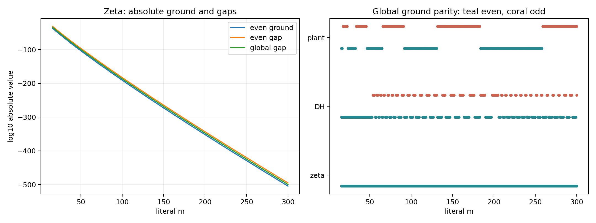
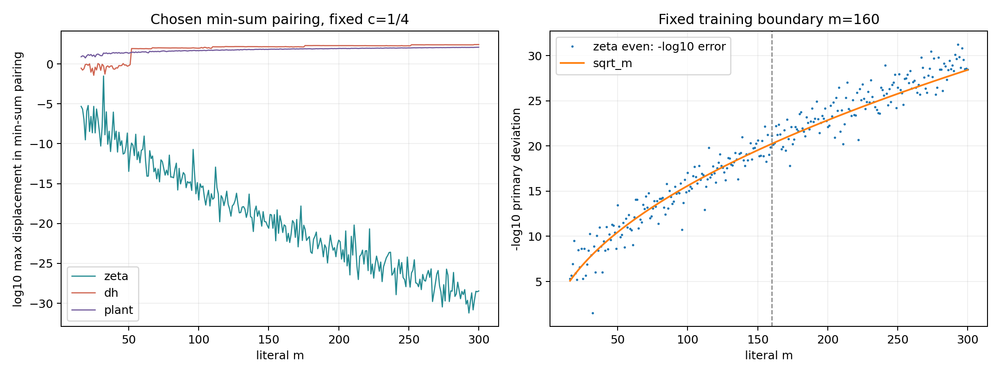

# Ground simplicity, parity and Fourier zeros: literal m16..300

**DIAGNOSTIC_NEVER_A_PROOF. Separate lane from D0; no route-state or RH export.**

All 285 integer windows, N=m and L=log m, have been computed in zeta, DH and the planted world: 855 world/window cells. Both parity blocks are compared. Source pin: 50777d478c72298ff65c7ffaa2b3783aec183dd6. Later concurrent branch history is preserved.

Primary cutoff is T=(1+(1+log L)/(4L))*2pi m/L, with fixed c=1/4. Controls at Omega=2pi m/L and 0.8Omega are retained in roots/summary.csv. The even restricted ground and actual full ground are distinct columns; all numerical accuracy/source caveats are in NORMALIZATION.md and the worker methods.

## Simplicity and parity

|world|cells|global parity counts|first global odd m|first negative even m|
|---|---:|---|---:|---:|
|zeta|285|{'even': 285}|None|None|
|dh|285|{'even': 184, 'odd': 101}|54|51|
|plant|285|{'even': 146, 'odd': 139}|18|16|

The finite zeta grounds are numerically isolated and even. DH first has a negative even ground at m=51, before its first odd global winner at m=54; the plant first has an odd global winner at m=18. Thus a simple even finite ground can already be negative in the DH control. A sign at m=16..300 is not a cofinal theorem.

|zeta m|lambda_even0|even gap|full gap|
|---:|---:|---:|---:|
|16|5.456138e-38|4.733413e-32|6.8472611e-35|
|24|2.6905128e-54|4.2761989e-48|4.5432011e-51|
|40|2.981177e-85|2.064999e-78|1.1421988e-81|
|80|3.4801216e-157|1.7223115e-149|3.3390508e-153|
|160|1.4321961e-289|4.2684459e-281|3.2374383e-285|
|300|2.4525376e-505|5.9320244e-496|1.6597068e-500|

The full gap merges the two ordered low pairs; for the zeta m=300 pilot the next state is odd. Absolute gaps are extremely small even though their separation from the arithmetic error floor and their ratios to the ground are large. For macroscopic control minima, the sign or vector of a near-zero second level may remain unresolved while its gap from the ground is resolved; signed-second-level flags are preserved.

## Counts and displacement of zeros

Numerator roots are found without source-zero seeds. Every transform also has exact external harmonic zeros, which must not be counted as recovered zeta zeros. Assignment count and close-match count are different. The table gives the complete physical-strip count, its numerator/forced split, and maximum displacement within the chosen minimum-total-Euclidean-distance one-to-one assignment. With unequal control censuses, tied sums can give different maxima; these maxima are not optimal bottleneck distances.

|zeta m|source zeros|numerator roots below T|forced external|full transform|close source matches <1e-6|max numerator displacement|
|---:|---:|---:|---:|---:|---:|---:|
|16|7|7|2|9|6|4.7893981e-6|
|24|11|11|4|15|11|2.3259934e-9|
|40|20|20|6|26|20|3.3818349e-10|
|80|43|43|11|54|43|6.5481333e-15|
|160|92|92|20|112|92|7.3817557e-22|
|300|183|183|36|219|183|3.4626781e-29|

At the 1e-6 close-match threshold, the incomplete zeta windows are [16, 17, 20, 21, 25, 27, 32]. The largest early displacement is 0.030560108 at m=32. Every tested m from 33 through 300 has all source points matched within 1e-6. Count equality alone does not imply exact or tolerance-close locations.

For zeta the observed finite count identity is `full FT count = source count + forced external count`; numerator/source counts agree on this grid. This is a reported finite observation, not an exact identity between the source and ground transforms. All individual counts, near misses, one-to-one pairings, and both-side unmatched-under-tolerance counts are retained.

|m300 actual global ground|parity|source points|non-real source points|FT strip roots|non-real FT strip roots|unrecovered source <1e-6|max in chosen min-sum pairing|
|---|---|---:|---:|---:|---:|---:|---:|
|zeta|even|183|0|219|0|0|3.4626781e-29|
|dh|odd|276|16|335|0|276|270.10434|
|plant|odd|185|2|335|0|185|124.67388|

|m|DH min-sum max|DH min-sum max/T|plant min-sum max|plant min-sum max/T|
|---:|---:|---:|---:|---:|
|16|0.29472672|0.0068761184|7.9507503|0.18549489|
|40|0.21834801|0.0027717744|23.23559|0.29495947|
|80|99.434473|0.75949544|39.624216|0.30265571|
|160|142.35932|0.6364107|68.356408|0.30558414|
|300|270.10434|0.7296575|124.67388|0.33679292|

CONTROL_SCALING.csv retains both controls at every integer m, including the close-match fraction. These are finite displacement curves; no asymptotic law is inferred for the controls.

Tie-independent control: for every source point, take its nearest candidate below T. This comparison permits shared candidates and is not an injective matching. Numerator-only and full-transform errors differ because the latter includes the forced harmonic lattice. NEAREST_SOURCE.csv retains every physical case at 200 dps.

|m|DH nearest numerator max|DH nearest full-transform max|plant nearest numerator max|plant nearest full-transform max|
|---:|---:|---:|---:|---:|
|16|4.4973714|1.0695989|4.3778671|0.93888305|
|40|4.2239907|0.73809079|9.3246564|0.7604815|
|80|5.1260003|0.57936012|15.218427|0.53186702|
|160|24.758828|0.60391509|23.423314|0.54228719|
|300|38.591791|0.53056361|39.936848|0.53718998|

At m=300 the nearest-candidate source-close counts at 1e-6 are 183/183 for zeta, 0/276 for DH and 0/185 for the plant, including the full harmonic lattice. The zero close counts in these controls therefore do not result from a tied assignment.

|world|first even pure-imaginary root m|first global pure-imaginary root m|global cells with non-real positive-height strip roots|
|---|---:|---:|---:|
|zeta|None|None|0|
|dh|54|None|0|
|plant|18|None|0|

No off-axis numerator roots were found anywhere in these complete finite polynomials, for either the restricted even or actual global grounds. The non-real exceptions in the controls are pure-imaginary axis roots. Consequently the physical-strip restriction does not conceal extra positive-height off-axis roots below T.

The first non-real DH source pair enters the primary cutoff at m=46. This differs from the first negative even minimum and the first odd global winner. Source densities differ between worlds; the raw count alone is not a density-matched discriminator.

Exploratory axis/parity check, seeded by the first DH/plant transitions: mismatch cells between even pure-imaginary-root presence and an odd global winner are {'zeta': [], 'dh': [], 'plant': []}. See CARD_AXIS_PARITY.md; this is a finite geometric check shared with controls, not an arithmetic conclusion.

The DH reference is its numerical census to 900; the m300 primary cutoff is only 370.179625... and contains 8 off-line quartets (16 positive-height non-real points). The plant contains its fixed two non-real positive-height points. These can be missing from the ground transform even when its own strip zeros are all real. Non-real ground-transform zeros therefore need not appear as copies of non-real source zeros.

Pure-imaginary numerator roots have height zero and are listed separately from positive-height strip roots. They occur in the controls, for example in their m300 even restricted grounds; they are not the missing source quartets. Off-axis/far-strip and pure-imaginary counts remain in the CSV instead of being silently called real.

## How the deviation scales

The preregistered candidate was -log10(d)=a*m/(log m)^2+b. Five fixed regressors were trained on m=40..160 and evaluated on held-out m=161..300, using actual root precision repeats and excluding arithmetic/reference floors. Threshold entry produces oscillations; pointwise monotonicity was not assumed.

|regressor|training RMSE, decades|held-out RMSE, decades|held-out maximum error, decades|
|---|---:|---:|---:|
|sqrt_m|1.1919|1.4539|3.6554|
|m_over_log_m_squared|1.1862|1.4711|4.4738|
|m_over_log_m|1.1882|1.8621|4.9704|
|log_m_squared|1.2169|2.3653|5.3018|
|m|1.1961|2.6278|5.6828|

Additional exploratory check, registered after an early validation peek: add the last included source zero depth, phi=(T-gamma_last)/(2pi/L). The untouched test tail is m=261..299, excluding pilot m=300. This is not a second independent preregistered result.

|modifier|baseline tail RMSE|with phase tail RMSE|
|---|---:|---:|
|m_over_log_m_squared plus edge_phase|1.5336|1.4044|
|sqrt_m plus edge_phase|1.5218|1.2914|

Best of these finite held-out comparisons: `sqrt_m`. Exact coefficients and all residuals are in SCALING.csv. This does not identify an asymptotic law or supply a uniform error bound.

## Precision and independent controls

The actual m300 even ground is about 2.45e-505, so an arbitrary double-precision near-null vector is inadequate. Analytic source assembly was independently checked against both parity quadrature formulas and the pinned MPFR source. An additional m=300, 2400-bit, 8-panel GL768 quadrature regression checks all worlds and both parity blocks: actual 2184-bit point entries differ by at most 2.631e-657; the higher-precision analytic comparison differs by at most 2.462e-700. These are numerical source regressions, not outward-rounded operator bounds.

Native ordered HIGH low pairs, residuals, source precision repeats and distinct LOW-vector root replays are retained. Some later LOW controls may use a reviewed shifted refinement with explicit source-perturbation gates, without replacing HIGH ordering; unavailable LOW second pairs are not fabricated. Some zeta root censuses use reviewed continuation plus complete sign-bracket/degree checks, with a full Flint fallback. The source and root methods, per-cell hashes, fallback records and review bindings remain explicit.

Selected full LOW/HIGH polynomial censuses through m300 agree. The zeta m300 primary roots move by at most 5.061e-147 between independently computed vectors, far below the observed 3.463e-29 source displacement. The separate sign-bracket degree checks certify the rounded LOW polynomial roots only; they do not certify the unknown exact eigenvector or RH. Generic L2 Fourier-error bounds are much looser and remain separately labelled.

The constant carrier control has zero source matches at 1e-6 in all 54 selected world/window/cutoff tests. Thus the close zeta recovery is not explained by the structural lattice alone. The far numerator-root tail and its universal finite Vieta/boundary-curvature check are documented in CARD_FAR_NUMERATOR_ROOTS.md and BOUNDARY_ROOTS.csv.

All scalar data: GAPS.csv and ZERO_SUMMARY.csv; all odd-winner m ranges: ODD_RANGES.csv; full precision/raw vectors and roots: the lossless publication archive. Restore before numerical replay, then follow the spectra/ and roots/ methods. The archive manifest and SHA256 inventories verify bytes; independent final review is under review/. No D0 state, cofinal conclusion, or RH claim is changed.
