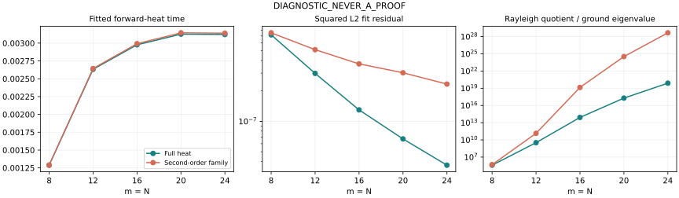

# Heat-temperature canary

**DIAGNOSTIC_NEVER_A_PROOF**

Source: rh_clean @ 167dff63a632f170fed2d01d88af61268ad0af7f. Literal even CCM, N=m, L=log m. Existing m12,16,20,24 matrices and eigenvectors are used unchanged; the missing m8 cell is regenerated using the same committed matrix builder. Every ground vector is normalized and its sign satisfies <f,P_m h> > 0.

## Result

Forward heat gives a much closer L2 fit than the undiffused theta profile in all five cells. The fitted heat time rises from m8 through m20, then decreases slightly at m24. It is neither increasing nor decreasing on the whole sample. No decay-to-zero law is observed: all three requested scaled quantities increase on these five cells. This finite sample does not establish a nonzero limiting temperature.

Despite the small L2 residual, the fitted heat profile is not an energy-accurate ground-state surrogate: its Rayleigh quotient exceeds lambda0 by about 3.93e5 at m8 and 7.73e19 at m24. Full-line heat preserves the Fourier zeros of h, but physical support truncation and finite modal projection do not preserve the full-line radical identity.

## Objective and projection

Set g_s=exp(s partial_x^2)h, v_m(s)=P_m g_s, s>=0. We minimize

    ||f-c v_m(s)||^2,  c=<f,v_m(s)>/||v_m(s)||^2,
    w(s)=|<f,v_m(s)>|^2/||v_m(s)||^2,
    residual^2=1-w(s).

This fits normalized directions with a free least-squares amplitude; it does not minimize energy. Negative s is excluded: the stipulated Fourier multiplier exp(-s t^2)H(t) is not integrable for negative s, so it does not define the same full-line heat family. The quadratic comparison uses the same s>=0 domain.

Fourier convention: hat g(t)=integral g(x)exp(-itx)dx. H(t)=4 xi(1/2-it). The even normalized theta profile is

    h(x)=sum_{n>=1}(16 pi^2 n^4 exp(9x/2)-24 pi n^2 exp(5x/2)) exp(-pi n^2 exp(2x)), x>=0.

For b=L/2, omega_n=2 pi n/L, d_0=1 and d_n=sqrt(2) otherwise, the physical basis is

    psi_n(x)=d_n (-1)^n cos(omega_n x)/sqrt(L), |x|<=b; zero outside.

Its transform B_n(t) is evaluated with the finite sinc formula, including removable values. Projection coefficients are

    (v_m(s))_n = (1/pi) integral_0^infinity H(t) exp(-s t^2) B_n(t) dt.

Thus full-line heat is applied before support/modal projection. Multiplying the pre-existing discrete modal coefficients by exp(-s omega_n^2) would describe a different object and is not used.

## Full heat fit

|m|s*|residual squared|w(s*)|w0|
|---:|---:|---:|---:|---:|
|8|0.00128776347202|7.189235578e-07|0.999999281076|0.999688977707|
|12|0.00263324640352|2.984208162e-07|0.999999701579|0.998761974682|
|16|0.00297643228241|1.297995825e-07|0.999999870200|0.998437510548|
|20|0.00312608466988|6.695949059e-08|0.999999933041|0.998285622241|
|24|0.00312092891172|3.677682874e-08|0.999999963223|0.998291252100|

## Second-order comparison

v_m^(2)(s)=P_m(h+s h''+(s^2/2)h^(4)) uses the physical derivative projections in the committed ladder data, rather than periodic derivatives of P_m h.

|m|s* (quadratic)|residual squared|w(s*)|w0|
|---:|---:|---:|---:|---:|
|8|0.00128888330088|7.526009577e-07|0.999999247399|0.999688977707|
|12|0.00264391546399|5.123869921e-07|0.999999487613|0.998761974682|
|16|0.00299214574867|3.706841233e-07|0.999999629316|0.998437510548|
|20|0.0031444499886|3.025429717e-07|0.999999697457|0.998285622241|
|24|0.00313932089872|2.338076829e-07|0.999999766192|0.998291252100|

The full heat fit is better in every cell. At m24 the squared residual is about 6.36 times smaller than the quadratic family's. The fitted s values remain close, but the truncation error matters at this residual scale.

## Scaling

|family|m|s* m|s* log m|s* m^2|
|---|---:|---:|---:|---:|
|heat|8|0.01030210778|0.00267782886|0.08241686221|
|heat|12|0.03159895684|0.006543371499|0.3791874821|
|heat|16|0.04762291652|0.008252422579|0.7619666643|
|heat|20|0.0625216934|0.009364912735|1.250433868|
|heat|24|0.07490229388|0.009918480082|1.797655053|
|quadratic|8|0.01031106641|0.002680157478|0.08248853126|
|quadratic|12|0.03172698557|0.006569883118|0.3807238268|
|quadratic|16|0.04787433198|0.008295989558|0.7659893117|
|quadratic|20|0.06288899977|0.009419930313|1.257779995|
|quadratic|24|0.07534370157|0.009976930807|1.808248838|

Both families rise to m20 and dip at m24. For full heat the final decrease is approximately 5.156e-6 (0.165%); the accuracy checks resolve this change. None of the three scaled columns is approximately constant across the five cells, so these data do not support 1/m, 1/log m, or 1/m^2 decay.

## Energy check

Energy is evaluated with the literal committed A_m, at the L2-fit minimizer:

    E(s*)=v(s*)^T A_m v(s*) / (v(s*)^T v(s*)).

|m|lambda0|E, full heat|E/lambda0, full heat|E, quadratic|E/lambda0, quadratic|
|---:|---:|---:|---:|---:|---:|
|8|1.02392587e-19|4.02366562e-14|3.92964543e+05|4.95206257e-14|4.83634871e+05|
|12|6.79042670e-29|2.22774356e-19|3.28071218e+09|9.42274480e-18|1.38765135e+11|
|16|5.45613801e-38|4.50856169e-24|8.26328381e+13|7.62210951e-19|1.39697887e+19|
|20|2.58446523e-46|4.99069430e-29|1.93103557e+17|8.62339928e-22|3.33662809e+24|
|24|2.69051281e-54|2.07919176e-34|7.72786418e+19|1.23513868e-25|4.59071845e+28|



## Search and validation

- Main calculation: mpmath 100 dps, composite Gauss-Legendre order40, panels of width4, Fourier cutoff256. The initial L2 search uses float64 only to locate candidate basins: dense spacing1e-4 on [0,.02], plus 161 logarithmic points between1e-7 and100 and s=0. Final stationary points, projections, residuals and energies are recomputed with mpmath; float64 does not supply the energy.
- The saved scan finds one minimizing basin for each family. Heat search is numerical, not an interval-certified uniqueness or global-minimum proof. The separate large-s bound in heat_review.md excludes s>=1 from improving even the baseline for all five cells, using the positive theta profile; its numerical inputs are not interval certified.
- For the quadratic family, finalize.py independently enumerates the quartic stationarity polynomial roots, compares all nonnegative real candidates, s=0, and the s->infinity direction h^(4). Zeros of <f,v(s)> have w=0 and cannot beat the selected fit. See polynomial_global_check.json.
- At s=0, spectral projection agrees with the independent physical h projections to relative1.26e-85 or better, and its s-derivative agrees with the h'' projections to4.80e-82 or better across all five cells.
- The fitted-s Fourier tail has the explicit coefficient-vector bound sqrt(m+1) H(0) sqrt(L) exp(-s T^2)/(2 pi s T), using positivity of h and |B_n|<=sqrt(L). The induced Rayleigh error is bounded by 4 ||A_m||_F times this bound divided by ||v||. Values are in fourier_tail_bounds.csv; these cover truncation only, not quadrature error.
- Independent enlarged calculation: 140 dps, GL56, cutoff320, and 140-dps source matrices/eigenvectors at m8 and m24. At m24, heat s* changes by2.87e-54, the projected vector by4.45e-53 relatively, and energy by1.60e-50 relatively. m8 agrees at all saved80 significant digits; reported zero differences mean agreement at saved precision, not exact equality.
- The m8 matrix/eigenvector generation is independently checked at100dps/GL128 and140dps/GL160. Relative ground-eigenvalue difference is2.08e-81. See core_m8_validation.json.
- Independent formula review checks the 1/pi coefficient normalization and the large-s exclusion. No interval certificate, RH conclusion, NOESCAPE estimate, or Perelman W monotonicity theorem follows from this canary.

## Files and reproduction

fits.csv is the compact table; main_results.json additionally saves fitted projected vectors, amplitudes, and source SHA256 values. scan.csv contains the preliminary float64 search. validation_results.json and validation_comparison.csv record the enlarged run. SHA256SUMS covers all delivered files except itself.

From this directory:

```sh
uv run --with mpmath python3 m8_core.py 100 128
uv run --with mpmath python3 m8_core.py 140 160
uv run --with mpmath python3 m8_core.py validate
uv run --with mpmath --with numpy --with scipy python3 heat_fit.py
uv run --with mpmath --with numpy --with scipy python3 heat_fit.py --dps 140 --order 56 --T 320 --ms 8 24 --high-source --tag validation
uv run --with mpmath --with numpy --with scipy python3 finalize.py
uv run --with mpmath python3 heat_review.py
uv run --with matplotlib python3 plot.py
```

The spectral quadrature cache is disposable under /tmp and excluded from the commit. Matrix/ladder helpers remain in the parent directory at the source commit. The fitted temperature is a finite diagnostic parameter, not a proved geometric flow quantity.
