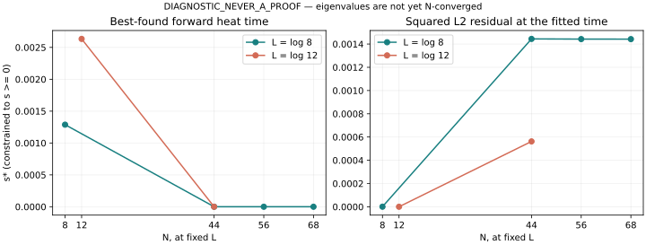

# Fixed-window heat-fit resolution canary

**DIAGNOSTIC_NEVER_A_PROOF.**

The best candidates found for all four higher-resolution cells are the forward-domain boundary s=0. Thus forward heat provides no improvement over the unheated theta profile in this scan. The one-sided overlap derivative is strictly negative at that boundary, so a zero stationary derivative is neither expected nor required.

|window m|N|s*|W(0)=W*|Residual squared|W'(0)|E/lambda0|
|---:|---:|---:|---:|---:|---:|---:|
|8|44|0|0.998555907367|0.00144409263285|-1.06094430324|5.9070087e+16|
|8|56|0|0.998557512094|0.00144248790584|-1.06035658897|6.7051112e+16|
|8|68|0|0.99855778034|0.00144221966036|-1.06025832461|7.0172651e+16|
|12|44|0|0.999437782206|0.000562217794374|-0.662615099427|6.6577912e+25|

The literal schedules had positive best-fit temperatures: s8=0.001287763472... and s12=0.002633246404.... Increasing N at fixed L changes the best-found constrained fit to s=0 in these cells. This establishes a finite resolution sensitivity of the positive-temperature interpretation; it does not establish a limiting temperature or a general plateau-artifact theorem.

For log8, lambda44/lambda56=1.1594461639119 and lambda56/lambda68=1.0613429025344. The bottom eigenvalues are still changing substantially. A repeated boundary value s=0 is not a convergence certificate.

At s=0 the Rayleigh energy is the baseline projected-theta energy, not an improved fitted energy. It remains many orders above lambda0. Small L2 residuals therefore do not provide the missing spectral/energy bound.

All lengths are L=log(window_m), independent of N; only modes change. The active prime sum retains every prime power with log(k)<L. No high-resolution N is substituted into the window or prime cutoff.

Primary calculations: 140 dps, eight-panel matrix GL128, spectral GL56 in width4 panels through T320. One-cell validation (log8,N68): 160 dps, matrix GL160, spectral GL64 through T320. No interval arithmetic is used. Full validation deltas are in validation.json. The common Fourier cutoff is additionally checked by comparing zero-time spectral projection to physical theta projection.

curve_probes.csv contains high-precision W(s) and derivatives at s=0,0.0001,0.001,0.003,0.01. boundary_conditions.csv records W'(0)<0 and residual'(0)>0. grid.csv contains the complete float64 candidate-search grid; it is not a certificate.

The analytic large-time bound from ../heat_review.md is evaluated for each target and excludes all s>=1 from beating the baseline. The compact search in [0,1] is best-found, not an exhaustive interval proof of global optimality. No negative heat time is evaluated.

Raw main_results.json preserves the generic field name stationary_residual from the fitter; at s=0 this is the nonzero gradient numerator, not a failed stationarity test. fits.csv gives its correct boundary/KKT interpretation.

Provenance and all ground/heat/residual coefficients are in main_results.json and validation_results.json. Matrix construction is replayable from matrix_core.py; heat projection uses the parent full-line heat_fit.py.

Replay:
```bash
uv run --with mpmath --with numpy --with scipy resolution_fit.py
uv run --with mpmath --with numpy --with scipy resolution_fit.py --dps 160 --matrix-order 160 --spectral-order 64 --validation
uv run --with mpmath --with numpy --with scipy boundary_checks.py
uv run --with mpmath finalize.py
```



The completed literal heat canary is in [the parent report](../RESULT.md), committed at c1a3b84b3ef358b9dc259829976b28fe9e49e4ba. The separate [zero-height scan and literature check](../../ladder_limit/identify/zero_height/RESULT.md) are delivered alongside this resolution test. Negative s is not part of the full-line heat family used here: exp(-s t^2) H(t) is nonintegrable for s<0.
