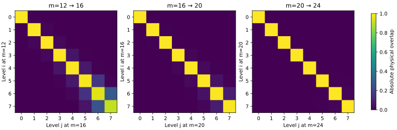
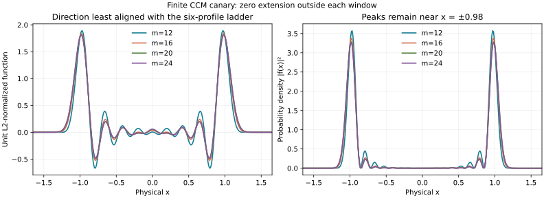

# Limiting-ladder canary — NOESCAPE Q4

**DIAGNOSTIC_NEVER_A_PROOF.** These four cells show physical stabilization; they do not establish an asymptotic limit or a cofinal NOESCAPE bound.

Source: `rh_clean @ 211bba33b9584a6fb81df1bab421d364018e54d7`, parent lowcluster data. All parent SHA256SUMS entries were checked before computation. Source file digests are also recorded in limit.json.

## Physical functions and normalization

For $L=\log m$, $b=L/2$, the reconstructed function is

$$v_i^{(m)}(x)=\mathbf1_{[-b,b]}(x)\sum_{n=0}^m V_{ni}^{(m)}\frac{d_n(-1)^n}{\sqrt L}\cos(2\pi n x/L),\qquad d_0=1,\ d_n=\sqrt2\ (n>0).$$

Each column retains its original unit L2(R) normalization. No rescaling to a common window is performed. Physical coefficients and common-x samples for all 32 vectors are in physical_cluster_coefficients.csv and physical_cluster_samples.csv.

For two windows, the basis inner product is integrated on $[-c,c]$, $c=\min(L,L^{\prime})/2$, using

$$\langle e_n^{L},e_j^{L^{\prime}}\rangle=\frac{d_nd_j(-1)^{n+j}c}{\sqrt{LL^{\prime}}}\{\operatorname{sinc}[(\omega_n-\omega_j^{\prime})c]+\operatorname{sinc}[(\omega_n+\omega_j^{\prime})c]\},\quad\operatorname{sinc}z=\sin z/z.$$

Thus every comparison uses physical L2(R) inner products, not dot products of coefficient arrays from different windows.

## Consecutive cluster Gram matrices

The complete signed and absolute 8x8 cross-Gram matrices are in physical_gram_consecutive.csv. All unordered cell pairs, including same-cell blocks, are in physical_gram_all_pairs.csv; transposition gives the reverse pairs.

| Level i | 12→16 diagonal overlap | 16→20 | 20→24 |
|---|---|---|---|
| 0 | 0.9999904707773 | 0.9999982163646 | 0.9999999956558 |
| 1 | 0.9999172391732 | 0.9999859394406 | 0.9999999082116 |
| 2 | 0.9996911629664 | 0.9999687919876 | 0.9999996112716 |
| 3 | 0.9981717687313 | 0.9998868790681 | 0.9999971091305 |
| 4 | 0.9959718687645 | 0.9995471241438 | 0.999987946544 |
| 5 | 0.9852068148412 | 0.9984024946075 | 0.9999707418663 |
| 6 | 0.9498948490157 | 0.9950870538154 | 0.9998544064776 |
| 7 | 0.9071632420064 | 0.9900529144313 | 0.9988688689957 |

The best-matching index is j=i for every level in every consecutive comparison. All eight same-level absolute overlaps increase across these three comparisons.

Largest principal angles between the first r physical levels:

| Pair | r=4 | r=6 | r=8 |
|---|---|---|---|
| 12→16 | 3.240800055° | 9.061493284° | 19.27989534° |
| 16→20 | 0.79276765° | 2.870926627° | 6.595701543° |
| 20→24 | 0.1394054776° | 0.3717140657° | 2.686426131° |

Every principal angle for r=1..8 is in consecutive_principal_angles.csv. The declining maximum angles support stabilization of the low subspaces over these cells. Four samples cannot prove overlap→1 or angles→0 as m→infinity.



## Direction least aligned with the six-profile ladder

For each cell, Q is an orthonormal basis of the projected six-profile ladder and C=[v0,...,v5]. The direction is C times the smallest RIGHT singular vector of Q^T C. It is the cluster-side direction, not the corresponding direction inside the ladder. It has unit L2 norm and sign fixed by positive center value.

| m | angle to ladder | peak abs(x) | <x²> | mass abs(x)>0.8b | mass abs(x)>0.9b | endpoint squared |
|---|---|---|---|---|---|---|
| 12 | 88.5582427° | 0.973295057 | 0.928398852 | 0.353613725 | 0.00430373367 | 5.58377281e-7 |
| 16 | 88.8719039° | 0.981178137 | 0.965295685 | 0.0220184787 | 7.91401795e-6 | 1.53587509e-13 |
| 20 | 87.9446034° | 0.983746069 | 0.975414048 | 0.000633299339 | 8.1711054e-9 | 2.82018174e-20 |
| 24 | 87.8339599° | 0.983597365 | 0.975830372 | 1.03341832e-5 | 3.85517275e-12 | 7.03915791e-28 |

The edge collar means 0.8b<abs(x)<=b, with total length 20% of the window. The physical peaks remain near±0.98 while b grows. The density is concentrated away from the central theta bulk, but does not track the moving endpoints. Relative edge concentration falls rapidly.

| m | mass abs(x)<=0.75 | mass abs(x)<=1 | mass abs(x)<=1.25 |
|---|---|---|---|
| 12 | 0.032883887367 | 0.68565787898 | 1.0 |
| 16 | 0.014687387072 | 0.60194906526 | 0.99999347416 |
| 20 | 0.01191261352 | 0.57639085721 | 0.99997084021 |
| 24 | 0.011955627827 | 0.57544283483 | 0.99995911188 |

Consecutive physical overlaps of this least-aligned direction: 12→16: 0.988728938541, 16→20: 0.998922142226, 20→24: 0.999981857101.



The directions and their densities are even. Multiplication by x makes x*f and x*|f|² odd; their signed integrals vanish. In particular mean x=0, and the left/right probability masses are each 1/2. D=−x∂x−1/2 preserves even parity.

## Fourier content

shape_coefficients.csv records every literal periodic modal power and its physical angular frequency 2pi*n/L. The following table instead uses the continuous Fourier transform of the zero-extended physical function, with symmetric band mass integral|fhat(t)|²dt/(2pi). It is evaluated from the analytic sinc transform, independently of the modal-power statistics.

| m | abs(t)<5 | 5–10 | 10–20 | 20–40 | 40–80 | >80 |
|---|---|---|---|---|---|---|
| 12 | 0.242366729 | 0.279025295 | 0.374439251 | 0.104168715 | 7.99079793e-9 | 2.09442971e-9 |
| 16 | 0.296237432 | 0.325794832 | 0.32930715 | 0.0486605865 | 2.52052458e-14 | 9.20434921e-16 |
| 20 | 0.313775473 | 0.33851563 | 0.310020795 | 0.037688103 | 3.35804707e-13 | 1.99998293e-22 |
| 24 | 0.31562449 | 0.339180529 | 0.30699805 | 0.0381969315 | 3.48763468e-12 | 1.05791556e-29 |

The >80 tail is the Parseval residual after the finite bands, not a direct infinite-range quadrature. GL64/GL96 band integrals agree within 7e−101 absolute. Periodic modal RMS frequencies are m12: 12.82389954, m16: 10.96777514, m20: 10.44374794, m24: 10.42488679. They are not global Fourier second moments: the zero-extended finite functions have nonzero endpoint traces.

## Pooled physical SVD

The pooled operator has 32 columns: eight unit physical vectors from each of four cells, all equally weighted. Its singular values are square roots of the eigenvalues of the complete physical Gram matrix. The threshold convention is explicit:

- Relative singular-value tolerance sigma_j/sigma_1>0.01: effective rank 10.
- Absolute singular-value tolerance sigma_j>0.01: effective rank 11.
- Rank10 POD truncation: every individual column has L2 error<=0.0092431123; RMS error 0.0022378406.
- Rank9 POD truncation: worst-column error0.0291415134, despite RMS error 0.0074275029.

These are properties of this pooled finite sample. The uniform-error ranks refer to POD truncations, not a minimax-optimality theorem over every possible common subspace.

The first eight singular values are approximately 2,2,2,2,2,1.99999686,1.99987678,1.96376090. The next four are 0.3773369574,0.04006389644,0.01246852525,0.002090674762. Full spectrum and reconstruction errors are in pooled_singular_values.csv and pooled_reconstruction.csv. Explicit unit common-subspace functions are supplied as combinations of the 32 original physical columns in common_subspace_coefficients.csv.

## Validation and reproduction

- Arithmetic: mpmath at 100 dps on committed source coefficients.
- Same-cell orthogonality error: 1.14299e-100.
- Analytic cross-Gram versus independent GL64 quadrature (20→24): 7.85804e-101.
- Replacing m24 source coefficients by the committed 140-digit version changes physical cross overlaps by at most 3.60073e-53.
- No interval certificate, no source-matrix modification, no status promotion.

```bash
uv run --with mpmath python3 limit.py
uv run --with mpmath python3 shape.py
uv run --with mpmath python3 report.py
MPLCONFIGDIR=/tmp/lowcluster-matplotlib uv run --with matplotlib python3 plot.py
```

All CSVs retain more precision than the displayed report.
