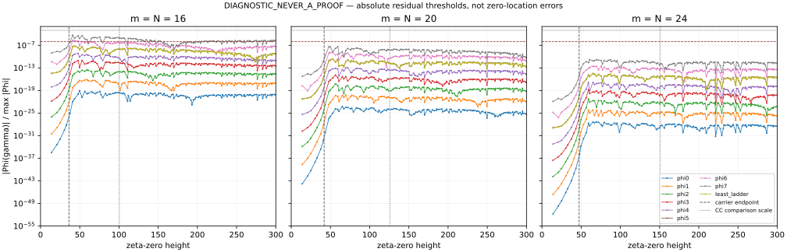

# Zero-height diagnostic

**DIAGNOSTIC_NEVER_A_PROOF.**

Input data: rh_clean @ 167dff63a632f170fed2d01d88af61268ad0af7f; exact local input hashes are in source_hashes.json.

The ninth direction is the normalized least-ladder-aligned direction in span{phi0,...,phi5}, constructed separately at each m by the same SVD as the parent ladder_limit study. The name ±0.984 refers to its observed m20/m24 peaks, not an imposed peak location.

All 138 accurate mpmath zeros with height at most 300 were evaluated at 100 dps. Selected m24 samples were reevaluated from 140 dps source at 140 dps.

Tables report first exceedances, with the preceding zero as bracket. Later returns below threshold are counted separately. No persistence outside the sampled zeros is inferred.

|m|profile|first T >1e-6|first T >1e-3|max residual through 300|
|---:|---|---:|---:|---:|
|16|phi0|censored (>300)|censored (>300)|9.46058e-20|
|16|phi1|censored (>300)|censored (>300)|7.826257e-17|
|16|phi2|censored (>300)|censored (>300)|3.166659e-14|
|16|phi3|censored (>300)|censored (>300)|9.656788e-12|
|16|phi4|censored (>300)|censored (>300)|7.56716e-10|
|16|phi5|censored (>300)|censored (>300)|6.351218e-8|
|16|phi6|40.918719|censored (>300)|2.210473e-6|
|16|phi7|40.918719|censored (>300)|4.744645e-5|
|16|least_ladder|censored (>300)|censored (>300)|5.801563e-8|
|20|phi0|censored (>300)|censored (>300)|6.073036e-24|
|20|phi1|censored (>300)|censored (>300)|6.0876e-21|
|20|phi2|censored (>300)|censored (>300)|5.843041e-18|
|20|phi3|censored (>300)|censored (>300)|1.271075e-15|
|20|phi4|censored (>300)|censored (>300)|1.169293e-13|
|20|phi5|censored (>300)|censored (>300)|2.230518e-11|
|20|phi6|censored (>300)|censored (>300)|1.267771e-9|
|20|phi7|censored (>300)|censored (>300)|4.250461e-8|
|20|least_ladder|censored (>300)|censored (>300)|1.928355e-11|
|24|phi0|censored (>300)|censored (>300)|4.495526e-28|
|24|phi1|censored (>300)|censored (>300)|6.684277e-25|
|24|phi2|censored (>300)|censored (>300)|5.549559e-22|
|24|phi3|censored (>300)|censored (>300)|1.647088e-19|
|24|phi4|censored (>300)|censored (>300)|1.515256e-17|
|24|phi5|censored (>300)|censored (>300)|3.352187e-15|
|24|phi6|censored (>300)|censored (>300)|3.127813e-13|
|24|phi7|censored (>300)|censored (>300)|1.576418e-11|
|24|least_ladder|censored (>300)|censored (>300)|2.865002e-15|

See thresholds.csv for both requested scaled heights, preceding-zero brackets, and later below-threshold counts. samples.csv preserves all signed transforms and normalized magnitudes.

Global maxima reuse the earlier m20/m24 diagnostic searches; m16 follows the same 0.05 grid and high-precision stationary refinement on [0,80]. The explicit sinc tail bound is below each found peak beyond 80. This is not a rigorous enclosure of the finite search interval.

No asymptotic height law or limiting radical membership follows from these three finite carriers.

Only m16 φ6 and φ7 exceed 10⁻⁶: their first crossing is zero 7, T=40.9187190121, bracketed by zero 6 at T=37.5861781588. Both have T/(2πm)=0.407026024736 and T/(2πm/log m)=1.12851576584. They subsequently return below threshold at 129 and 51 sampled zeros respectively. Thus neither crossing is persistent. No profile exceeds 10⁻³. All m20/m24 profiles are right-censored through 300 at both thresholds.

The largest normalized residual over all profiles is 4.74464546e−5 at m16 (zero 7), 4.250461e−8 at m20 (zero 18, T=59.3470440), and 1.576418e−11 at m24 (zero 19, T=60.8317785); each belongs to φ7. Per-profile maximum ratios across m are in trend.csv. No fitted height law is reported under this metric.

Global-maximum normalization can hide loss of relative fidelity where the transform is itself small at high frequency. Censoring means no exceedance among the sampled zeros through 300; it does not mean an infinite threshold height or establish radical membership.

The 36 selected m24 validation samples change relatively by at most 3.44e−48 when both source and evaluation precision increase to 140 dps. These are empirical numerical comparisons, not interval bounds.

## Height-scale comparison

|m|2 pi m|2 pi m/log m|
|---:|---:|---:|
|16|100.530964915|36.258881135|
|20|125.663706144|41.947575640|
|24|150.796447372|47.449305588|

The only uncensored first crossings are at the same height in one carrier, so no empirical power or proportionality law for T_i(m) can be fitted. The other entries are censored, not measured heights.

[Primary-source literature comparison](LITERATURE.md): CC23 Proposition4.2 explicitly motivates E=2 pi lambda^2 by a mean-count comparison, giving 2 pi m in this dictionary. It does not guarantee individual-zero accuracy; the distinct Galerkin endpoint is 2 pi m/log m.

Reproduce with `uv run --with mpmath python3 scan.py`; plot with `uv run --with matplotlib python3 plot.py`.

The [fixed-window heat-temperature resolution test](../../../heat_temperature/resolution/RESULT.md) is delivered in the same commit.
