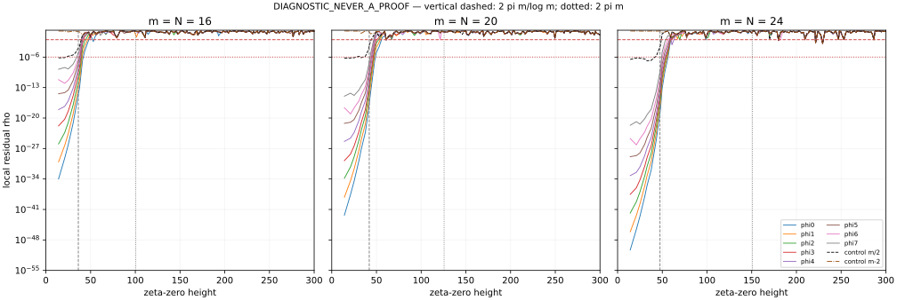

# Locally normalized zeta-zero height test

**DIAGNOSTIC_NEVER_A_PROOF.**

All 138 positive zeta zeros through height300 are evaluated at180dps, using fresh literal even CCM eigensystems at180dps and validation sources at220dps. Source branch before this task: rh_clean @21d63ff6aa3a1bd31115b2c651a670c9818a90b7. The objects remain N=m,L=logm, with all original prime powers in the matrix. Indices are zero-based.

## Finding

With local normalization, every tested profile has a finite first crossing of both thresholds. The eight cluster levels retain the small local residual substantially longer than the i=m−2 controls. Their crossovers lie near the retained Fourier-mode endpoint B=2pi m/logm, rather than the larger Connes–Consani mean-count comparison scale E=2pi m.

For the cluster, T(1e−6)/B ranges from1.033 to1.251 and T(1e−2)/B from1.129 to1.346 over these three carriers. This is a finite empirical mode-cutoff-scale observation, not an asymptotic height law. Different cluster levels cross at different zeros. The first crossing need not be persistent; later returns below threshold are counted in thresholds.csv.

## Exact convention

For consecutive positive ordinates gamma_k:

    delta_k = min(gamma_k-gamma_(k-1), gamma_(k+1)-gamma_k)/2, k>=2;
    delta_1 = (gamma_2-gamma_1)/2.
    rho_i(gamma_k) = |Phi_i(gamma_k)| / max_[gamma_k-delta_k,gamma_k+delta_k] |Phi_i(t)|.

This chooses half the smaller adjacent gap, not half an averaged gap. The last window uses gamma139=301.649325462... to define its right gap even though only gamma<=300 is scored. Gamma138=299.840326054... is the last scored zero. Accurate ordinates are obtained with mpmath.zetazero.

A local maximum includes both endpoints, the zero ordinate, all grid samples and refined roots of Phi_i'(t). Main search uses32 subintervals,180dps arithmetic and bracketed Anderson refinement with normalized derivative. The denominator is neither a global maximum nor |H| nor a maximum only over zeta zeros.

The physical finite cosine functions are normalized and zero outside[-L/2,L/2]. Their exact sinc Fourier transforms, with removable modal values, are used. The main implementation uses the algebraically equivalent rational expression away from removable points. All sample files preserve numerator, local denominator, local ratio, maximizing height, peak type and number of stationary candidates.

## Cluster first-crossing heights

Entries are the first sampled zero with rho strictly above the indicated threshold, not interpolated heights.

|i|m16:1e−6|m16:1e−2|m20:1e−6|m20:1e−2|m24:1e−6|m24:1e−2|
|---:|---:|---:|---:|---:|---:|---:|
|0|43.327073281|48.005150881|49.773832478|56.446247697|59.347044003|60.831778525|
|1|40.918719012|48.005150881|48.005150881|56.446247697|56.446247697|59.347044003|
|2|40.918719012|48.005150881|48.005150881|52.970321478|56.446247697|59.347044003|
|3|40.918719012|43.327073281|48.005150881|52.970321478|56.446247697|59.347044003|
|4|40.918719012|43.327073281|48.005150881|49.773832478|52.970321478|59.347044003|
|5|40.918719012|40.918719012|48.005150881|48.005150881|52.970321478|59.347044003|
|6|37.586178159|40.918719012|48.005150881|48.005150881|52.970321478|56.446247697|
|7|37.586178159|40.918719012|43.327073281|48.005150881|49.773832478|56.446247697|

## Non-cluster controls

These are actual high even eigenvectors of the same matrix, not randomized or synthetic controls. The midpoint control is i=m/2, so it is only one level above the cluster at m16; it retains nontrivial early-zero agreement. The i=m−2 control fails both thresholds at the first zeta zero for every m.

|m|control i|first T:1e−6|first T:1e−2|rho at first zero|
|---:|---:|---:|---:|---:|
|16|8|25.010857580|40.918719012|6.74996777e-07|
|16|14|14.134725142|14.134725142|0.990713846|
|20|10|30.424876126|48.005150881|6.05955594e-07|
|20|18|14.134725142|14.134725142|0.99965736|
|24|12|43.327073281|49.773832478|2.90007192e-07|
|24|22|14.134725142|14.134725142|0.999029332|

## Scale comparison for the ground vector

|m|B=2pi m/logm|E=2pi m|T1e−6/B|T1e−6/E|T1e−2/B|T1e−2/E|
|---:|---:|---:|---:|---:|---:|---:|
|16|36.258881135|100.530964915|1.19493685|0.43098237|1.32395566|0.47751607|
|20|41.947575640|125.663706144|1.18657233|0.39608757|1.34563790|0.44918497|
|24|47.449305588|150.796447372|1.25074631|0.39355731|1.28203728|0.40340326|

All30profiles and both thresholds have these scaled values, preceding-zero brackets, crossing ratios and later-below counts in thresholds.csv. No fit of T proportional to2pi m is supported by this small sample. The observed cluster crossover is within roughly1.0–1.35B, but three finite carriers do not establish a limiting proportionality constant.

The [previous primary-source check](../zero_height/LITERATURE.md) distinguishes E=2pi lambda^2 from the Fourier endpoint. CC23 Proposition4.2 motivates E through a mean-count comparison for a prolate-conditioned Dirac construction, not a uniform individual-zero error guarantee for our N=m low cluster. Here lambda=sqrt(m), so E=2pi m and B=2pi N/L. The present early crossover does not contradict that counting statement or numerical results using substantially higher N.

## High-frequency behavior and validation

The finite zero-extended profiles need not continue to decay like H. Beyond the retained band their transforms generally have algebraic boundary tails. At the last zero, the ground ratios are about0.8303,0.1292,0.8678 for m16,20,24, despite tiny absolute numerators. Their local denominators are approximately7.79e−21,3.37e−25,3.61e−29. This directly exhibits why the previous global normalization concealed loss of local zero agreement.

Fresh source checks:180dps GL160 versus220dps GL192. Maximum eigenvector-entry changes are3.24e−149,5.58e−141,3.72e−133 for m16,20,24. Thus source precision is increased along with evaluation precision; old100dps eigenvectors are not merely read into a higher-precision context. See core_validation.json.

Independent local-max validation uses220dps sources, a direct sinc/sinc-derivative implementation, recomputed zero ordinates, Ridder refinement and128/256-subinterval windows. It selects threshold crossings and neighbors, first and last zeros, and largest-rho cases for every cluster/control profile. All213 selected cases across52 windows preserve both threshold classifications. The maximum relative rho change is2.53e−121 and the maximum relative local-denominator change is6.45e−130. Exact counts and differences are recorded in validation_summary.json. These searches and precision comparisons are numerical checks, not interval certificates or a proof that all stationary points were enclosed.



## Optional backward heat

No unregularized negative-time fit is reported. For s<0 the stipulated full-line transform exp(-s t^2)H(t) grows quadratically exponentially and does not define this L2 heat family. A finite Fourier cutoff or a finite Taylor jet would define a different, regularized fit and require its own cutoff-stability test. The earlier fixed-window forward-heat result s*=0 is a constrained boundary optimum, not a negative-time estimate. Also, the N68 ground was not certified N-converged: the prior lambda56/lambda68 was1.06134.

## Files and replay

- samples_m16.csv, samples_m20.csv, samples_m24.csv: all4140 local measurements, ten eigenvectors per carrier.
- thresholds.csv: all60 first-crossing records and scale comparisons.
- profile_summary.csv, zeros.csv: per-profile and ordinate summaries.
- core_build.py, core_m*.json, core_validation.json: fresh matrices/eigenvectors and validation.
- local_validation.py and its outputs: independent local-max checks.
- SHA256SUMS: exact delivered file hashes; source_hashes.json records numerical inputs.

```sh
uv run --with mpmath python3 scan.py --prepare
uv run --with mpmath python3 scan.py --m 16
uv run --with mpmath python3 scan.py --m 20
uv run --with mpmath python3 scan.py --m 24
uv run --with mpmath python3 finalize.py
uv run --with mpmath python3 local_validation.py
uv run --with matplotlib python3 plot.py
```

DIAGNOSTIC_NEVER_A_PROOF. No RH, NOESCAPE or cofinal zero-tracking claim.
