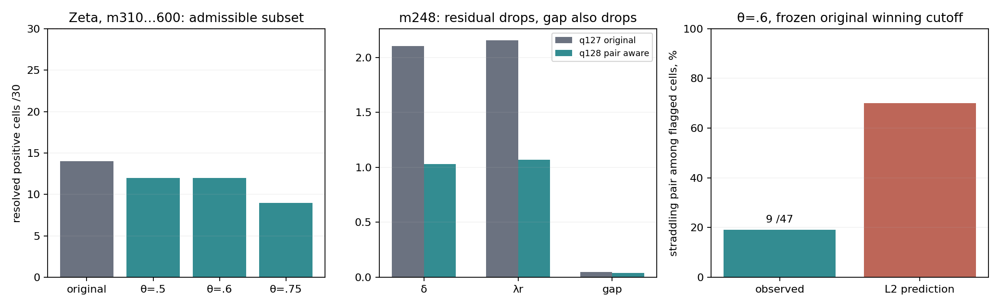

# Pair-aware quiet spaces

**DIAGNOSTIC_NEVER_A_PROOF. Route B CHALLENGER / NOT_RH.**
Inputbase `cdb84497649c7399448737732b7dd3d632e141f0`; evidence50777d47.
All945 world/size cells and2835 theta restrictions are retained. No route-state
or RH export. Source, zero tables, ranks and original guards are unchanged.

**Keeping close pairs together reduces the admissible set; it does not repair
the separator gap.** The Hermite change is numerically clean. The close-pair
explanation does not cover most spike/unresolved cells under the registered
operational overlay.

## Baseline and T1

All945 archived sector/census readbacks pass, and seven fresh numerical gates
reproduce the pinned maxima: ζ248 and ζ/plant/DH310/600, using original guards.
The supplied RESULT/REPORT/METHOD hashes match exactly. Restored baseline
point maxima agree in all945 cells; bounded gaps are never replaced by0.

PAIRS.csv contains5911 marked pair records at theta.5,.6,.75, with local
spacing2pi/log(midpointgamma/(2pi)). Neighborhoods are frozen within2 such
spacings of Omega or the original numerical winning-cutoff representative.
The representative is not asserted to be a unique true optimizer. Adjacent
DISTINCT HEIGHT events are used; quartets remain atomic rank2 events.
CLUSTERS.csv records4698 connected marked-edge components, including742
with3+ events. Excluding every internal marked edge already treats triples
and longer chains consistently.

The prescribed spacing formula is used in all worlds, including DH. It is an
asymptotic density scale and can be crude at very low DH heights; no silent
conductor/density correction is introduced. Each original grid packet uses
its OWN supplied census. All sector endpoints and q counts are cross-checked
against those tables. The rule never deletes an orbit or source atom.

## T2: restricted maxima

For the same fixed source and spaces, admissible restriction gives

    S_pair subset S_original,     g*_pair <= g*_original.

It can lower a residual by moving to a smaller quiet space, but lambda_r also
changes. That is a domain restriction, not an improved source inequality.

|theta|ζ positive16..300 /285|ζ positive310..600 /30|high unresolved|
|---:|---:|---:|---:|
|original|285|14|16|
|.5|282|12|18|
|.6|276|12|18|
|.75|266|9|21|

None of the original16 high-grid unresolved cells resolves, positively or
negatively. L3 FAILS under either reading. L4 FAILS its resolved-all30 criterion;
this is not a proof against every sub-resolution positive gap.
At theta.5/.6 the previously resolved cells350/430 lose resolution; theta.75
also loses380/460/500. Full per-cell brackets and five-sample block median
brackets are in SUMMARY.csv and BLOCK_MEDIANS.csv; no near-floor point is
reported as an exact zero.

The m248 calibration illustrates the tradeoff:

|sector|q|delta|lambda_r|gap|
|---|---:|---:|---:|---:|
|original winner|127|2.10503849|2.15383777|.04879928|
|pair-aware winner, all3theta|128|1.02781704|1.06735961|.03954258|

The split127/128 pair is removed, and the residual drops substantially;
the margin also drops. This agrees with the prior mode-removal evidence,
without converting it into a better separator.

Old incumbent-pruning labels were not reused as failures. We recomputed161
retained formerly bounded ζ residuals and85 small-nullspace completion points,
applying new information to the unrestricted baseline as well. Every point
stays inside its original absolute upper bound. Published unrestricted point
maxima do not change beyond their original guards. All2831 nonempty restricted
cases have finite measured lower bounds;2819 have width<=4.01originalguards.
Twelve ζ brackets remain roughly4.1–4.8guards wide and UNRESOLVED; we stop
there. Four low-DH theta.75 cases have EMPTY_ADMISSIBLE, kept distinct from
NO_NUMERIC and from source positivity. No precision chase was used.

Plant has no resolved separator anywhere, before or after restriction. DH
retains its original point censuses and signed source; its detected negative
levels are not removed. The300 newly needed mid-grid control delta_max values
use the unchanged source/frame recipe. All baseline minima agree with old
guards and remain negative; six independent row/null checks agree within
4.87e−15 in projector norm and1.78e−15 in residual. Negative-source controls
are not claimed negative in every tiny pre-detection window.

## T3: coordinates preserve the space

The physical average row and divided difference are formed at768bits BEFORE
float conversion, retaining both rows. Their transform is invertible. For
quartet/quartet pairs, matching real/imaginary branches transform together;
no intermediate orbit rank is admitted. Mixed1/2-row pairs require an explicit
invertible3-row construction and are not falsely counted as tested2-row cases.

The bounded numerical check has10 prefix pilots,8 distinct active transforms
and13 active theta receipts. Max relative delta change is1.113e−15; max
projector difference5.926e−15. Lambda_r is identically reused at the same rank
and source. L1 PASSES on these executed nonidentity checks. The exact row-span
argument applies generally, but a full-grid numerical Hermite replay is NOT
claimed. Identity cases are not counted as successes; ζ600's original floor
residual is not relatively scored. Regional input hashes and all tested
complete-event conditions are in hermite_VALIDATION.json.

## T4: overlay and L2

The registered local log-median/MAD spike definition is fixed in PREDICTIONS.md.
It uses up to5 neighbors each side, MAD floor.05, threshold3 robust scales,
separate integer/high grids and a100guard residual floor. The known248 anchor
is flagged separately rather than forced into the blind spike algorithm.

At theta.6, using the original numerical winning cutoffs:

|flagged set|pair straddles|total|coverage|
|---|---:|---:|---:|
|spike/unresolved plus known248 anchor|9|47|19.15%|
|blind spike/unresolved only|8|46|17.39%|

L2 FAILS the70% criterion under the declared operational definition. The
primary descriptive phi coefficient is.1373. CONTINGENCY.csv retains all
worlds/theta/grid/outcome/window combinations; OVERLAY.csv retains every cell.
SPIKES_AND_NEAREST_PAIRS.csv lists every algorithmic spike and the calibration
anchor, including nearest-pair heights and normalized gaps. These are
deterministic descriptive/post-selection associations, not causal or statistical
population claims. Original-optimum windows already depend on baseline data.

## Limits and files

L1 passes the bounded coordinate check; L2,L3,L4 fail their stated numerical
criteria. Restriction cannot manufacture a better true maximum; unresolved
still means unresolved. All error guards remain inherited empirical budgets,
not outward source bounds or zero-completeness certificates. No cofinal
behavior or RH conclusion follows.

INPUTS.json pins all source/census/archive inputs. LOCAL_ARRAY_HASHES.json
records local NPZ hashes; dense arrays remain local. The compact control archive
contains every one of the300 scalar/hash receipts. Repetitive zero-row labels
are retained locally and hash-referenced to exact input censuses and q counts,
not copied hundreds of times. METHOD.md, REPRODUCE.md, REVIEW.md and SHA256SUMS
make scope and replay explicit. Canon and mirror are identical.
