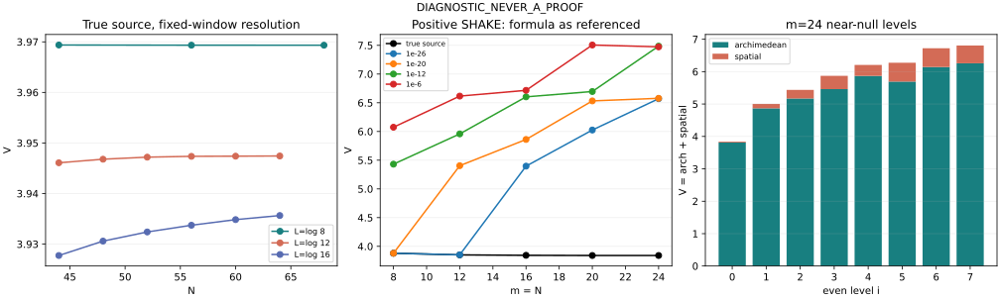

# Phase-space V: finite K1 discriminator

**DIAGNOSTIC_NEVER_A_PROOF.**

Proshka source: f73901ce86043a9aa98c3882497a405c58c0a146, PROSHKA_VERDICT_PHASE_SPACE_V_2026-11-02.md. Exact source snapshots and Git-blob/SHA256 metadata are in source/. The diagnostics implement the owner's resolution, positive-SHAKE and excited-level tests; no source drift or cofinal V bound is claimed.

## Finding

For these finite cells, positive fixed-weight SHAKE produces markedly larger V and small theta overlap once the ground sign becomes negative. The true literal sequence stays near3.84, but its numerical value is resolution-dependent: higher-N true bottoms give about3.94–3.97 at the fixed windows tested. V changes mildly with N while the tiny eigenvalues can change by many orders of magnitude.

This is finite discrimination, not evidence of a proved divergence in broken worlds or a uniform true-world bound. V contains no prime data for a fixed function: the arithmetic enters through the recomputed minimizing vector. Positive shifts often change that vector substantially. They are not the negative-shift, nearly unchanged-shape examples in the referenced script.

Excited near-null levels already have V between5.00 and6.81. Much of the broken-world range overlaps these finite excited-state costs. Therefore a larger finite V can reflect selection of a different near-null state; it does not by itself establish spatial or frequency escape as m tends to infinity.

## Definition and normalization

For a unit real even physical vector, zero-extended outside[-L/2,L/2],

    V[f] = Apositive[f] + integral log(1+x^2)|f(x)|^2 dx,
    Apositive[f] = integral_0^infinity j(s)||f-T_s f||^2 ds,
    j(s) = exp(-s/2)/(1-exp(-2s)).

The basis is phi_n=d_n(-1)^n cos(2pi n x/L)/sqrt(L), d0=1,dn=sqrt(2). There is no x/L rescaling and no division of V by m. The archimedean matrix includes its infinite translation tail exactly through the closed constant, without truncating a frequency integral. The full even source is K=Apositive-cstar I-prime+pole*pole^T, cstar=EulerGamma+log(8pi)+pi/2. Full pole and prime powers are retained.

w0=|<f,P_N h>|^2/||P_N h||^2, with h the fixed theta profile whose transform is4xi(1/2-it). V is evaluated on the actual normalized lowest even eigenvector, not on h or a near-null surrogate. Gaps are saved; the numerical bottoms are simple. This does not certify absence of exact degeneracy by intervals.

## True literal baseline N=m

|m|lambda0|Apositive|spatial|V|w0|
|---:|---:|---:|---:|---:|---:|
|8|1.0239259e-19|3.854748223546|0.024896756593|3.879644980139|0.9996889777|
|12|6.7904267e-29|3.824621644671|0.026064927980|3.850686572650|0.9987619747|
|16|5.4561380e-38|3.817023825528|0.026362612102|3.843386437630|0.9984375105|
|20|2.5844652e-46|3.813713411093|0.026492311711|3.840205722805|0.9982856222|
|24|2.6905128e-54|3.813752930637|0.026487095800|3.840240026438|0.9982912521|

The m8 andm16 values reproduce3.879644980139 and3.843386437630 from Proshka. The literal m20->24 increment is slightly positive, so even the true values are not strictly decreasing on these five cells.

## Fixed-window resolution

L=log(window m) stays fixed as N changes. N44..64 means44,48,52,56,60,64. The prime cutoff is determined by L, never by N.

|window m|N|lambda0|Apositive|spatial|V|w0|
|---:|---:|---:|---:|---:|---:|---:|
|8|44|6.2911538e-33|3.947812408194|0.021556516762|3.969368924956|0.9985559074|
|8|56|5.4259991e-33|3.947776887709|0.021557679864|3.969334567572|0.9985575121|
|8|68|5.1123902e-33|3.947770956636|0.021557874466|3.969328831102|0.9985577803|
|12|44|3.7538334e-52|3.923717205810|0.022360260582|3.946077466392|0.9994377822|
|12|48|7.0249192e-53|3.924446541102|0.022335403230|3.946781944332|0.9994170778|
|12|52|2.1947867e-53|3.924867128775|0.022321086806|3.947188215581|0.9994049700|
|12|56|1.1931821e-53|3.925036429940|0.022315328204|3.947351758144|0.9994000618|
|12|60|9.1907269e-54|3.925069471643|0.022314205171|3.947383676815|0.9993991020|
|12|64|8.2701992e-54|3.925106737320|0.022312938063|3.947419675382|0.9993980181|
|16|44|1.7157383e-63|3.904720061978|0.023018550060|3.927738612038|0.9998449372|
|16|48|6.6386019e-66|3.907671815394|0.022914738883|3.930586554277|0.9997982929|
|16|52|8.0339896e-68|3.909545671305|0.022849128485|3.932394799791|0.9997655064|
|16|56|2.1708983e-69|3.910922323326|0.022801069128|3.933723392455|0.9997398476|
|16|60|6.9953565e-71|3.912071982023|0.022761028606|3.934833010630|0.9997174005|
|16|64|3.7380589e-72|3.912911934768|0.022731828883|3.935643763651|0.9997004142|

The endpoint lambda decreases are factors1.23057(log8),45.3899(log12),4.58992e8(log16), while the relative V changes are−0.001010%,+0.034014%,+0.201265%. These are not N-convergence certificates. The last log16 eigenvalue is still strongly resolution-sensitive despite the mild change in V. See resolution_ratios.csv and RESULT_resolution.md.

## Broken-world positive shifts

For every original power2^j<=m, shift its location to log(2^j)+j epsilon, while retaining weight log2/sqrt(2^j). Every other prime power, L, N, the archimedean form, the spatial form and the pole remain fixed. This is the supplied SHAKE fixed-weight control, not a fully reweighted Beurling Euler product.

The reference break_sign_keep_shape.py uses negative epsilon. Here epsilon is positive as requested. Its q formula has no support clipping; the primary rows below reproduce that formula. At m8 andm16, the endpoint2^j=m moves outside the physical correlation support. We therefore also compute q=0 for shifted locations>=L. The physical-clipped comparison is in shake_summary.csv and endpoint_convention_comparison.csv; every reported eigenvalue sign agrees between the two conventions. At the other three windows both conventions coincide.

|m|epsilon|lambda0 (sign explicit)|Apositive|spatial|V|w0|
|---:|---:|---:|---:|---:|---:|---:|
|8|1e-26|+1.0239259e-19|3.8547482235|0.0248967566|3.8796449801|0.99968898|
|8|1e-20|+1.0866495e-19|3.8547516619|0.0248966235|3.8796482854|0.99968905|
|8|1e-12|-2.6533558e-12|5.3370139213|0.0934475741|5.4304614954|0.14934628|
|8|1e-6|-8.9613609e-06|5.7629162048|0.3107903022|6.0737065070|0.013534446|
|12|1e-26|+6.7854622e-27|3.8259373325|0.0260118394|3.8519491720|0.99881602|
|12|1e-20|-2.6808469e-20|5.3058833377|0.0983569865|5.4042403243|0.14889087|
|12|1e-12|-8.4787167e-12|5.6424321521|0.3155299479|5.9579621000|0.0180509|
|12|1e-6|-1.4526133e-05|6.3470271201|0.2690783254|6.6161054455|3.0042263e-06|
|16|1e-26|-2.6791148e-26|5.2962216825|0.0998690541|5.3960907366|0.14936536|
|16|1e-20|-8.0902870e-20|5.5460497379|0.3147493989|5.8607991368|0.021978946|
|16|1e-12|-1.4646345e-11|6.3457981725|0.2571143414|6.6029125139|0.00013680095|
|16|1e-6|-2.0556787e-05|6.3992685452|0.3167420026|6.7160105478|0.00015073749|
|20|1e-26|-8.5017385e-26|5.7157362515|0.3095411908|6.0252774423|0.016891778|
|20|1e-20|-1.1676509e-19|6.2463171651|0.2858740896|6.5321912547|0.0012339723|
|20|1e-12|-2.0519886e-11|6.3868090625|0.3087517922|6.6955608547|0.00015328516|
|20|1e-6|-4.4505814e-05|7.0329623352|0.4726011877|7.5055635229|2.8834668e-06|
|24|1e-26|-1.2685739e-25|6.3103889762|0.2602977624|6.5706867387|8.7587545e-05|
|24|1e-20|-1.8498551e-19|6.2506654928|0.3267667312|6.5774322240|0.001291887|
|24|1e-12|-3.6914564e-11|6.9925024500|0.4935470212|7.4860494713|1.2565042e-05|
|24|1e-6|-5.0190962e-05|7.0734119128|0.3998993842|7.4733112970|4.7744063e-06|

All four positive-shift sequences end at substantially larger V at m24 than at m8. They are not all monotone: epsilon1e−26 decreases from m8 to m12 before rising; epsilon1e−6 drops from7.505563523 at m20 to7.473311297 at m24. At epsilon1e−26 the m8/m12 bottoms remain positive; m16/m20/m24 are negative, with V5.39609/6.02528/6.57069 and w0 .14937/.01689/8.75875e−5. No finite sign observation is promoted to a broken-world asymptotic statement.

## Near-null calibration at m24

|level i|lambda_i|Apositive|spatial|V|
|---:|---:|---:|---:|---:|
|0|2.6905128e-54|3.813752930637|0.026487095800|3.840240026438|
|1|4.2762016e-48|4.868041155352|0.136169435834|5.004210591186|
|2|9.9741981e-43|5.170885554069|0.265866620854|5.436752174923|
|3|8.5841088e-38|5.461234681530|0.409689993796|5.870924675327|
|4|1.9273465e-33|5.869094226474|0.338151786950|6.207246013425|
|5|4.7853966e-29|5.692799554895|0.581929116266|6.274728671162|
|6|6.2812030e-25|6.142474525225|0.579705732306|6.722180257531|
|7|3.1787593e-21|6.257844405646|0.548881583914|6.806725989560|

These seven excited eigenvalues are tiny but their V costs are appreciably above the bottom. This supports keeping the definition on exact bottoms rather than extending one numerical constant to an arbitrary near-null cluster. It is only a finite calibration.

## Checks and provenance

- Independent formula review and direct physical-integral checks are in REVIEW.md and validate_forms_independent.py. At m=N8,90dps, sampled arch/spatial/pole/correlation entries agree to roughly3e−90. The archimedean tail and physical x normalization were explicitly checked.
- Resolution:140dps/GL128 per panel, validated at log16,N64 with160dps/GL160. Absolute V change2.19e−76; relative lambda change4.75e−69. Both are precision/order checks, not interval or N-convergence certificates.
- SHAKE:180dps/GL160; m24 epsilon1e−26 and1e−6 checked at220dps/GL192. Relative eigenvalue changes are below7.54e−155.
- Cluster:180dps/GL160 and220dps/GL192, with independently built literal matrices/eigenvectors from the local-zero test. Matrix agreement, source balance, eigen residuals and V differences are saved in cluster_* files. Zero saved V differences mean agreement at the120-digit output precision, not exact equality.
- Exact source snapshots in source/ match the original Git blobs. SHA256SUMS covers delivered artifacts. Arithmetic coefficients are not refitted or omitted.

Replay from this directory using mpmath (the scripts expose their arguments). v_forms.py is the shared source of the independent archimedean/spatial forms. Run resolution.py, shake.py, cluster.py, finalize.py; plot.py additionally requires matplotlib. Individual settings and commands are in RESULT_resolution.md and RESULT_shake.md and the script entry points.

No cofinal V-bound, source drift inequality, RH conclusion, or interval certificate is claimed.
