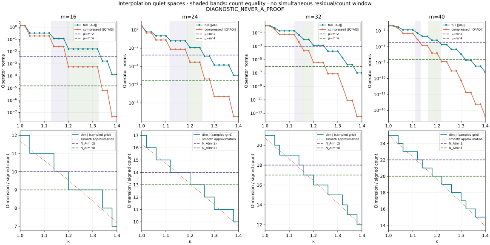

# Interpolation quiet-space κ scan

**DIAGNOSTIC_NEVER_A_PROOF.** Source branch rh_clean @bf890512b36abf2330d8f61a95f120cae58d0e0a. Literal even A_m, N=m, L=ln m. All84 points κ=1.00,1.02,…,1.40 are included.

## Result

**The simultaneous window is empty for all four m and both thresholds.** At the required dimension, the full operator residual is too large. Adding more zero constraints eventually makes the space quieter, but then its dimension is smaller than the signed spectral count. The compressed-form norm also exceeds μ at every count-equality window.

The basis and residual are constant between successive zero-entry heights. Therefore the cached count-equality subspace checks also exclude a passing point between grid samples within[1,1.4], subject to the same finite numerical accuracy; this is not an extrapolation to other m.

|m|B|Required dim J=N_A(μ)|Count-equality κ interval, approximately|δ/μ|β/μ|First grid κ with δ<μ|Both conditions|
|---:|---:|---:|:---|---:|---:|:---|:---|
|16|2|10|(1.128516, 1.194937]|30.18918|6.604445|1.34|empty|
|16|4|9|(1.194937, 1.323956]|1080.713|36.8291|none|empty|
|24|2|14|(1.116356, 1.189612]|36.19151|4.292165|1.26|empty|
|24|4|13|(1.189612, 1.250746]|3862.789|96.19657|none|empty|
|32|2|18|(1.122355, 1.156265]|50.92081|4.276276|1.26|empty|
|32|4|17|(1.156265, 1.198782]|11310.58|234.9668|1.38|empty|
|40|2|22|(1.111162, 1.1323]|60.28698|3.856714|1.22|empty|
|40|4|20|(1.164481, 1.216924]|4472.343|16.58481|1.32|empty|

The interval is left-open/right-closed because the constraint uses γ<T strictly. Grid membership is recorded separately in windows.csv. No eigenvalue absolute-value count is substituted: N_A(μ)=#{λ_i(A)<μ}, including the ground and any negative level.

## Construction and Gram control

The physical basis is ψ_n=d_n(−1)^n cos(2πnx/L)/sqrt(L), d_0=1,d_n=sqrt(2), zero outside the window. E evaluates these transforms at the selected positive zeros using the exact rational-times-sine formula, with direct sinc continuation at modal points. The constant mode is retained.

In the polynomial formula in the request, the denominator product is n=1,…,m when the prefactor is1/z and deg P≤m. Including n=0 instead requires an extra z² factor in the numerator. NORMALIZATION.md gives the coefficient map and the conditions for full evaluation rank.

Main construction:200dps full SVD of row-normalized E, retaining its full right nullspace. Row normalization does not alter the kernel. No small-singular-value cutoff is used to create J. Full row rank q is supported by the distinct-node Cauchy/Vandermonde structure and verified singular values far above numerical residuals. All sampled q<d; no zero-dimensional convention is needed.

The orthonormal basis Q is stored for every distinct q. We compute δ=||AQ||op=sqrt(λmax(Q* A² Q)) and β=||Q*AQ||op=max|λ(Q*AQ)|. The second quantity is not substituted for the first. Source matrices are180dps/GL160 for m16,24,40 and160dps/GL128 for m32; zero ordinates carry180digits. Higher working precision does not upgrade those source accuracies.

|m|Maximum condition number of row-normalized E|Maximum ||Q*Q−I||F|Maximum ||EQ||F|
|---:|---:|---:|---:|
|16|85824.75|9.776163e-201|6.33764e-201|
|24|2.282789e+07|1.721724e-200|8.498227e-201|
|32|9.351722e+10|1.531233e-200|1.226177e-200|
|40|4.009287e+14|2.505952e-200|1.584661e-200|

## Dimension formula

For the selected distinct nonstructural zeros, every row adds one condition: dim J=m+1−q at all84 points. This is checked against the numerical rank. Zero evaluation alone imposes no derivative conditions for multiplicities; the exact rank statement uses distinct evaluations. The finite zeta list and its accuracy are inherited from the capacity-matrix packet.

The supplied smooth approximation is D_asym=m[1−κ+κ(1+ln L−ln κ)/L]. Riemann–von Mangoldt contributes the additional constant1/8 to d−N(T), plus the oscillatory −S(T) and O(1/T) remainder. Thus exact integer dimension need not equal a rounded smooth approximation. Both D_asym and dim J−D_asym are reported below.

## Complete grid

### m=16

|κ|q|dim J|δ=||AQ||op|β=||Q*AQ||op|N(m⁻²)−dim J|N(m⁻⁴)−dim J|D_asym|dim J−D_asym|
|---:|---:|---:|---:|---:|---:|---:|---:|---:|
|1|5|12|1.362719|1.324826|-2|-3|11.6557|0.344285|
|1.02|5|12|1.362719|1.324826|-2|-3|11.4523|0.547733|
|1.04|6|11|0.3341082|0.1928238|-1|-2|11.2466|-0.246556|
|1.06|6|11|0.3341082|0.1928238|-1|-2|11.0386|-0.0386251|
|1.08|6|11|0.3341082|0.1928238|-1|-2|10.8285|0.171483|
|1.1|6|11|0.3341082|0.1928238|-1|-2|10.6163|0.383729|
|1.12|6|11|0.3341082|0.1928238|-1|-2|10.4019|0.598074|
|1.14|7|10|0.1179265|0.02579861|0|-1|10.1855|-0.18552|
|1.16|7|10|0.1179265|0.02579861|0|-1|9.96709|0.0329101|
|1.18|7|10|0.1179265|0.02579861|0|-1|9.74667|0.253331|
|1.2|8|9|0.01649037|0.0005619675|1|0|9.52429|-0.524292|
|1.22|8|9|0.01649037|0.0005619675|1|0|9.29999|-0.299992|
|1.24|8|9|0.01649037|0.0005619675|1|0|9.0738|-0.0737992|
|1.26|8|9|0.01649037|0.0005619675|1|0|8.84574|0.154255|
|1.28|8|9|0.01649037|0.0005619675|1|0|8.61586|0.384142|
|1.3|8|9|0.01649037|0.0005619675|1|0|8.38417|0.615831|
|1.32|8|9|0.01649037|0.0005619675|1|0|8.1507|0.849297|
|1.34|9|8|0.001666262|6.51094e-06|2|1|7.91549|0.0845112|
|1.36|9|8|0.001666262|6.51094e-06|2|1|7.67855|0.321448|
|1.38|10|7|0.0001332814|4.648819e-08|3|2|7.43992|-0.439917|
|1.4|10|7|0.0001332814|4.648819e-08|3|2|7.19961|-0.19961|

### m=24

|κ|q|dim J|δ=||AQ||op|β=||Q*AQ||op|N(m⁻²)−dim J|N(m⁻⁴)−dim J|D_asym|dim J−D_asym|
|---:|---:|---:|---:|---:|---:|---:|---:|---:|
|1|8|17|2.956529|2.866323|-3|-4|16.2837|0.716306|
|1.02|9|16|0.59169|0.4630547|-2|-3|15.9768|0.0231683|
|1.04|9|16|0.59169|0.4630547|-2|-3|15.667|0.332992|
|1.06|10|15|0.223322|0.0789233|-1|-2|15.3543|-0.354279|
|1.08|10|15|0.223322|0.0789233|-1|-2|15.0387|-0.0387003|
|1.1|10|15|0.223322|0.0789233|-1|-2|14.7203|0.279675|
|1.12|11|14|0.06283248|0.007451675|0|-1|14.3992|-0.399203|
|1.14|11|14|0.06283248|0.007451675|0|-1|14.0754|-0.0753833|
|1.16|11|14|0.06283248|0.007451675|0|-1|13.7489|0.251086|
|1.18|11|14|0.06283248|0.007451675|0|-1|13.4198|0.580159|
|1.2|12|13|0.01164276|0.0002899443|1|0|13.0882|-0.0882076|
|1.22|12|13|0.01164276|0.0002899443|1|0|12.7541|0.245943|
|1.24|12|13|0.01164276|0.0002899443|1|0|12.4174|0.58257|
|1.26|13|12|0.001343366|4.241696e-06|2|1|12.0784|-0.078367|
|1.28|13|12|0.001343366|4.241696e-06|2|1|11.7369|0.263094|
|1.3|14|11|0.0001426112|5.160534e-08|3|2|11.3931|-0.393086|
|1.32|14|11|0.0001426112|5.160534e-08|3|2|11.0469|-0.0469417|
|1.34|14|11|0.0001426112|5.160534e-08|3|2|10.6985|0.301491|
|1.36|14|11|0.0001426112|5.160534e-08|3|2|10.3478|0.652178|
|1.38|15|10|1.076661e-05|3.205048e-10|4|3|9.99491|0.00508652|
|1.4|15|10|1.076661e-05|3.205048e-10|4|3|9.63982|0.360184|

### m=32

|κ|q|dim J|δ=||AQ||op|β=||Q*AQ||op|N(m⁻²)−dim J|N(m⁻⁴)−dim J|D_asym|dim J−D_asym|
|---:|---:|---:|---:|---:|---:|---:|---:|---:|
|1|12|21|1.213816|1.081328|-3|-4|20.7095|0.290517|
|1.02|12|21|1.213816|1.081328|-3|-4|20.2972|0.702826|
|1.04|13|20|0.5323465|0.3262748|-2|-3|19.8812|0.118757|
|1.06|14|19|0.2008346|0.05871152|-1|-2|19.4618|-0.46176|
|1.08|14|19|0.2008346|0.05871152|-1|-2|19.0388|-0.0387935|
|1.1|14|19|0.2008346|0.05871152|-1|-2|18.6124|0.387593|
|1.12|14|19|0.2008346|0.05871152|-1|-2|18.1827|0.817338|
|1.14|15|18|0.04972736|0.004176051|0|-1|17.7496|0.25038|
|1.16|16|17|0.01078661|0.0002240818|1|0|17.3133|-0.313338|
|1.18|16|17|0.01078661|0.0002240818|1|0|16.8739|0.126128|
|1.2|17|16|0.001364574|3.988755e-06|2|1|16.4313|-0.431276|
|1.22|17|16|0.001364574|3.988755e-06|2|1|15.9856|0.0143984|
|1.24|17|16|0.001364574|3.988755e-06|2|1|15.5369|0.4631|
|1.26|18|15|0.000185022|7.95265e-08|3|2|15.0852|-0.0852199|
|1.28|18|15|0.000185022|7.95265e-08|3|2|14.6306|0.369391|
|1.3|18|15|0.000185022|7.95265e-08|3|2|14.1731|0.826888|
|1.32|19|14|1.973626e-05|9.778316e-10|4|3|13.7128|0.287226|
|1.34|20|13|1.765393e-06|8.409663e-12|5|4|13.2496|-0.249637|
|1.36|20|13|1.765393e-06|8.409663e-12|5|4|12.7837|0.216255|
|1.38|21|12|1.057828e-07|3.237237e-14|6|5|12.3151|-0.315137|
|1.4|21|12|1.057828e-07|3.237237e-14|6|5|11.8439|0.156148|

### m=40

|κ|q|dim J|δ=||AQ||op|β=||Q*AQ||op|N(m⁻²)−dim J|N(m⁻⁴)−dim J|D_asym|dim J−D_asym|
|---:|---:|---:|---:|---:|---:|---:|---:|---:|
|1|16|25|0.9942721|0.837892|-3|-5|24.9975|0.00246056|
|1.02|16|25|0.9942721|0.837892|-3|-5|24.4785|0.521532|
|1.04|17|24|0.5492853|0.307849|-2|-4|23.9551|0.0448564|
|1.06|18|23|0.1571251|0.03396946|-1|-3|23.4276|-0.427649|
|1.08|18|23|0.1571251|0.03396946|-1|-3|22.8961|0.103938|
|1.1|18|23|0.1571251|0.03396946|-1|-3|22.3605|0.639542|
|1.12|19|22|0.03767936|0.002410446|0|-2|21.8209|0.179088|
|1.14|20|21|0.00949739|0.0001736535|1|-1|21.2775|-0.277492|
|1.16|20|21|0.00949739|0.0001736535|1|-1|20.7303|0.269732|
|1.18|21|20|0.001747009|6.478441e-06|2|0|20.1793|-0.179304|
|1.2|21|20|0.001747009|6.478441e-06|2|0|19.6247|0.375336|
|1.22|22|19|0.00026077|1.567499e-07|3|1|19.0664|-0.0664101|
|1.24|22|19|0.00026077|1.567499e-07|3|1|18.5046|0.495399|
|1.26|23|18|3.354588e-05|2.772396e-09|4|2|17.9393|0.0607071|
|1.28|23|18|3.354588e-05|2.772396e-09|4|2|17.3705|0.629457|
|1.3|24|17|3.985004e-06|4.169766e-11|5|3|16.7984|0.201596|
|1.32|25|16|2.896617e-07|2.342227e-13|6|4|16.2229|-0.222929|
|1.34|25|16|2.896617e-07|2.342227e-13|6|4|15.6442|0.355833|
|1.36|26|15|2.203315e-08|1.437529e-15|7|5|15.0622|-0.0621689|
|1.38|26|15|2.203315e-08|1.437529e-15|7|5|14.477|0.523019|
|1.4|27|14|1.455897e-09|6.637476e-18|8|6|13.8887|0.11135|

## Independent validation and reproduction

A second implementation builds P(y)=prod_selected(y−yγ) times Chebyshev polynomials, converts to modal residues, and uses twice-reorthogonalized220dps QR. It does not use E-SVD to construct the kernel. All12 m40 subspaces and11 other boundary/endpoint cells were checked. Projectors differ by at most1.40e−187; full residual norms agree relatively within3.52e−150 and compressed norms within2.06e−150. Independent m40 arithmetic matrices at160/GL128 and180/GL160 preserve the norms, with relative differences at most7.40e−152 and1.61e−142. These are precision/algorithm checks, not interval certificates.

Files: scan.csv (all84 rows); windows.csv (both conditions and exact zero-entry interval endpoints); cell_m*.json (Q, singular values, condition numbers, matrix provenance and residual checks); validation*.py/json/csv; NORMALIZATION.md; RESULT_validation.md; code and plots. The full and compressed norms are in every row.

Replay scan.py with m=16,24,32,40 and its aggregation entry point; validation.py/validation_compare.py/validation_source.py use their documented entry points. Then run report.py and plot.py. Dependencies are mpmath,numpy,matplotlib. The exact source hashes are preserved in each cell.

This excludes the requested finite interpolation-space saturation guard on these four carriers over the scanned interval. It does not prove or disprove a cofinal count law, another quiet-space construction, NOESCAPE, or RH.
