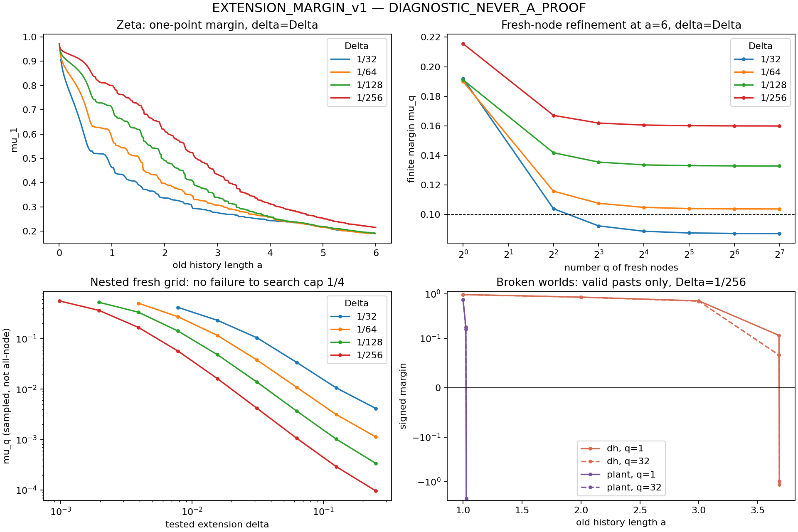
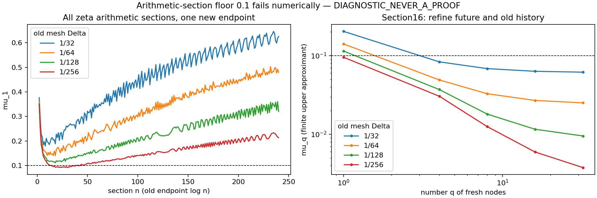

# EXTENSION_MARGIN_v1

**DIAGNOSTIC_NEVER_A_PROOF. Route B = CHALLENGER / NOT_RH.**
No route-state change, global source sign, or RH claim is made.

The requested full-future margin is infinite dimensional. We measure its
finite-future upper approximants, keeping the complete specified old history:

`mu_q = 1 - lambda_max(F_q^(-1/2) V_q^T C^(-1) V_q F_q^(-1/2))`.

Here C is the positive old Gram and F_q is the positive fresh-increment
Gram. Both positivity guards are required. Undefined pasts are marked
INVALID_PAST; no indefinite whitening or truncated pseudoinverse is used.
Where the full fresh form is positive, nested dyadic fresh grids give
decreasing mu_q >= mu_full. Therefore a
negative sampled margin detects failure, while positive samples do not
certify the all-node operator comparison in source (17).

For one new endpoint, mu_1 is exactly the next innovation divided by
2Psi(delta). For several nodes it is generally smaller. The old planted
hazard margin 1-lambda_max(Theta) and the new margin agree in sign and zero
boundary for an identical
combined node set with positive old/fresh blocks; their numerical values
have different normalizations. Extra nodes change the test.

| Old mesh Delta | a=6,delta=Delta: mu_1 | mu_32 | mu_128 |
|---|---:|---:|---:|
|1/32|0.192005211|0.087489910|0.087061794|
|1/64|0.190036790|0.103996401|0.103702040|
|1/128|0.191119553|0.133065626|0.132832070|
|1/256|0.215579926|0.160093482|0.159902345|

The largest q32-to128 change is 0.000428116. This finite stability check
does not bound the uncomputed infinite tail. MP80 checks confirm the coarse
mu_32=0.0874899096813415 below 0.1; that history a=6 lies beyond log240
and does not by itself test Mythos's arithmetic-section prediction.



The uniform study retains 8,628 scalar rows, 480 future-block rows, eight
extra refinements, and 90 nested-step measurements. All tested valid dyadic
future refinements decrease. There are 185 invalid-past block rows and no
unresolved factorization rows. DH and the plant fail while their old blocks
are still positive. At Delta=1/256 the planted block changes sign between
old endpoints 1.0234375 and 1.02734375; their new endpoints are 1.02734375
and 1.03125, respectively, agreeing with the previous first-negative endpoint.

The zeta step search keeps the old history fixed and adds fresh nodes on
one fixed microgrid Delta/4. After a=1,3,6, no sampled failure occurs through
the search cap delta=1/4. At a=6,Delta=1/256 the sampled cap margin is only
9.66931598e-5. This is a censored **sampled** search, not a lower bound for
the true all-node delta-star. Finite old/future refinement limits are not
exchanged. Conditional on RH, all finite future extensions are positive
and the unrestricted full step supremum is infinite; a finite decreasing
zeta delta-star is not assumed. A small margin does not imply a small radius.

Independent uniform controls at MP80, with one MP120 repeat, differ from
float64 margins by at most 1.30e-13. The source uses the full closed
archimedean/pole terms and every arithmetic coefficient within support.
The larger scans remain floating diagnostics, not interval certificates.

The source's four-anchor section16 replay independently gives
mu_q=0.508310185,0.457861134,0.452457148,0.450617477,0.450004986 for
q=1,4,8,16,32. Its q32 MP80/100 difference is 1.65e-79. Yet the coarse
source lower estimate is 1-rho/beta=-1.670586212, with beta=.357721048,
rho=.955324898. A negative sufficient lower estimate is not a negative
margin. For the same fixed history, delta=.001 and .00001 give q32
margins .973570415 and .999532807. This checks the source's local
fixed-history behavior; it does not supply a global continuation budget.

**Mythos arithmetic-section prediction fails numerically.** Every section
n=2..240 was tested at q1, with exact old endpoint a=log n and a partial
terminal old increment. The full old history is retained.

| Old mesh | Minimum mu_1 over n=2..240 | argmin n | n=16: mu_32 |
|---|---:|---:|---:|
|1/32|0.179550808|8|0.061636076|
|1/64|0.140119402|18|0.025106551|
|1/128|0.111055289|18|0.009519241|
|1/256|0.091573452|30|0.003773764|



Thus the finest one-point scan already falls below .1; even the coarse
section16 future-block test does. Section16 has delta=log(17/16)<1/16,
within the source's proved fresh coercivity range. Since mu_full<=mu_32,
no uncomputed future tail can restore the proposed .1 floor. This is a
diagnostic rejection of that quantitative floor, not a negative zeta margin.
The n16 old histories and future grids are nested across old meshes, so
their decreasing margins are not evidence for a zeta-specific power law.
No four-point exponent is fitted or extrapolated.

The additional complete zeta block profiles retain all 239 sections at
q4 and q8 on every old mesh: 1,912 further cells. All remain positive and
obey mu_8<=mu_4<=mu_1. Their q8 minima are .0303418,.0205092,.0158163,
.0121705 on meshes 1/32,1/64,1/128,1/256. The n<16 rows lie outside the
source's proved short-coercivity range and assert only finite F positivity;
the validated n16 and n30 failures of the .1 floor avoid this issue.

Refining the old mesh at fixed section16 keeps delta fixed and reduces
clearance. Refining the mesh in the earlier a6 table also shrinks delta=Delta,
so it changes two limits at once. These experiments do not identify a
single resolution-independent scaling law.

The fine n30 scalar result independently replays at MP80 as
0.0915734519013928067 with 871 old directions, including the exact
partial endpoint; its float discrepancy is 9.95e-15. Section16,mesh32
replays at MP80 as mu_4=.0833588792525536 and mu_32=.0616360758945333,
with maximum discrepancy 4.61e-14 across the tested fresh refinements.

The broken-world sections also show why the endpoint alone is insufficient.
At mesh1/256, DH section39 has mu_1=.0848456 but mu_32=-.0193334;
the plant's section2 has mu_1=.0998293 but mu_32=-.00140864.
Both old blocks remain positive. Added fresh nodes expose the failure
missed by the single endpoint. These are source-matched finite detectors,
not a positive arithmetic law for zeta.

Arithmetic-section results, precision checks and the registered Mythos test
are in sections/RESULT.md. All hypotheses, evidence, killers and handoffs are in
CARDS.md and the component cards. The exact source copy and provenance
are retained; the pinned text's actual formulas are (3), (10), (17).

Reproduce with existing Python packages mpmath, numpy, scipy and matplotlib:

```
python3 ../innovation_law/unpack_data.py
python3 unpack_data.py
python3 uniform/margins.py
python3 uniform/refine.py
python3 uniform/validate.py
python3 uniform/analyze.py
python3 review/check_margin.py
python3 review/coarse_source.py
python3 plot.py
```

See sections/RESULT.md for its commands. Raw large tables are archived
losslessly with member SHA256s; SHA256SUMS covers published artifacts.
No measured finite positive margin is promoted to an all-node sign law.
