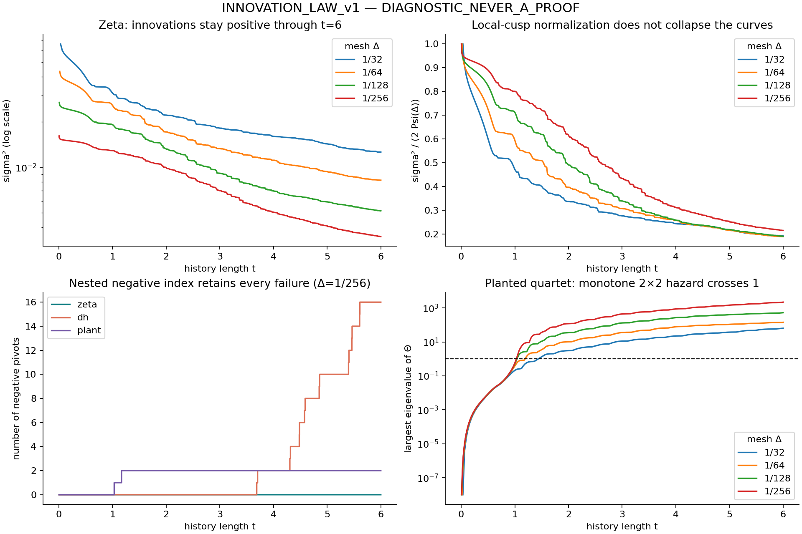
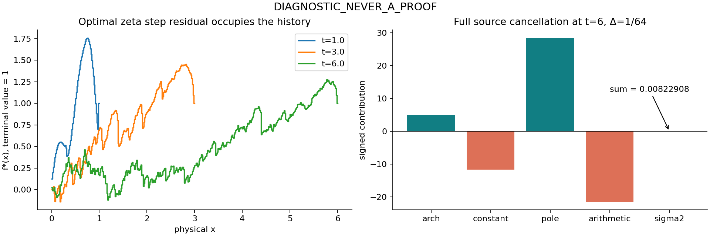

# INNOVATION_LAW_v1

**DIAGNOSTIC_NEVER_A_PROOF. Route B = CHALLENGER / NOT_RH.**
Route-state is unchanged. This package measures source-defined kernels;
it supplies no unconditional infinite-history positivity bound.

The four grids distinguish the actual zeta source from DH and the planted
quartet. The registered exponential law and the proposed Euler cone fail.
The strongest surviving mechanism is a two-dimensional negative-capacity
threshold explaining the planted failure, with no new sign estimate for zeta.

| Delta | prefixes per world | zeta sigma²(6) | first DH negative t | first plant negative t | negative index at 6: zeta/DH/plant |
|---|---:|---:|---:|---:|---|
|1/32|192|0.0126492525054|5.9375|1.4375|0 / 1 / 2|
|1/64|384|0.00822908150465|4.296875|1.203125|0 / 2 / 2|
|1/128|768|0.00515231626825|3.78125|1.046875|0 / 8 / 2|
|1/256|1536|0.00348429430077|3.6875|1.03125|0 / 16 / 2|

All 2,880 zeta prefixes are positive and nonincreasing in each fixed-grid
sequence. This monotonicity is generic for positive stationary histories.
After a negative direction appears, subsequent values are **signed Schur
pivots**, not variational prediction errors: the unconstrained signed
minimum is then minus infinity. A positive last pivot does not reset inertia.
No continuum first-failure length is inferred from the mesh-dependent onsets.

The full fine-grid repeats at 100/160 digits match every sign and inertia.
Maximum relative changes: zeta 2.11e-97, DH 5.84e-94, plant 4.93e-95.
Independent source integrals agree within 2.43e-100; first negative residual
quadratic forms replay within relative 6.23e-96. These are arbitrary-precision
floating diagnostics, not directed-rounding certificates.



The point kernel and increment Toeplitz kernel are related by a triangular
congruence of determinant one. Their prefix innovations coincide. This also
reconciles the older DH mesh64/128 onsets exactly with the new table.

**Mythos prediction:** rejected under the registered finite tests. On [1,6]
the log-innovation slopes are −0.162470, −0.217053, −0.270628, −0.285682;
R² ranges from 0.9638 to 0.9854. The across-mesh slope spread is 50.5% of
the median magnitude. Curvature is visible in the prespecified split ranges.
The final two slopes differ 5.4%, so eventual asymptotic convergence is open.

**Arithmetic residual:** the Euler cone Q_f*(log p^k)<=0 fails already at
t=1. For true zeta, Q(log2)=+0.49942689 on mesh32 and +0.36793958 on mesh64.
Both signs occur later. Reoptimising finite differences verify source
partial sigma²/partial c_n=−Q(log n). The residual occupies the history;
at t=6,mesh64 its L2 mass is 2.18848, while its final bin contributes 1/64.
The small innovation is the cancellation

`arch + constant + poles + arithmetic =`
`4.880575022 − 11.756894320 + 28.349425257 − 21.464876878 = 0.008229082`.



**Prime thresholds:** sigma² is continuous at an isolated log n with fixed
past. The temporal slope jump is −2c_n(1−sum a_i), with shifted-hinge
contributions added when present. This is distinct from the coefficient
derivative −Q. In particular Q_f(t)=0 at an atom's unshifted birth, while
the time-slope kink can be nonzero. On mesh32, zeta has 88 positive and 10 negative prime-threshold slope
jumps among the 98 prime powers. The plant has the same 88/10 counts,
so these counts do not discriminate the worlds. Hinge sources use MP80 with float64
predictor solves and selected MP80 predictor replays. The initial finite
difference table and targeted near-grid correction are both retained.
The final maximum absolute slope-jump discrepancy is 3.38e-9, with no
nonzero sign disagreement; nine MP80 predictor replays differ in predicted
jumps by at most 2.97e-13. At n=16 the zeta jump is negative, approximately
-0.005051850807, despite its positive von Mangoldt weight.
Full measured hinge tables and validation are in residual/; changing history between uniform-grid rows is not a
fixed-history derivative.

**Controls:** at mesh64, multiplying every positive Lambda atom by 1/2 or
3/2 gives the first negative prefix at 0.78125. Replacing all prime-power
atoms n>=2 by exp(s/2)ds on [log2,infinity) gives 0.75. Both meshes and
100/160-digit repeats confirm the
failures. These controls retain the cusp; no functional equation is asserted
for them. Positive coefficients alone do not explain continuation.

**Planted mechanism:** on the full one-sided grid the quartet has two
positive and two negative real feature columns. With
`T_plant=C−UU^T`, `C=T_zeta+VV^T`, the 2x2 matrix
`Theta=U^T C^−1 U` accumulates with history. Its upper eigenvalue crosses 1
at precisely the four planted onsets in the table. The determinant-ratio
reconstruction matches all 2,880 prefix inertias; relative pivot error is
at most 1.86e-11 in float64 and 5.11e-77 in separate 80-digit controls.
At mesh256 the upper value changes from 0.97827508 to 1.06357132 at onset.
This generalizes the source's **even-sector** rank-one diagnostic to this
full grid. It is a finite explanation for the plant, not a low-rank DH model
or a new zeta positivity theorem.

The local scale does not separate the worlds: at t=6,mesh256,
sigma²/(2Psi(Delta)) is 0.215614316 for zeta and 0.216157876 for the plant,
despite the latter's two negative directions. Conditional on RH, the generic
bound 0<=sigma_n²<=2Psi(Delta) prevents divergence; it is not the missing
arithmetic supplier. The planted judge rejects endpoint-only magnitude tests.

All hypotheses, probabilities, kill-switches and handoffs are in CARDS.md,
core/PREREGISTRATION.md, residual/PREREGISTRATION.md,
review/PREREGISTRATION.md and CONTROL_PREREGISTRATION.md. No further tuning
or longer scan is used to rescue the failed candidates.

Source pin: inbox bfd66b5aaf1756477f5cae2066c630cc8ba599b2. Exact source
copies and SHA/git-blob identities are in PROVENANCE.json. The pinned text's
actual equation numbers are (9), (11), (17), (29), differing from the brief.
The user base dd4cd91 is retained in history; publication preserves subsequent
Suzuki diagnostics rather than rewinding rh_clean.

Reproduce from this directory after `python3 unpack_data.py`:

```
uv run --with mpmath python3 core/scan.py --dps 100
uv run --with mpmath python3 core/scan.py --mesh 256 --dps 160
uv run --with mpmath --with numpy python3 core/analyze.py
uv run --with mpmath --with numpy --with scipy python3 review/planted_hazard.py
uv run --with mpmath --with numpy --with scipy python3 residual/residual.py
uv run --with mpmath --with numpy --with scipy python3 residual/arch_validate.py
uv run --with mpmath --with numpy --with scipy python3 residual/hinges.py
uv run --with mpmath --with numpy --with scipy python3 residual/hinges.py --repair-near-grid
uv run --with mpmath --with numpy --with scipy python3 residual/finish_hinges.py
uv run --with mpmath --with numpy --with scipy python3 control_worlds.py
uv run --with mpmath --with numpy --with scipy python3 control_worlds.py --mesh 64 --dps 160
uv run --with mpmath python3 validate_controls.py
uv run --with numpy --with matplotlib python3 plot.py
```

Large raw CSV/JSON files are in the lossless split archive, with member
SHA256s and verified restoration. Summary CSVs and reports remain directly
readable. SHA256SUMS covers every published artifact. No source sign law,
cofinal bound, route-state edit or RH claim is delivered by this experiment.
