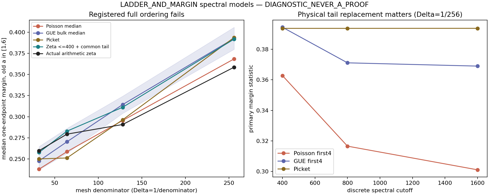
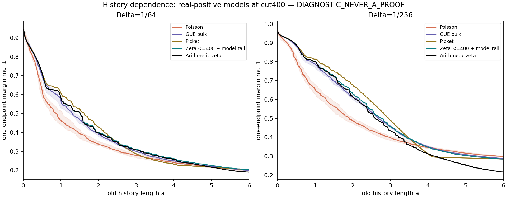

# LADDER_AND_MARGIN_v1

**DIAGNOSTIC_NEVER_A_PROOF. Route B = CHALLENGER / NOT_RH.**
Base: a1d2a97350e61f1697744056e26f95a1c8baf3de. No route-state change.

Six finite arithmetic screw-Gram matrices are certified positive by
directed intervals. The explicit between-node error budget does not
certify all real points in these windows. The registered rigidity ordering
fails in the finite spectral models, and their fine-grid calibration to the
actual arithmetic zeta source fails. No universal explanation of a .2 margin
or all-node source-positivity budget is supplied.

| Window length | Mesh | Exact nonzero nodes | Strict certified eigenvalue lower bound |
|---|---|---:|---:|
|log3|1/32|49|0.0006484745999|
|log5|1/32|107|0.0000981496803|
|log7|1/32|166|0.0000611372481|
|log3|1/64|97|0.0008140163758|
|log5|1/64|211|0.0001783811777|
|log7|1/64|329|0.0001172554057|

The labels are exact `k/M+log(r)` inside [0,logW], with r=1,...,W.
This contains the grid, endpoint and closure under every forward
prime-power shift that stays inside the window, including the composite
shift log6 at W7. Distinctness, source thresholds and exact zero terms
are resolved symbolically or by intervals; no approximate merging is used.
The structural node0 is removed. Principal submatrices are covered, and
repetitions give positive semidefinite matrices. Arbitrary new real nodes
are not covered by this finite alphabet.

Executed arithmetic: **mpmath.iv directed intervals**, 512-bit precision,
explicit Li2 geometric remainder below1e-50, outward decimal endpoints.
Native Arb/python-flint was unavailable and is not claimed as executed.
The fallback satisfies the interval alternative in the request. The source
includes all prime powers in support, both poles and the complete arch term;
no zero list or RH assumption builds these matrices.

M32 uses positive interval LDL pivots and an enclosed inverse-factor norm.
Direct LDL wraps around zero for W5/W7 at M64; those failures are retained.
Exact dyadic Cholesky/inverse witnesses, exact integer product residuals and
directed source intervals then certify every M64 matrix. The tabulated
numbers are conservative eigenvalue bounds, not numerical eigenvalues or
minimum LDL pivots. Their ordering across meshes has no interlacing meaning.

The largest W7/M64 witness was independently replayed by the root run:
lambda_min>0.00011725540571905891678, with source residual norm
<6.7368253811e-15. The verifier needs no floating Cholesky in replay mode.
W3 also has a 768-bit replay; seven MP80 source controls, including prime
births, lie inside the source intervals. See cert/RESULT.md and JSON records.

The between-node bound is explicit. For coordinates staying in [0,T],
moving each by at most epsilon changes a kernel entry by at most
`E=omega_T(2epsilon)+2omega_T(epsilon)`, hence an N-node matrix by at most
`N*E`. The modulus retains the logarithmic cusp, every arithmetic hinge and
the pole derivative; review/CONVENTIONS.md gives its formula. At the nearest
grid displacement 1/(2M), the outward norm budgets are roughly30.7,82.6,145.7
at M32 and31.4,83.7,147.9 at M64. They overwhelm the certified gaps.
This is failure of that sufficient estimate, not a negative kernel result.
Tiny corresponding-coordinate neighborhoods inside the same window are
certified. Arbitrary cardinality and collisions under nearest-grid mapping
remain unpaid: they destroy any fixed Euclidean eigenvalue reserve.

## Real-positive spectral controls

All constructed worlds use
`g(t)=2 sum_(gamma>0)(cos(gamma*t)-1)/gamma^2` and a specified positive tail.
They are positive by construction, not independent positivity evidence for
arithmetic zeta. Synthetic heights share the same smooth RVM counting map,
first ordinate and pair weights. Poisson/GUE each have20 registered seeds;
GUE is an unfolded Hermite beta2 bulk model, and picket is equally spaced
in the unfolded coordinate. Mean density and equal-count controls are saved.

Primary statistic: the median mu_1 over old lengths a in[1,6], followed by
the ensemble median for random worlds. The registered full order requires
at least75% paired Poisson<GUE and75% GUE<picket on each mesh.

| Delta | Poisson | GUE | Zeta <=400 + model tail | Arithmetic zeta | Picket |
|---|---:|---:|---:|---:|---:|
|1/32|.237982|.247752|.257741|.259794|.250062|
|1/64|.258631|.270311|.282886|.279368|.251209|
|1/128|.295509|.314313|.311142|.290764|.296345|
|1/256|.368360|.392600|.391776|.358555|.393689|

Poisson<GUE fractions are .75,.80,.85,.90. GUE<picket fractions are
.60,0,0,.60: the registered finite-model order fails on every mesh.
Four equal-count controls preserve the weaker Poisson<GUE trend without
restoring the full order. This does not decide a universal hierarchy for
complete, purely discrete, infinite spectra.

The actual zeta list contains202 positive ordinates through400. Its omitted
zeros are replaced by the same positive continuous mean-density tail used
in the synthetic controls, plus a stated independent-point-noise remainder.
This is a defined finite-grid approximation, not an exact continuous screw
function or a source-matched arithmetic tail. The registered calibration
tolerance .02 fails on meshes1/128 and1/256: errors .020378 and .033221.
FFT and frequency-bin refinements are much smaller than this discrepancy.
Changing the discrete synthetic cutoff400->800->1600 materially changes
Poisson/GUE margins. Hence actual-zeta interpretation stops at this gate;
neither more FFT digits nor matched mean density pays the missing discrete
high-zero information. No true zeta zeros above400 are invented.

## History length and multi-node clearance

All168 primary-cutoff scalar profiles are nonincreasing to1e-10 as history
grows. This is generic stationary positive-kernel prediction behavior.
No positive asymptotic plateau or decay exponent is inferred from a<=6.
For Delta=1/256, descriptive ensemble medians at fixed a are:

| World | mu_1(a=1) | mu_1(a=3) | mu_1(a=6) | mu_32(a=6) |
|---|---:|---:|---:|---:|
|Poisson + common tail|.654787|.397042|.297690|.241325|
|GUE bulk + common tail|.787976|.459393|.287543|.228090|
|Picket + common tail|.813735|.490548|.284528|.224057|
|Zeta <=400 + common tail|.800901|.456471|.284494|.223968|
|Arithmetic zeta reference|.800660|.434046|.215580|.160093|

At a=6 the median Poisson clearance exceeds GUE and picket, whereas it is
smaller early. A hierarchy based only on rigidity is therefore also sensitive
to the history statistic in these finite models. The fixed-a comparison is
descriptive, not a newly selected statistical test. Complete q1,4,8,16,32
block data at a1,3,6 and scalar histories are retained.

A no-tail control has rank at most404; fine-grid positive prefixes become
unresolved long before length6. Such failures are labelled rank/conditioning
failures of a PSD construction, never negative-world evidence. This is why
finite zero truncation cannot supply the requested full-source experiment.

CARDS.md and component preregistrations retain probabilities, discriminators,
kill gates and handoffs. The finite-node certificates pass; all-node ladder
positivity and a source-specific law for the margin remain open.

Reproduce: restore the prior innovation/extension archives if needed, then
`python3 unpack_data.py`. Component RESULT.md files list all numerical commands.
`python3 postprocess.py` and `python3 plot_history.py` use saved data only.
The large raw tables and exact dyadic witnesses are archived losslessly;
member hashes, published SHA256SUMS and restore verification are retained.
