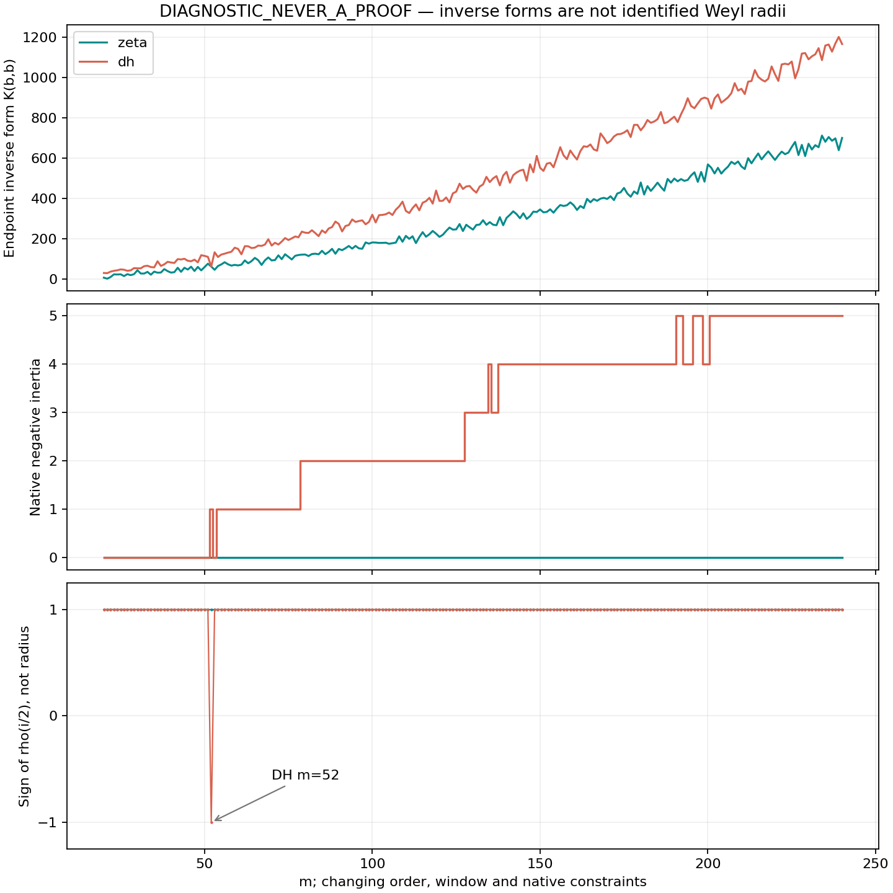
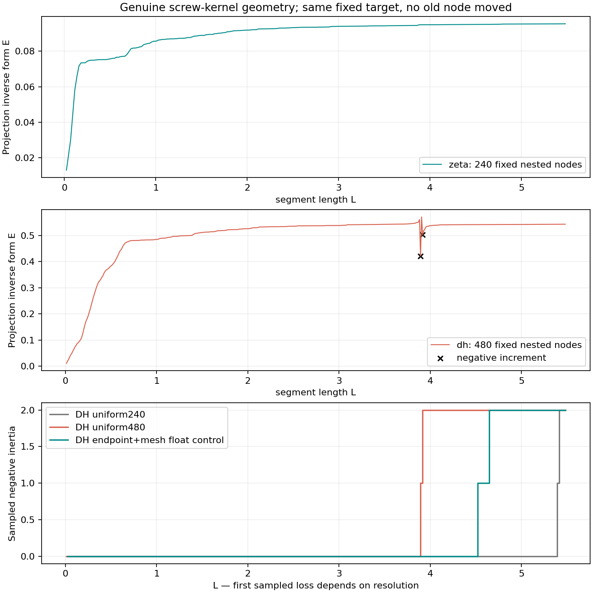

# SCREW_LINE_v1

**DIAGNOSTIC_NEVER_A_PROOF. Route B = CHALLENGER / NOT_RH.**

Независимый addendum к параллельно доставленному canonical-пакету
[../RESULT.md](../RESULT.md) @ `05d2604ae7a1d8d96d59306d559ac6a72e070701`.
Первоначальные результаты и архивы сохранены. Этот пакет добавлен как
`passivity_check/`; перекрытие всех442 инерций и1768 Fourier/endpoint kernels
сверено после независимого расчёта: максимум относительной разницы4.88e-65.
См. `CONCURRENT_READBACK.md` и `CONCURRENT_NUMERIC_VALIDATION.json`.

Получен конечный геометрический судья сохранения положительности: на
вложенных матрицах настоящего screw-ядра энергия проекции фиксированной
точки у ζ возрастает, а у DH падает при отрицательном Schur-дополнении.
Исходный источник сохранён целиком. Лемма о пассивности каждой
арифметико-архимедовой секции остаётся **OPEN**; её точный контракт записан
в `PROSHKA_HANDOFF.md`, без отправки Прошке.

Base: `rh_clean @ 1c91c4c86ef6987782c08c84e22707d1b7324646`.
Сохранены native κ=1.1, все комплексные ограничения DH, истинные gamma/pole
данные и все коэффициенты логарифмической производной. Непростостепенные
атомы не удалялись.

## (i) Обратные ядра: все 442 ячейки

Посчитаны **каждое целое m=20..240, оба мира**. Для C=U*AU решены четыре
системы: физический endpoint и Fourier-evaluation при z=i/2,i,2i.
Использованы

    t_n=e_n(b),    e_n(z)=integral_(-b)^b e_n(x)exp(izx)dx,
    K_b=(U*t)* C^-1 (U*t),    K_z=(U*e(z))* C^-1 (U*e(z)).

Эти два вида evaluation различны; соглашение явно закреплено.
`native_kernels.csv` содержит все K, signed proxy rho=1/(Im(z)K), его квадрат
и инерцию C. Пропорциональная константа proxy выбрана равной1. Ни один proxy
не назван установленным радиусом Вейля: отсутствует отождествление с
нормированной канонической системой. При индефинитном C K — алгебраическая
обратная форма, а не положительная воспроизводящая норма.

464 полных числовых записи — 442 основных, 14 уточнений и 8 координатных
стресс-контролей — находятся в lossless-архиве из четырёх частей.
`NATIVE_ARCHIVE.json` даёт SHA-256 каждой записи; `restore_native.py`
проверяет и восстанавливает их. Псевдообратная и скрытая обрезка ранга
не использовались.

## (ii) Гладкий поток и арифметические изломы

Есть три разных наблюдения, их смешивать нельзя.

**Сама кривая.** В g(L) новый атом имеет НУЛЕВОЙ скачок значения; в g'(L)
при L=log n скачок равен b(n)/sqrt(n). `source_sections.csv` при 85 dps
раздельно даёт гладкую gamma/pole часть, накопленные старые атомы, новый
излом и точный прирост g между log m и log(m+1). Это сохраняет весь источник,
не превращая его в набор удалённых/независимых атомов.

**Локальное обратное ядро.** При фиксированном порядке носителя, локально
постоянном ранге и обратимом C,

    jump(A'_L)=-2b(n)/sqrt(n) e_b e_b*,
    jump(K'_z)=2b(n)/sqrt(n) |t*U C^-1 U*e(z)|².

`birth_kinks.csv` даёт знак и размер для всех native ячеек;
`arithmetic_atoms.csv` — все b(n), ordinary prime-power support и сравнение
с b(n)/sqrt(n), включая n<20. У ζ эти inverse-kinks неотрицательны и
поддержаны на степенях простых. У DH возникают оба знака и непростостепенные
события. Этот знак сам по себе не оплачивает гладкую часть секции.

**Сырой шаг m→m+1.** `raw_steps.csv` сохраняет изменения порядка, окна,
функционала, ограничений и ранга. Однородного знака нет. Если отмечать
простую степень в НАЧАЛЕ секции, endpoint ΔK у ζ имеет 45 положительных
и 9 отрицательных шагов; каждый из трёх spectral ΔK — 34 положительных
и 20 отрицательных. В таблице также дано соглашение с атомом в КОНЦЕ
секции. Сырой шаг не отождествляется с локальным birth-kink.

Следовательно, предсказание 0.4 об одном знаке сырых шагов не прошло.
Однознаковость точных локальных изломов — отдельное алгебраическое свойство
из Λ>=0, а не новая лемма пассивной склейки.

## (iii) Первый DH native-дефект

Предсказание «первый отрицательный native C в [50,56]», p=0.6, прошло
в численном диагностическом смысле: **m=52**.

|m|q DH|отрицательных направлений C|знак K_b|знаки K_i/2,K_i,K_2i|
|---:|---:|---:|---:|---|
|50|46|0|+|+,+,+|
|51|47|0|+|+,+,+|
|52|48|1|+|−,−,−|
|53|49|0|+|+,+,+|
|54|49|1|+|+,+,+|
|55|50|1|+|+,+,+|
|56|51|1|+|+,+,+|

Выход52 и возврат53 выдержали 300-dps/GL320 контроль. У ζ все 221 native C
положительны при заявленной численной точности. У DH после54 положительные
диагонали обратного ядра уже пропускают индефинитность. Функционал может
не видеть отрицательное направление.

У вещественного rho квадрат rho² не бывает отрицательным. Это не тот же
судья, что инерция, нуль K или полюс обратной формы. Возврат DH к положительности
на53 дополнительно показывает: меняющиеся native C не образуют вложенную
последовательность пассивных секций одной кривой.

## Свойство, сохраняющееся при настоящем удлинении

Вместо ложного отождествления A с матрицей точек непосредственно построено
точное source-first ядро

    G(t,u)=g(t-u)-g(t)-g(u),
    E_n=k_tau* G_n^-1 k_tau.

Старые узлы НЕ двигались. Целевая точка tau фиксирована. Для одного нового
узла точное block-inverse тождество имеет вид

    E_(n+1)-E_n=|k_new-c*G_n^-1 k_tau|²/s_n,
    s_n=G_new,new-c*G_n^-1c.

Положительные Schur-дополнения сохраняют знак приращения. Это рабочий
конечный судья пассивной геометрии. После потери положительности E считается
алгебраической обратной формой, а не квадратом нормы.

На uniform240 сетке при 85 dps у ζ все дополнения положительны; E возрастает.
У DH возникает отрицательное дополнение и падение E. Разрешение существенно:

|DH-сетка|первое найденное L|exp(L)|первый отрицательный Schur pivot|
|---|---:|---:|---:|
|uniform240, 85 dps|5.389294941|219.048889|−0.04317845664|
|log endpoints + fixed mesh, float control|4.521527112|91.975948|−0.0004614679855|
|uniform480, 85 dps, тот же tau|3.893537235|49.084202|−0.001441908404|

В последней строке E уменьшается на **0.13965456**. Это явное конечное
нарушение сохранения положительного знака. Первый найденный индекс —
зависимая от разрешения граница выборки, не доказанный первый дефект
континуального источника. Уточнение сетки не восстанавливает положительность
уже найденного старого отрицательного блока.
Для DH это эрмитово ядро формального g: при найденной индефинитности
его нельзя называть Gram гильбертовой screw line.

Только узлы log n до240 вообще пропустили DH-дефект. Добавление fixed mesh
его выявило; у ζ объединённая матрица478 узлов остаётся положительной,
её наименьший float eigenvalue около2.96e-5. Это важный planted control
против вывода «все endpoint-секции прошли, значит источник пассивен».
На DH объединённой матрице минимальный eigenvalue около−0.01999.

## Пассивность и программа сборки

Зафиксирована требуемая логика: каждый SAME-SOURCE section transfer должен
сохранять Herglotz-класс для всех допустимых нагрузок и Im z>0. Ни determinant1,
ни знак одного b(n), ни generic Hermitian resolvent не являются этим свойством.
Конкретный canonical finite-end m_t здесь не построен, поэтому его пассивность
не выдумывается из K или rho. Точный открытый источник-зависимый Schur-контракт
и альтернативный transfer-контракт даны в `PROSHKA_HANDOFF.md`.

Контроль фактического GLOBAL Q=i Lambda'/Lambda показателен:
при z=i/2,i,2i Im Q положительна у ОБОИХ миров. У заранее выбранной точки
`85.699348485... + 0.2313878868...i` получено

    Im Q_zeta ≈ +0.402412628,
    Im Q_DH   ≈ -10.91705096.

Это не finite-end impedance; это источник-согласованный отрицательный
контроль выбора трёх частот. Один спектральный скаляр может пропустить
активный элемент. Причинной привязки отрицательного Schur-события к одному
непростостепенному атому здесь не доказано: старые взаимодействия сохранены,
а первая обнаруженная потеря зависит от набора тестов.

Служебные знаки DH используют точный formal Dirichlet-log support, а не
порог для малых десятичных чисел. Исправлены12 ложных non-prime-power меток
нулевых коэффициентов; исходные decimals, input hashes и численные решения
сохранены. См. `EXACT_SUPPORT.md`.

## Честный контроль и артефакты

- 442 native solves: 220 dps source, GL256, 768-bit GMP QR/LDL; без threshold
  rank cutoff, inverse replacement или float sign decision.
- 14 контролей: 300 dps, GL320, 1024-bit; инерция совпала, K согласованы
  до всех 100 сериализованных значащих цифр.
- Независимые mpmath source/Householder/LU проверки ζ/DH на20/55 согласованы
  примерно до1e-100; проверен endpoint derivative-measure pullback.
- Детерминированный стресс DH-координат ±1e-77 на120/240 сохраняет инерцию;
  относительные изменения K меньше2.7e-78. Это стресс, не доказанный error box.
- Uniform curve computations: 85 dps, explicit source integral, полные
  nested LDL и solve residuals около1e-85. Zeta g независимо воспроизводит
  Suzuki special-function expression с ошибками порядка1e-85.
- Aligned float controls раздельно помечены; GL64/128 и MP source spots,
  residuals, минимальные eigenvalues и resolution dependence сохранены.

`NATIVE_SUMMARY.json`, `PYTHON_NATIVE_VALIDATION.json`, `INPUTS.json`,
`NATIVE_ARCHIVE.json` и `SHA256SUMS` дают точные источники и контроль.
`SOURCE_AUDIT.md` фиксирует первичные ссылки Suzuki и недостающий контракт
круга Вейля. `FORMULAS.md` даёт определения; `HYPOTHESES.md` — карточки,
falsifiers и kill-switch. `REPRODUCE.md` содержит команды.

Численные нули остаются исходным непроинтерваленным census. Повышенная
арифметическая точность не делает его interval certificate. Канонический
импеданс, лемма пассивных секций и RH не установлены. Route-state, экспорты
и прежние источники не изменялись.
