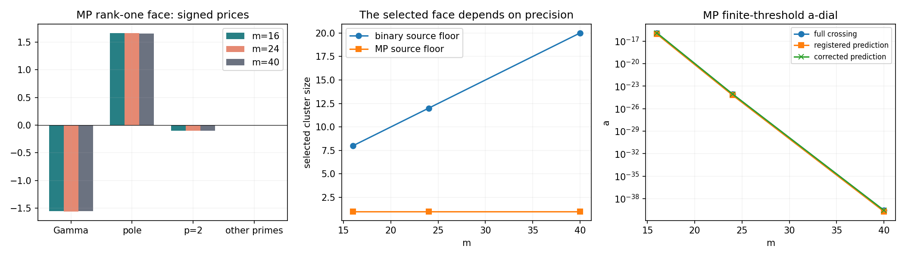

# Stiffness v2: finite face prices and sign detection

**DIAGNOSTIC_NEVER_A_PROOF. Route B CHALLENGER / NOT_RH.**
Base `cdb84497649c7399448737732b7dd3d632e141f0`. The v1 brief/predictions remain
as issued; its structural audit is retained. V2 explicitly authorized unchanged
source/frame regeneration on eight calibration sizes and three MP pilots.

**The requested MP face is one-dimensional, with many flat parameter directions
and a resolved positive ball optimum. It is not a strict first-order vertex.**
The strongest observable price balance in its lowest mode is negative Gamma,
positive pole, and smaller negative arithmetic prices. A budget-neutral direction
primarily increasing the pole and decreasing Gamma improves this compressed
face. That does not establish a feasible ray for the complete source: other
levels and off-face couplings remain relevant.

## P1: unchanged source and further split

All24 binary world/size reconstruction gates pass. Maximum entry discrepancy
is5.67e−13, below each inherited rho=epsilon_m/100. All three MP reconstructions
pass with maximum6.05e−119 at the declared1e−108 gate (source400bits,
GL256/eight panels, MP algebra120digits). Every prime-power atom keeps its
original sign. DH has an explicit extra non-prime-power block; double2 adds
only a second integer2 atom. No nonzero arithmetic terms are discarded.

Large C/B/A, Q/U and dense dual arrays stay local. REGENERATED_ARRAYS.json
records43 exact file hashes plus per-array payload hashes. The pinned builders
are unchanged. Regenerated NPZ frames do not match the original INDEX file
hashes byte-for-byte; no equality is claimed. Independent constraint checks
on all16 frames give max normalized residual4.01e−16. Their dimensions and
point-coordinate inputs match the pinned definitions. Compiler/numerical-library
and packaging differences are recorded, without attributing a proven cause
for each original-file hash difference.

## Face, prices and tangent program

The selector examines j=1..floor((m+1)/2), chooses the largest adjacent
relative gap, and takes the lowest j-dimensional eigenspace. Ratios use a
precision floor in the denominator. Binary uses the inherited rho; MP uses
the empirical source floor1e−114. This choice and every candidate ratio are
explicit; no eigenvalues or prices are forced to zero.

|m|binary selected size|MP size|MP gap ratio|MP full price kernel|MP ball value|
|---:|---:|---:|---:|---:|---:|
|16|8|1|8.6754e5|7|2.275383|
|24|12|1|1.5894e6|10|2.281238|
|40|20|1|6.9268e6|13|2.270090|

The MP near-null gate ||PAP||/max||M_i|| gives3.29e−38,1.62e−54,1.80e−85,
well below the declared1e−8 admission tolerance. The image of ones is retained
as the small NONZERO PAP, not imposed as a null relation. Rank-one face maps
necessarily have kernel dimension k−1; restricting to1perp gives k−2.
Consequently S1′ FAILS. Complete singular values and kernel bases are retained.

The MP unit budget optimizers have t_Gamma≈−.684, t_pole≈+.729,
t_B2≈−.044, with much smaller remaining entries. Every signed price and
coefficient is recorded in mp_prices_m*.json. The scalar optimum has an exact
finite compressed-face formula; MP recomputation checks norm, gauge and
primal/dual gap. Its trace-one Y=1 is a valid BALL dual with gradient norm
about2.27. It is NOT an annihilating stress. Positive condition ratio alone
cannot certify a dual that fails the equal-price equations. S2′ FAILS.

The inherited MP upper-exit carrier has >.999999999999 overlap mass with
this one-dimensional face; the lower exit has about.933–.934. Binary exits
need not identify the same tiny mode. All MP/binary overlaps are retained.
The floor-dependent binary faces are much larger. Their SCS outputs remain
candidates/upper envelopes, not claims of zero optimum or strict duality.
Source-guard and relative-face rank thresholds are reported separately.

All eight ζ binary face gates pass. Only DH24/40 pass among the DH calibration
faces; the other DH and every double2 face fail the near-null gate. P2–P3 stop
on those failed faces. No alternate face is silently selected to rescue them.
P4 remains an independent full-source calculation after its P1 gate.

## P4: full-source one-knob intervals

P4_INERTIAS.csv gives every knob's full-matrix numeric inertia. The three MP
Gamma inertias (negative,positive) are(3,14),(3,22),(4,37); all have two finite
interval ends, so S3′ PASSES. At40, Gamma offsets are approximately
−8.09537e−73 and+1.92078e−85 at epsilon1e−100.

The pole is structurally rank-one PSD. Its interval is one-sided, with upper
endpoint+infinity; MP lower offsets are approximately−3.29085e−38,
−1.61801e−54,−1.80276e−85. It has no finite full width. Every prime<=13
has its own interval receipts. Binary uses the inherited finite epsilon;
MP uses epsilon1e−100, unchanged congruence and no precision escalation.
Source/endpoint residuals are explicit, and unresolved recession/kernel cases
are never converted into a finite end. P4_INTERVALS.csv and
mp_prices_intervals.csv retain the controls as well as ζ.

## P5: the source-correct a-dial

All11 ζ source/deformation gates pass. A(0)=2A exactly in preserved-baseline
evaluation, independently checked against the original source formula.
The arch norm/Dirac counterterm only doubles; it is not multiplied by cosh.
All atoms, Gamma and the even pole receive the correct separation multiplier.

|m|MP first sampled full crossing a*|a* / registered prediction|
|---:|---:|---:|
|16|1.228549462e−16|1.414016529|
|24|8.733477978e−25|1.414106752|
|40|2.716368803e−40|1.414190075|

S4 is NOT basis-stable. The inherited MP polynomial pilot basis has all
negative diagonals, but MP evaluation of the authorized regenerated saved
frame at24 finds a positive column of curvature about+1.7872. The saved-frame
reading of S4 therefore FAILS; the polynomial-basis-only reading passes.
Both are recorded, without substituting one basis for the other. The full
curvature compression has positive eigenvalues, with maxima3.36e−5,3.56,
1.66e−8. This is not a negative-definite form and the basis statement is
orientation dependent. The known-zero contribution−4sum_(0<gamma<T)E′E′ᵀ
and the source-balance remainder are reported separately. The latter is not
an independently bounded infinite tail.

S5 PASSES its original factor-two criterion. Since A_a=2A+a²H+O(a⁴), the
fixed-vector threshold prediction is sqrt((2lambda_q+epsilon)/abs(h_q)).
The full roots divided by this corrected prediction are.99986068,.99992447,
.99998339. Both registered/corrected formulas and full/fixed-trial roots are
retained; no prediction was rewritten after observing the result.

DH negatives are detected at80,120,200,248,300; double2 and the pinned
low-quartet plant are negative already at a=0 at all eight sizes. Their
already-negative first dial is0. The binary nonzero thresholds concern the
much larger inherited epsilon and do not estimate the tiny MP thresholds.

## Limits and delivery

The face is a precision-sensitive finite surrogate, not an exact singular
boundary of the complete source cone. Softness on it does not settle full-source
feasibility. MP source errors are empirical, not interval enclosures. The
reported a* is the first sampled/bracketed crossing, without a global theorem
excluding earlier crossings. No cofinal stiffness or RH claim is made.

S1/S2/S3 from v1 remain FAIL as recorded; v2 scores are S1′ FAIL, S2′ FAIL,
S3′ PASS, S4 FAIL on the regenerated saved frame (PASS only for the separate
MP polynomial basis), S5 PASS. These are finite diagnostic scores; original
unavailable NPZ bytes are not retroactively scored.
The unchanged STRUCTURAL_AUDIT.md core and its v2 addendum explain why.
SUMMARY.csv joins27 calibration/pilot rows; per-part CSVs and the verified
binary scalar/vector archive retain details. No large source/frame arrays,
route-state changes or RH exports are committed. Canon and mirror are identical.
