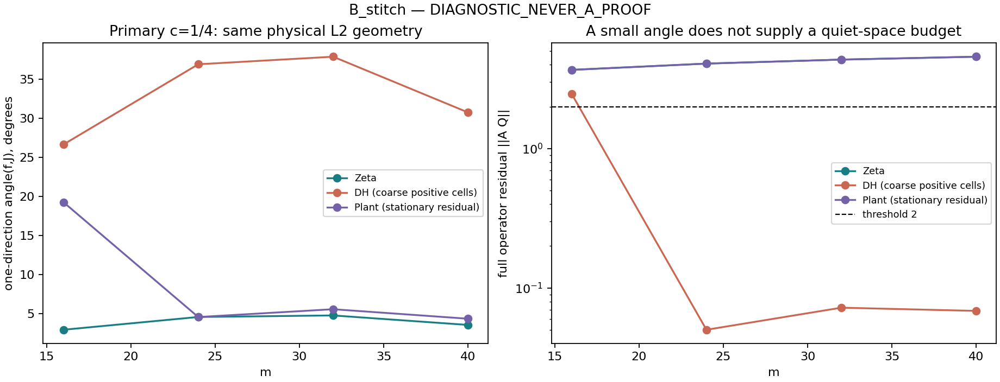

# B: section and quiet Schur coordinates in one physical carrier

**DIAGNOSTIC_NEVER_A_PROOF. Route B CHALLENGER / NOT_RH.**

Both constructions use the same full real step carrier in every cell.
The prescribed low-resolution DH cells do not detect a source negative
level, whereas a separately labelled common-ambient DH resolution control
at m40 does: its section Schur block and primary quiet Schur block are
both negative at threshold0. No sign is forced by discarding an eliminated
negative direction or comparing different spectral thresholds.

## Ambient and normalization

For m16,24,32,40 set L=logm, a=log(m-1), delta=L-a. Nodes are the full
uniform grid jL/(2m+1), with a and a+jdelta/4,j1..4 added. Every regular
node exceptL precedes a on this grid. Consequently d=2m+5, old dimension
2m+1 and fresh dimension4. The basis is 1_bin/sqrt(binlength), orthonormal
for physical L2. It is a full real step space, not an even Fourier carrier.

The source matrix is the mixed increment Gram of the full arithmetic
source g, divided by the square roots of physical bin lengths. All von
Mangoldt atoms, the full archimedean term and both zeta poles are retained.
DH uses its own all-integer logarithmic-derivative coefficients and gamma
constant, with no pole; the plant adds the same specified quartet. No
zero-table truncation is used to build A.

Three fixed cutoffs are reported: kappa1(control),
kappa=1+c*(1+logL)/L for primaryc1/4 and secondaryc1/2,
T=kappa*2pi*m/L. Every real positive zero belowT contributes both Fourier
real/imaginary constraints. Plant w and conjugate(w) contribute four real
rows. The DH off-line pair at85.699 contributes four rows when belowT;
240.405 is above every cutoff in this requested grid. Its omission is due
to T, not an assumption that that pair does not exist. All quiet spaces are
constructed in exactly the same carrier as their section block.

## Distinct thresholds remain distinct

SectionS0=F-B^T Cold^-1 B and its lowest fresh-L2-unit vector z define
f=[-Cold^-1 Bz;z]. The reported sigma_section is z^T S0z=f^TAf;
it is an energy with fresh norm1, not the Rayleigh quotient normalized by
||f||². Cold must be positive for this to be an actual minimizer over old
coefficients. Otherwise the infimum is minus infinity and f is labelled
STATIONARY_ALGEBRAIC_INF_MINUS_INFINITY.

Quiet coordinates use orthonormal columns Q spanning J and U spanning
its complement. D=Q^TAQ, G=U^TAU, Bq=Q^TAU. The requested quiet Schur
at threshold2 is G-2I-Bq^T(D-2I)^-1Bq. Its eliminated index is always
retained. The raw negative count equals N_A(2)-r only if D<2I.

For a matching comparison, both section and quiet Schurs are additionally
checked at thresholds0 and2 separately:

`nminus(A-tI)=nminus(eliminated-tI)+nminus(Schur_t)`.

Inertia at threshold0 is not equated with inertia at threshold2. The sorted
lambda_r means the actual A eigenvalue at zero-based indexr=dimJ; it is
not called an eigenvalue of J or its complement. The requested ratio uses
sigma_section/(lambda_r*||P_Jperp f||²) only with resolved positive denominator.
If J is empty, delta=0 is a trivial zero-space norm and the90degree angle
is explicitly a projection-distance convention, not evidence of quietness.

## Primary c=1/4 baseline cells

|world|m|r|sigma_section|angle(f,J),degrees|full norm(AQ)|ratio|
|---|---:|---:|---:|---:|---:|---:|
|zeta|16|23|.311314|2.90977|3.67621|1.25359|
|zeta|24|31|.347446|4.54721|4.07822|.540036|
|zeta|32|37|.496874|4.74337|4.35680|.964401|
|zeta|40|45|.658378|3.52868|4.57040|.831212|
|DH|16|3|.991911|26.6216|2.47606|1.00731|
|DH|24|3|1.18494|36.8888|.0501527|1.77788|
|DH|32|5|1.28889|37.8578|.0722339|1.23859|
|DH|40|5|1.56524|30.7305|.0685023|1.01391|
|plant|16|19|.635412|19.2406|3.67534|.210090|
|plant|24|27|.462309|4.53782|4.07793|1.30292|
|plant|32|33|.616761|5.53853|4.35647|1.21203|
|plant|40|41|.800998|4.32192|4.57039|1.15882|



The plant has two negative old directions and two negative full source
levels in every baseline m. Its positive section value is stationary,
not an optimizer or a recovery of positive geometry. At threshold0 its
negative index can reside wholly in the eliminated old block. The baseline
DH source matrices are numerically positive on this coarse carrier; no
negative DH control is claimed from them. Secondary DH c1/2 has Jempty
at all four m. These cutoff conventions are fixed, not density-matched.

A decisive bookkeeping example is zeta m24,c1/4: r=31 and N_A(2)=31,
but D-2 has28negative and3positive directions, and quietS2 has3negative.
The correct identity is31=28+3. The full residual ||AQ||=4.07822 and
compression norm4.07471 do not meet a quiet-below2 hypothesis. Thus a
numerical count equality alone does not turn this quiet Schur positive.
No original-CCM quiet-residual theorem or calibration is transferred to
this different step carrier.

## DH resolution control: both coordinates at the same m

The separately specified finer m40 ambient includes every k/256 through L=log40 plus exact
a=log39 and the fresh quarter endpoints. It has949orthonormal physical
bins:938old,11fresh. It is not claimed nested with the coarse85bin ambient;
both Schur comparisons use only their own one declared ambient. It contains the already stored944-increment negative
DH witness ending at3.6875. The entire old block is numerically positive,
minimum8.72047e-6. Full A minimum is-.00151499925 and sectionS0 minimum
is-.06106305735. Unlike the baseline plant, this section direction is a
numerical genuine conditional minimizer with positive old block.

|cutoff|r|complex evaluation points|nminus(D0)|nminus(quietS0)|quietS0 minimum|
|---|---:|---:|---:|---:|---:|
|kappa1|885|0|1|0|+.471862313|
|primaryc1/4|869|0|0|1|-.078464955|
|secondaryc1/2|857|2|0|1|-.008242089|

For primary and secondary cutoffs, sectionS0 and quietS0 are both negative
in this same949dimensional source matrix at m40. For kappa1 the raw quiet
Schur is positive because the eliminated quiet block already has one
negative direction. All total inertia identities agree at thresholds0and2;
there are no unresolved eigenvalues under the declared1e-7 numerical floor.
At threshold2 the full count is37, with quiet eliminated/remaining counts
30+7,27+10,25+12. D<2 does not hold in any enlarged quiet case.

The physical Rayleigh replay of the stored MP100 witness is
-3.68041563189e-5 versus inherited MP100 value-3.68041563196e-5,
absolute difference7.11e-16. Twelve independently evaluated MP100 matrix
entries involving split and edge bins differ from the float source by at
most4.57e-12. This is a strong floating control, not a rigorous global
entry enclosure or interval certificate. The reported inertia floor is
explicitly numerical. The resolution run took12.6seconds and used no
large arbitrary-precision eigensolve or PSD clipping.

## Precision and artifacts

The baseline uses complete real SVD at80and100digits, with one designated
zeta,m24,c1/4 replay at120digits. Checkpoints, per-cell complete stationary
residual coefficients, all eliminated indices, rank/orthogonality residuals,
full AQ norms, compression norms and valid ratios are retained. preferred.csv
adds an explicit empty-J angle convention. precision_replay.csv and SUMMARY.json
record the precision agreement: all36rank/inertia comparisons agree, maximum
scaled80/100digit metric change9.20e-66, and maximum100/120digit validation
change1.11e-97. Every coordinate identity is checked by
analyze.py, without silently removing a negative old or quiet direction.

```
uv run --with mpmath python stitch.py --dps 80
uv run --with mpmath python stitch.py --dps 100
uv run --with mpmath python stitch.py --dps 120 --ms 24 --worlds zeta --cutoffs cquarter
uv run --with mpmath python analyze.py
uv run --with mpmath --with numpy --with scipy python resolution_control.py
uv run --with mpmath --with numpy --with scipy python resolution_validate.py
```

An execution-environment outage terminated the primary100digit process after
32complete cells. resume100.py computed only the four absent cells and checked
that all32existing checkpoint hashes stayed unchanged; RESUME100.json retains
that recovery. No completed cell was silently replaced.

No all-mode return theorem, count law, conditional-source floor or RH result
is obtained. This is a same-ambient finite stitching and sign-discriminator test.
